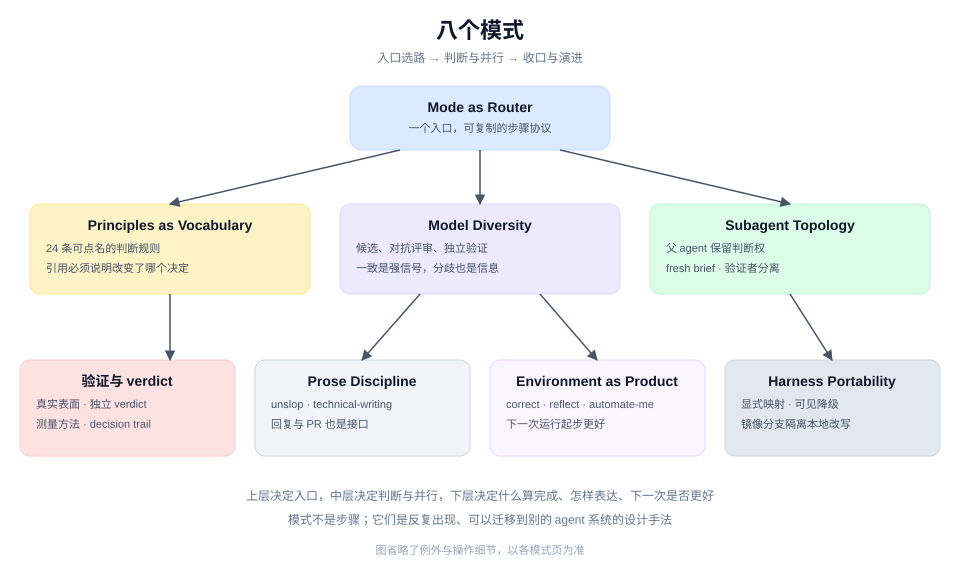

# Patterns

这里不是按 skill 罗列功能，而是抽取 pstack 反复使用的设计手法：怎样把一句请求接进流程、怎样让判断可被点名、怎样用多个模型换质量、怎样让子代理不互相污染、怎样定义"完成"，以及怎样让环境自己变好。

八个模式分三层：**入口与路由**（mode-as-router）、**判断与并行**（principles-as-vocabulary、model-diversity、subagent-topology）、**收口与演进**（evidence-first、prose-discipline、environment-as-product、harness-portability）。先理解入口，再读判断层，最后读收口层，会比把八篇当平行清单更容易形成结构。

## 先从哪读

| 你想回答的问题 | 从这里开始 | 接着读 |
|---|---|---|
| 一句请求怎样变成一条可执行、可审计的流程？ | [Mode as Router](./mode-as-router.md) | [Subagent Topology](./subagent-topology.md) |
| 怎样用一两个词精确改变 agent 的判断？ | [Principles as Vocabulary](./principles-as-vocabulary.md) | [Model Diversity](./model-diversity.md) |
| 多模型到底换来了什么？ | [Model Diversity](./model-diversity.md) | [模型面板](../system/model-panel.md) |
| 什么时候派 subagent，怎样收敛？ | [Subagent Topology](./subagent-topology.md) | [Evidence First](./evidence-first.md) |
| 怎样防止"测试绿了"被当成完成？ | [Evidence First](./evidence-first.md) | [自主与门](../system/autonomy-and-gates.md) |
| agent 的回复和 PR 正文为什么也算质量门？ | [Prose Discipline](./prose-discipline.md) | [unslop 单页](../skills/unslop.md) |
| 怎样让下一次运行比这一次更好？ | [Environment as Product](./environment-as-product.md) | [reflect](../skills/reflect.md) |
| 换 harness 时哪些东西会坏？ | [Harness Portability](./harness-portability.md) | [分发与安装](../system/distribution.md) |

## 八个模式

### 入口与路由

- [Mode as Router](./mode-as-router.md)：一个主入口把请求映射到一份可复制的步骤协议，并在没有合适协议时分层兜底。

### 判断与并行

- [Principles as Vocabulary](./principles-as-vocabulary.md)：把反复出现的判断写成可点名的短规则，用名字而不是段落来指挥。
- [Model Diversity](./model-diversity.md)：用不同模型产生候选、做对抗评审、做独立验证，把"第二个意见"变成结构性输入。
- [Subagent Topology](./subagent-topology.md)：父 agent 保留控制面，worker 输入输出封闭，验证者与被验证者分离。

### 收口与演进

- [Evidence First](./evidence-first.md)：完成不是一句话，而是在真实表面产生、可被独立复核的证据。
- [Prose Discipline](./prose-discipline.md)：回复、PR 正文、提交信息和决策日志都按同一套写作规则收口。
- [Environment as Product](./environment-as-product.md)：`correct`、`reflect`、`automate-me` 把重复纠正变成结构，让下一次运行起步更好。
- [Harness Portability](./harness-portability.md)：用显式映射与可见降级换跨 harness 的可运行性。

## 怎么读图

箭头表示工作或证据的流动，不表示每次都必须走这条路线。实线是主流程或明确交接；虚线是共享词汇、按需加载的 reference 或可选旁路。每张图都省略了正文里的例外和操作细节，以对应模式页为准。

图是仓库内手写的 SVG，位于 [`../figures/`](../figures/)。改术语或布局时直接编辑 SVG，不需要重新生成位图。

要把这些模式放回完整工作流，读 [系统总览](../system/README.md)；要从具体任务反查 skill，读 [技能索引](../skills/README.md)。
