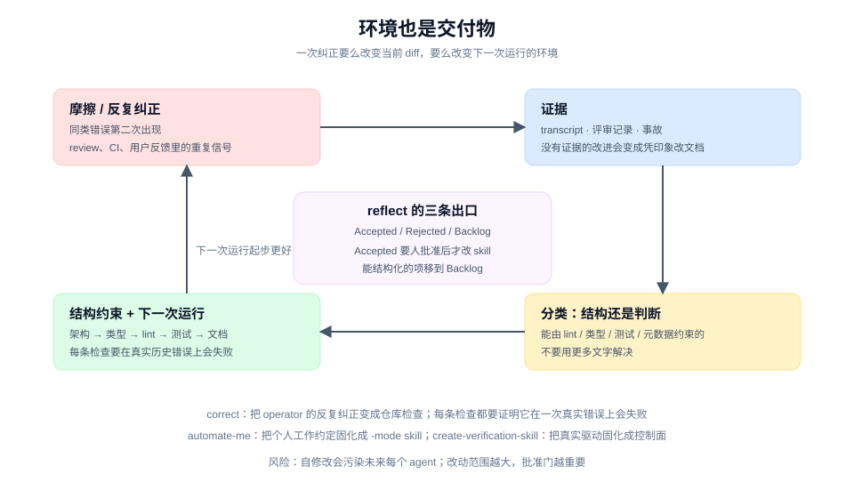

# Environment as Product 模式

## 是什么

pstack 有一组 skill 不改产品代码，改的是**让下一次工作发生的环境**：`correct` 把重复纠正变成仓库里的检查，`reflect` 把会话经验路由回 skill，`automate-me` 把个人习惯固化成 `-mode` skill，`create-verification-skill` 把"证明它工作"变成项目内的控制面，`setup-pstack` 把模型选择变成一份可复用配置。

它们的共同假设是：一次交付的产物不只是 diff，还包括"下一个 agent 在这份仓库里能不能做得更好"。

## 源码里的形状

### `correct`：把纠正变成结构

当 operator 反复纠正同一类错误时，改变仓库，让下一个 agent 无法再犯。顺序是：

1. 架构
2. 类型
3. 一条错误信息本身就在说怎么修的 lint
4. 测试
5. 文档（最后）

每条检查都要证明它在一次真实的历史错误上会失败。文档放最后，因为文档是最弱的约束。

### `reflect`：把会话经验路由回 skill

1. 找到本次会话的 transcript，不跨项目读别人的记录。
2. 三个 reviewer 并行：judgment、tooling、divergent。
3. synthesizer 通过 MCP 核对引用，产出 Accepted / Rejected / Backlog。
4. 如果一个 Accepted 项能由 lint、脚本、元数据或运行时检查更可靠地执行，移到 Backlog。
5. 展示完整结论，**等待明确批准**后才应用 skill 修改。
6. Backlog 项直接进团队的 devex/backlog tracker，不必等批准。

批准门的存在有明确理由：skill 修改会影响组织里每一个未来的 agent。

### `automate-me`：把个人习惯变成 skill

从最近的 transcript 里挖出用户的工作约定，起草或修订一个 `-mode` skill，再走 skill-authoring 与 `unslop`。它产出的不是通用最佳实践，而是"这个人希望 agent 怎样工作"。

### `create-verification-skill` / `maintain-verification-skill`

生成一个项目本地的验证 skill：启动应用、像用户一样走一条路径、捕获证据、维护 feature map。它把"证据从哪里来"变成仓库的一部分，而不是每次临时发挥。

### `encode-lessons-in-structure`

这是背后的原则：如果你第二次写同一条指令，就把它编码成 lint、元数据、运行时检查或脚本。判断类的教训无法编码时，才提高指令的显著度并加一个失败例子。

## 为什么有效

- **复利。** 一次纠正变成一条检查，之后每次运行都受益。
- **把记忆外化。** 不依赖某个人记得"这个仓库不要这样写"。
- **结构优先于文字。** 一条会失败的 lint 比一段"请注意"更可靠。
- **改动有审计。** `reflect` 的 Accepted 列表要人批准，Backlog 进 tracker，不是悄悄改 prompt。

## 代价

- **自修改有风险。** 改 skill 就是改未来所有 agent 的行为；一次过拟合的修改可能长期污染流程。
- **结构不一定可行。** 有些判断无法编码，强行加检查会制造假安全感。
- **改进会很慢。** `correct` 要求证明检查在真实错误上失败，`reflect` 要求跨模型综合与批准；这比"顺手改一句提示词"慢得多。
- **需要证据来源。** transcript、review、incident 是输入；没有这些，reflect 会变成凭印象改文档。

## 怎么迁移

1. 先记录重复出现的纠正，不要每次只改当前 diff。
2. 按"架构 → 类型 → lint → 测试 → 文档"的顺序找约束，越靠前越可靠。
3. 每条新检查都要在一个真实历史错误上验证它会失败。
4. 改 skill 或全局指令前设一个批准门；改动范围越大，门越重要。
5. 把无法结构化的教训写短、写具体，并附一个失败例子。

## 关键洞察

1. **交付物包括环境。** 只修当前 bug，下一次还会以另一种形式出现。
2. **结构优于文字，文字优于沉默。** 能用检查解决的，不要用提醒解决。
3. **自我修改需要外部审计。** 改流程的人不能是唯一评审流程的人。
