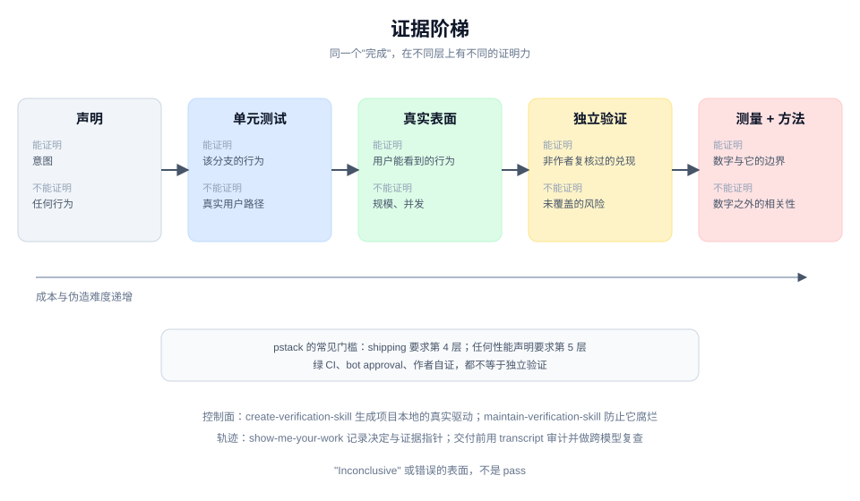

# Evidence First 模式

## 是什么

pstack 反复把"完成"从一句话变成一个可检查的产物：真实表面上的复现、可重跑的基准、独立验证者的 verdict、与 transcript 对得上的决策轨迹。测试绿了、编译过了、CI 通过，都不自动等于兑现。

## 证据阶梯

| 层级 | 例子 | 能证明什么 | 不能证明什么 |
|---|---|---|---|
| 声明 | "修好了" | 几乎没有 | 任何行为 |
| 单元测试 | 新增回归测试通过 | 这条分支的行为 | 真实用户路径、性能、集成 |
| 真实表面 | 用 control skill 驱动应用 | 用户能看到的行为 | 其他表面、规模、并发 |
| 独立验证 | 非作者的 verifier 给 `PASS` | 这次改动在该表面上的兑现 | 未覆盖的风险 |
| 测量 + 方法 | benchmark 带基线、样本数、限制 | 数字本身 | 数字之外的相关性 |

pstack 的门通常要求至少到第三层；`shipping` 要求第四层；任何性能声明要求第五层。

## 源码里的四个装置

### 1. `prove-it-works`

验证真实产物，不用代理指标。"能编译"不是证据，"测试绿了"只在测试覆盖了该行为时才是证据。

### 2. `benchmark-checklist`

报告任何性能数字前回答七个问题：什么限制了它、调优空间、上限、错误、可重复性、相关性，以及**工作是否真的发生了**。一次运行只能算 ballpark，而且要说清楚只有一次；在两个选项之间做选择时，一次运行永远不够。

### 3. `create-verification-skill` / `maintain-verification-skill`

把"像用户一样驱动这个应用"固化成项目内的控制面：启动、走一条真实路径、捕获证据。`maintain` 定期核对 feature map 与源码，防止控制面腐烂。

这是 pstack 对"证据从哪里来"的结构性回答：不要每次临时写脚本，生成一个项目自己的验证 skill。

### 4. `show-me-your-work`

长任务的决策轨迹：一行一个决定，证据是指针，结果是一个可检查的状态。交付前用 transcript 审计，再让不同模型家族的 subagent 复查。

## 为什么有效

- **把"完成"变成可复查的状态。** 下一位不需要相信上一位的叙述。
- **失败位置可定位。** 证据指向具体命令、路径或 SHA，争论可以回到同一份材料。
- **防止代理指标作弊。** "测试通过"很容易被写成完成；"在真实表面看到这个行为"更难伪造。

## 代价

- **建立控制面很贵。** 一个能驱动真实应用的 verification skill 需要初始投入，之后还要维护。
- **证据有覆盖边界。** 一次通过只证明跑过的那条路径；pstack 要求写出覆盖边界，但这仍是自述。
- **独立验证需要额外 agent。** shipping 的每个 PR 都要一个非作者 verifier，成本随栈长度增长。
- **轨迹可能自报。** 所以才有 transcript 审计和跨模型复查；单靠 TSV 不能证明 TSV。

## 怎么迁移

1. 给"完成"写一句可检查的谓词：在哪个表面、看到什么、由谁验证。
2. 优先建一个可重复的控制面，而不是每次手写一次性脚本。
3. 性能数字必须带方法：样本、基线、限制、是否真的在做那件事。
4. 高风险交付引入独立验证者；不要让作者自己宣布通过。
5. 长任务留轨迹，并在交付前用原始记录对一遍。

## 关键洞察

1. **证据的分母是表面，不是测试数量。** 在错误表面上跑一百个测试，仍然不能证明用户路径。
2. **独立性比强度更重要。** 一个没写代码的 verifier 的 `PASS`，比作者自己跑十遍更有信息量。
3. **轨迹的价值在于可审计。** 它让人能沿着指针检查，而不是相信总结。
