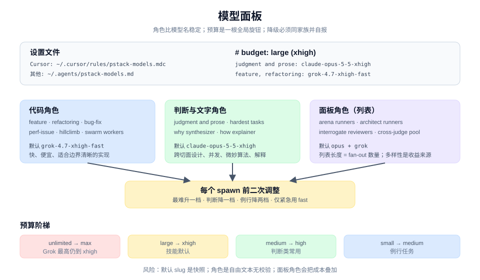

# 模型角色

pstack 不把模型写死在 skill 里。每个 skill 声明自己需要哪些角色，`setup-pstack` 把角色到模型的对应写进设置文件，一行一个角色。角色行缺失时退回 skill 内的默认值。

## 角色行

设置文件是 Cursor 的 `~/.cursor/rules/pstack-models.mdc` 或其余 harness 的 `~/.agents/pstack-models.md`。值可以是单个 slug、逗号分隔的列表，或 `inherit-parent` / `auto`（两者都表示这个角色跑在父 chat 的模型上，省略子代理的 `model`）。

面板角色有几项就跑几个 subagent，列表长度就是 fan-out 数量：`arena runners`、`architect runners`、`interrogate reviewers`。`arena cross-judge pool` 也是列表，但 `arena` 只从里面选一个与父模型不同家族的模型。`swarm workers` 是所有 worker 的默认模型，除非 race 或对照给每条 arm 另配模型。

源码：[`skills/setup-pstack/SKILL.md`](../../skills/setup-pstack/SKILL.md)、[role line](../system/model-panel.md)。

## 四个 skill 怎样读这些行

- `arena`：每个候选拿同一个 prompt，`arena runners` 每个条目跑一个候选，候选各自有输出位置。裁判从 `arena cross-judge pool` 里选，优先不同家族，按 Phase A 写好的 rubric 逐项打分。父 agent 自己读完所有候选，再与裁判结论对照：一致就确认，不一致读双方理由。源码：[`skills/arena/SKILL.md`](../../skills/arena/SKILL.md)。
- `interrogate`：`interrogate reviewers` 每个条目一个 reviewer，各拿同一份 diff 和 rubric。对抗信号来自不同模型，不来自分配人设。综合时两个以上模型独立提出的问题信号最高；单独一个模型的发现要读，但权重降低；互相矛盾的发现记下来。源码：[`skills/interrogate/SKILL.md`](../../skills/interrogate/SKILL.md)。
- `swarm`：worker 默认 `swarm workers`；做模型 race 时，每条 arm 的模型在 fan-out 前点名。源码：[`skills/swarm/SKILL.md`](../../skills/swarm/SKILL.md)。
- `reflect`：三个 reviewer 与 synthesizer 都读 role 行。judgment 与 divergent 读 `reflect judgment, divergent, synthesizer`，tooling 读 `reflect tooling`。源码：[`skills/reflect/SKILL.md`](../../skills/reflect/SKILL.md)。

## 为什么把模型放进设置文件

- 角色比 slug 稳定。模型会改名、下架、换家族；角色名不变。
- 预算是全局设置。设置文件的 `# budget` 一行把每个真实 slug 的 effort token 上调或下调，`inherit-parent` 与 `auto` 不动。
- 面板退化看得见。所有角色都配同一个模型时，fan-out 仍会发生，但独立意见没有了。

## spawn 前的调整

`poteto-mode` 的 Subagents 要求每次 spawn 前从角色行或默认值出发，按工作难度调推理档位。起点由 `setup-pstack` 的 budget 定，默认 `xhigh`；最难或最微妙的工作升一档，判断类降一档，例行工作降两档或更多。只有 CI 或 trunk 红了、有人正在等结果时才用 `-fast`，否则用同一 slug 的 standard 速度。验证是例外，停在 `swarm workers` 的模型与速度。只改 effort 与 fast，不改家族。

## 代价

- 成本随 fan-out 叠加。`arena` 的 N 个候选加一个裁判，`swarm` 的 N 个 worker，都是 N 份生成。
- 默认 slug 是快照。换 harness 或模型下架时要降级。
- 面板可能退化。所有角色配成同一个模型，流程照跑，收益消失。
- 综合仍是单点。最终判断由父 agent 或 lead reviewer 做，模型数量不能替代判断质量。

## 关键洞察

1. 要的是独立判断，不是更多候选。`arena` 给候选，`interrogate` 给反对意见，`swarm` 给覆盖。
2. 一致与分歧都要解释。一致确认结论，分歧暴露 rubric 的歧义或上下文的缺失。
3. 角色行是配置，不是保证。没有人检查 `interrogate reviewers` 的两项是不是真的两个模型。
