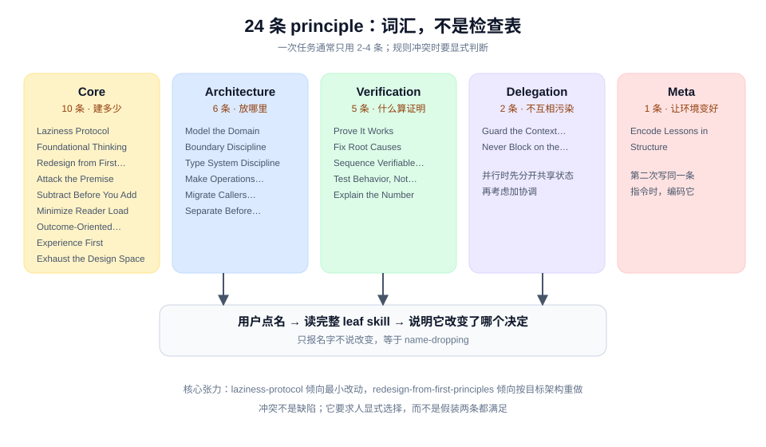

# Principles as Vocabulary 模式

## 是什么

pstack 把 24 条工程判断做成 24 个 `principle-*` skill。它们的用途不是被"调用"，而是被**点名**：用户说"use subtract before you add"，agent 就按那条规则重新检查当前决定，并在回复里说出这条规则改变了哪个选择。

## 源码里的形状

- `poteto-mode` 的 **Principles** 一节按 Core / Architecture / Verification / Delegation / Meta 分组，每条给一句"何时适用"。
- 每条 principle 是一个独立 `SKILL.md`，通常 10-40 行，结构是"规则 + Why"。
- mode 要求：应用某条 principle 时读完整 leaf skill；回复中必须点名这条 principle，并说明它改变了哪个具体决定。
- `docs/guide/08-principles.md` 把这叫"steering"：你不调用 principle，你用它的名字改变工作方向。

这和普通"最佳实践清单"的差别在于**引用义务**。点名而不说改变了什么，会被视为 name-dropping。

## 为什么有效

- **压缩指挥成本。** 一段"先删掉没用的适配器，再在剩下的基础上设计"可以压缩成"subtract before you add"。
- **共享词汇。** 人和 agent 用同一组名字讨论判断，评审时可以直接指规则。
- **可逐条维护。** 每条规则有自己的文件，可以单独改写、单独引用、单独检查。
- **名字锚定预训练概念。** 大多数名字本身就能激活一整套工程直觉，不需要每次从零解释。

## 代价

- **数量本身是负担。** 24 条要记、要选、要在回复里正确引用。不熟的人读起来像术语表。
- **名字可能被当作口号。** 没有"改变了哪个决定"的约束，点名就会退化成装饰。
- **规则之间可能冲突。** 例如 `laziness-protocol` 倾向最小改动，`redesign-from-first-principles` 倾向按目标架构重做；冲突时靠人判断。
- **不是强制。** 没有 lint 检查 principle 是否被遵守，只有回复里的自述。

## 怎么迁移

1. 只把**反复出现、且能用一句话说清**的判断写成规则。一次性的建议留在文档里。
2. 每条规则回答"何时适用 + 要求什么 + 为什么"，不要写成口号。
3. 给规则起一个能激活既有概念的名字，不要发明新词。
4. 要求引用时说明**改变了哪个决定**，否则名字会变成装饰。
5. 规则冲突时，明确哪条优先，或把冲突交给人的判断。

## 关键洞察

1. **可点名的规则比长段落更适合指挥。** 一个短语就能重定向工作方向。
2. **引用义务是防退化的关键。** 名字必须落到决定上，否则只是术语。
3. **24 条是词汇量，不是检查表。** 不需要每次全用，只需要在触发时用对。
