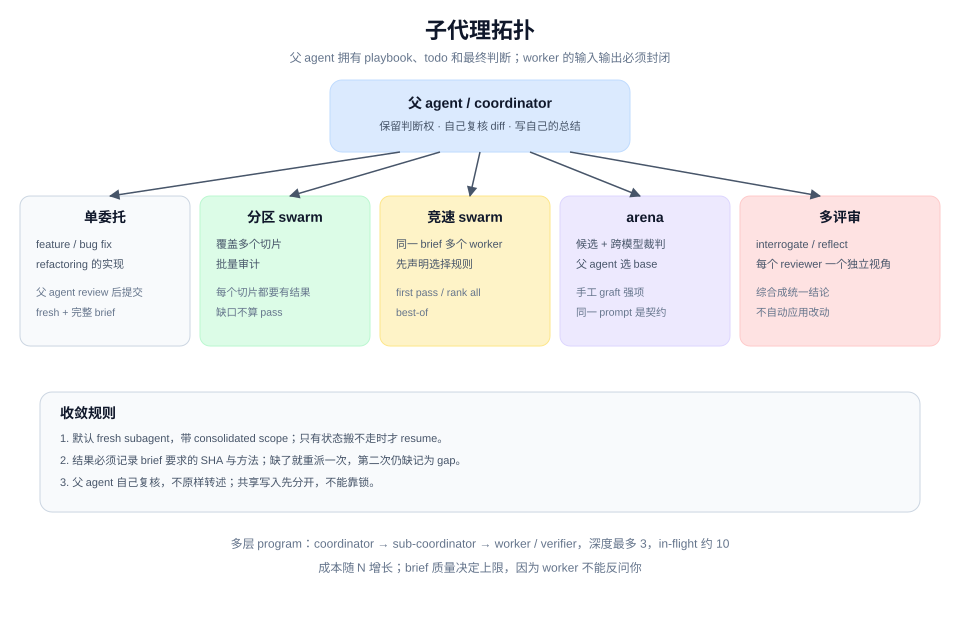

# Subagent Topology 模式

## 是什么

pstack 让父 agent 保留 brief、todo 和最终判断：它拥有 playbook、todo 和每一次 spawn；子 agent 是输入输出封闭的执行单元，负责一块可以被写清楚的工作。不同流程用不同拓扑：单委托、分区、竞速、候选竞争、多评审、多层 program。

## 基本约束

来自 `poteto-mode` 的 **Subagents** 一节：

- code-writing 委派用 `poteto-agent`；子 agent 必须先完整读 `poteto-mode/SKILL.md`，包括 Principles。
- 默认 `run_in_background: true`，agent 模式（`readonly` 会剥掉 MCP）。
- 给文件指针，不把上下文整段内联。
- 每个角色显式指定模型；难度决定档位。
- **默认 fresh subagent**：新任务带 consolidated scope（原始 brief、后续指令、上一个 agent 的报告和分支）。只有新工作确实依赖它持有的状态（本地 checkout、未提交改动、还在跑的进程）时才 resume。
- 父 agent 拥有子 agent 的工作：自己看 diff、自己写总结，不原样转述子 agent 的话。

## 六种拓扑

| 形状 | 用在哪 | 收敛方式 |
|---|---|---|
| **单委托** | feature、bug fix、refactoring 的实现 | 父 agent review diff，验证后提交 |
| **分区 swarm** | 覆盖多个切片、批量审计 | 每个切片都要有结果；缺口不算通过 |
| **竞速 swarm** | 同一 brief 多个 worker | 事先声明 `first pass` / `rank all` / `best-of` |
| **arena** | 设计或代码 bakeoff | 候选 + 跨模型裁判 + 父 agent 选 base + 手工 graft |
| **多评审** | `interrogate`、`reflect` | interrogate 每个模型一个 reviewer；reflect 每个视角一个 reviewer；综合成统一结论，不自动应用 |
| **多层 program** | `orchestrate` | coordinator → sub-coordinator → worker/verifier，深度最多 3 |

`orchestrate` 还规定了 in-flight 上限（大约 10 个）、滚动窗口而不是阻塞批次、每个 worktree 只有一个写者、验证者与 worker 不同模型家族。

## 为什么这样切

- **上下文是稀缺资源。** 大批量读取、长文件、重复探索放进子 agent，主线程只留结论。
- **封闭输入输出让失败可定位。** 一个 brief 写不清，失败就在那个 worker，不会污染整条链。
- **fresh 比 resume 可靠。** `interrupt-chained resumes silently drop directives`；新 agent 带完整 brief，比相信"done"摘要更安全。
- **父 agent 保留判断权。** 子 agent 可以建议、可以证明缺陷，但不能替父 agent 决定合并或改变范围。

## 聚合规则

- 结果必须记录 brief 要求的 SHA 和方法；缺了就丢弃并重派一次，第二次仍缺就记为 gap。
- gap 不等于 pass。
- worker 掉线就用 N-1 继续，并明确记录。
- 不粘贴原始输出，给紧凑的结果表和一行证据。
- 父 agent 自己复核，不把子 agent 的总结当自己的总结。

## 代价

- **成本。** 每个 subagent 都是一次完整生成，N 个 worker 是 N 份 token。
- **brief 质量决定上限。** `orchestrate` 说得很直白：brief 就是产品；含糊的 brief 会安静地失败，因为 worker 不能反问你。
- **共享写入会互相破坏。** 同一分支、同一文件、同一 key 上的并发必须靠"先分开"解决，不能靠锁。
- **多层会重付方向成本。** 每层嵌套都要重新理解一遍上下文；父层阻塞等待时，子层在空转。

## 怎么迁移

1. 先决定"谁保留判断权"。父 agent 必须自己复核，不能只做转发。
2. 给每类工作写一个 brief 模板：目标、范围、只写哪些路径、验收、验证命令、禁止动作、报告形状。
3. 默认 fresh，只有状态确实搬不走时才 resume。
4. 并发先解决共享写入，再考虑加协调。
5. 给验证者一个与实现者不同的模型家族。

## 关键洞察

1. **子代理的可靠性来自 brief，不来自模型。** brief 写不清，换多强的模型都会失败。
2. **fresh 是一种正确性策略。** 它避免指令在 resume 链里悄悄丢失。
3. **父 agent 的复核不可省。** 否则多 agent 只是把同一个盲点复制了多份。
