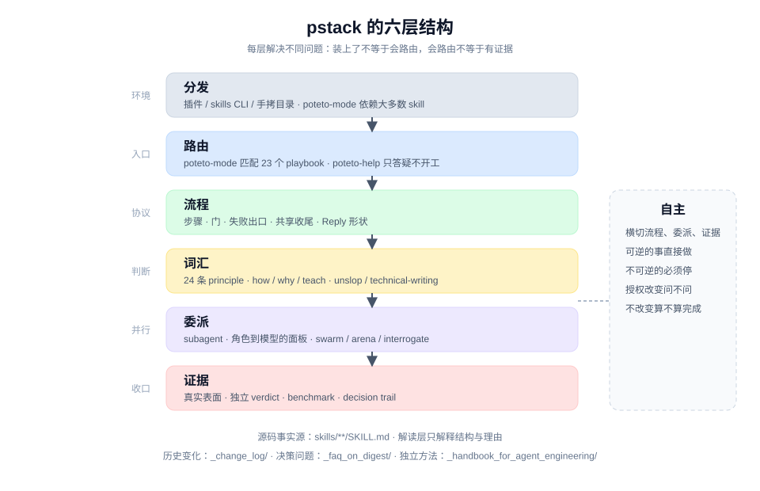

# 系统总览

## 一句话

pstack 不是一组零散的 slash command，而是一台分层的执行机器：mode 把请求接进流程，playbook 规定每一步和它的门，principle 提供判断时可以直接点名的词汇，模型面板与子代理把工作并行出去，证据与验证负责决定什么时候可以停。

## 六个层次

| 层次 | 它负责什么 | 主要材料 |
|---|---|---|
| **分发** | skill 怎样进入 Cursor、Claude Code、Codex、Pi 或其他 harness | [分发与安装](./distribution.md) |
| **路由** | 从一句请求选择 playbook，或把问题转给 `poteto-help` | [mode 与 playbook](./mode-and-playbooks.md) |
| **流程** | 用步骤、暂停点、失败出口和共享收尾约束一次执行 | [playbook 索引](../playbooks/README.md) |
| **词汇** | 用 principle、解释类 skill 和写作规则统一判断与表达 | [principles 索引](../principles/README.md) |
| **委派** | 用 subagent、模型角色与 fan-out 形状换并行和判断质量 | [模型面板](./model-panel.md) |
| **证据** | 用真实表面、基准检查与 decision trail 决定"完成" | [验证与 verdict](../patterns/evidence-first.md) |

自主（autonomy）不单独占一层。它横切流程、委派和证据：什么时候可以不停下来问人，什么时候必须停，都写在这些层的具体条款里。见 [自主与门](./autonomy-and-gates.md)。

把这六层分开很重要。安装成功不等于 mode 会匹配到正确的 playbook；匹配对了不等于步骤里的门会被遵守；门写清楚了也不等于 subagent 会带回可核查的证据。每层解决不同的问题。

## 主流程怎样工作

### 0. 一次性配置

`setup-pstack` 探测当前 harness 可用的模型，选一个推理预算，把"角色 → 模型"写进设置文件。之后派 subagent 的 skill 优先读这份设置；文件或角色行缺失时，才回退到 skill 内写的默认值。

设置文件的位置随 harness 变化：Cursor 是 `~/.cursor/rules/pstack-models.mdc`，其余 harness 是 `~/.agents/pstack-models.md`。

### 1. 用 mode 进入

`poteto-mode` 是唯一的主入口。它读请求，从 23 个 playbook 里选一个，把该 playbook 的步骤**逐字**复制进 todo list，然后按步骤执行。不想做的步骤必须留在列表里，写一行 `skip: <reason>`。

这一步同时确定了三件事：这次工作的形状、必须经过的门、以及哪些 skill 会在中途被调用。

### 2. 在步骤内调用能力

playbook 不复制执行规则，只规定顺序和交接点。例如 bug fix 的步骤会指向 `how` 定位、`architect` 规划、`tdd` 写回归测试；每一步的具体协议留在各自的 `SKILL.md`。

这是"编排决定顺序，skill 拥有规则"的分工。

### 3. 派 subagent

code-writing 的委派默认使用 `poteto-agent`，每个新任务开一个 fresh subagent，带上 consolidated scope：原始 brief、后续指令、上一个 agent 的报告和分支。`swarm`、`arena`、`interrogate`、`reflect` 各自定义 fan-out 形状与模型角色。

父 agent 保留 brief、todo 和最终判断，子 agent 的产出要经过父 agent 自己复核，不能原样转述。

### 4. 在真实表面验证

"测试绿了"不算完成。`prove-it-works` 要求验证真实产物；`benchmark-checklist` 在报告任何性能数字前逐项检查；`create-verification-skill` 把"像用户一样驱动这个应用"固化成项目内的控制面。验证与写作是两条独立的工作，不能互相替代。

### 5. 收口

需要开 PR 的 playbook 以 `opening-a-pr` 收尾：worktree、提交节奏、PR 标题与正文、forge 选择、栈的形状。回复本身按 `unslop` 与 mode 的 **Writing the reply** 规则写，每条断言带证据或标签。

长任务、自主运行或用户离开后要复查的工作，还要留下 `show-me-your-work` 的 TSV decision trail，并在交付前做一次跨模型审计。

## 其他起点怎样汇入

| 起点 | 入口 | 汇入位置或产物 |
|---|---|---|
| 不知道用哪个 skill，或 pstack 怎么配 | `poteto-help` | 回答 + 一段可直接发送的 prompt，不替用户开工 |
| 只想知道代码怎样运行 | `how` | 带文件定位的机制说明 |
| 想知道为什么这样设计 | `why` | 带引用的决策与权衡阅读 |
| 要把一套工作讲给一个人听懂 | `teach` | 组合 `how` 与 `why` 的一段说明 |
| 接手别人未完成的工作 | `poteto-mode` → Session pickup | 接管在途工作 + 当前状态 |
| 重建自己最近的工作上下文 | `recall` | 当前状态简报 + 下一步 |
| 离开一阵后要补课 | `ketchup` | 平实语言的变更摘要 |
| 任务本身没说清 | `sharpen` | 专家路径、真实目标、规格松紧 |
| 环境反复出同一种错 | `correct` / `reflect` | 结构性检查 / 写回 skill 的改进 |
| 想把个人习惯变成 skill | `automate-me` | 一个定制的 `-mode` skill |

除 Session pickup 外，这些入口不要求先跑 `poteto-mode`。其中 `how`、`why`、`architect`、`arena`、`swarm`、`interrogate`、`tdd` 等会被 mode 的步骤在需要时点名；`teach`、`recall`、`sharpen`、`correct`、`automate-me`、`poteto-help` 主要是人的独立入口。

## 人和 agent 的责任边界

| 人保留 | Agent 承担 |
|---|---|
| 目标、产品取舍、不可逆行动的授权 | 环境事实检索、执行步骤、生成证据、维护 artifact |
| 是否接受一个设计或一次评审结论 | 提供有依据的推荐、明确 trade-off、按证据排除假设 |
| 何时进入高代价或不可逆行动 | 检查 gate 条件是否满足、在可逆范围内自行推进 |
| 是否合并、发布、删除数据 | 准备证据、等待明确指令 |

pstack 把这叫 **never block on the human**：可逆的事直接做，做完再让人纠正；不可逆的事（强推共享分支、部署、删数据、给客户发消息）列在 **Always pause** 里。这不是礼貌性确认，而是所有权模型。

## 五个容易误读的地方

1. **它几乎不自动触发。** 54 个 skill 里有 53 个设置了 `disable-model-invocation: true`。模型不会自己挑 skill；要么人输入命令，要么 mode 在 playbook 里点名。见 [调用模型](./invocation-model.md)。
2. **它有主线，但不是单链。** 23 个 playbook 覆盖调查、构建、验证、交付和长时间自主运行；`poteto-mode` 会按任务选一条，而不是所有工作都走同一条。
3. **playbook 不是提示词模板。** 它是带暂停点、失败出口和证据要求的执行协议；步骤要逐字复制，跳过要写原因。这正是它可审计的原因。
4. **多模型不是硬依赖。** 单模型也能跑完所有流程，但 `arena`、`interrogate`、`reflect` 的核心收益来自模型差异，单模型时这些收益消失；`swarm` 的主收益是并行覆盖，模型竞速只是可选项。
5. **文档不是附属输出。** PR 正文、回复、decision trail 都是交接接口。写不清楚，下一位（人或 agent）就得重建上下文。

## 关键洞察

1. **分层是为了定位失败。** 装不上、选错 playbook、门没遵守、证据不够，是四个不同层的问题，不能用同一种修法。
2. **路由与执行不换手。** mode 选完流程继续执行，减少"选完就忘"的损耗。
3. **词汇是接口。** principle 的名字让评审和回复能指向同一条规则，而不是重新争论。
4. **证据决定什么时候停。** 没有可检查的产出，自主就只是"相信我"。

## 下一步怎么读

- 想按情境找工具：看 [技能索引](../skills/README.md)。
- 想理解反复出现的设计手法：看 [Patterns 总览](../patterns/README.md)。
- 想理解一个 skill 的文件结构：看 [SKILL.md 结构解剖](./skill-anatomy.md)。
- 想理解为什么几乎全部 user-invoked：看 [调用模型](./invocation-model.md)。
- 想理解模型与预算怎样分配：看 [模型面板](./model-panel.md)。

> 源码：[`skills/poteto-mode/SKILL.md`](../../skills/poteto-mode/SKILL.md)、[`plugin.json`](../../plugin.json)、[`README.md`](../../README.md)。
