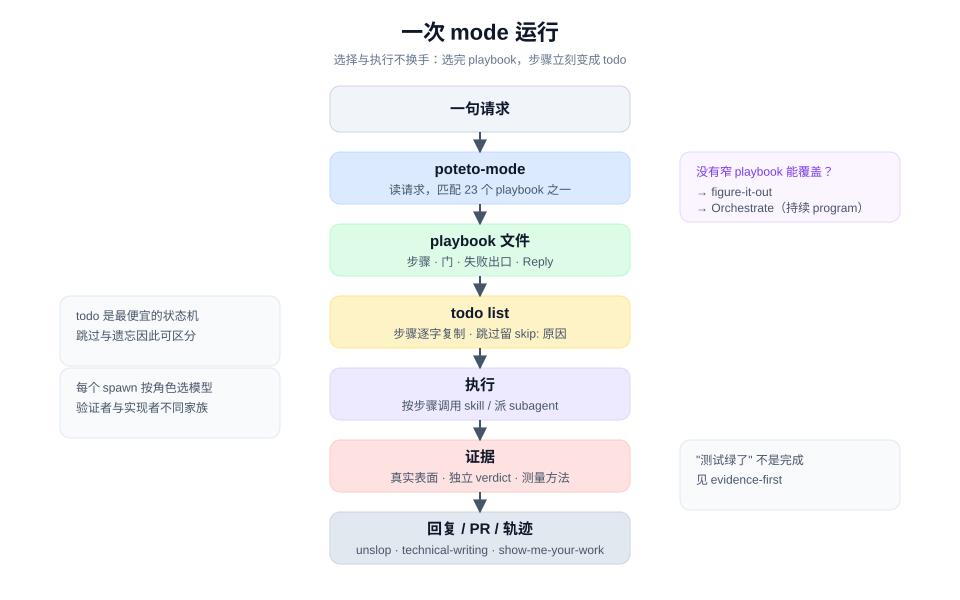

# mode 与 playbook

## 一句话

`poteto-mode` 既是路由器又是执行者：它把一句请求映射到一个 playbook，再把那个 playbook 的步骤原样搬进 todo list，按步骤调用其他 skill 和 subagent。流程的形状由 playbook 决定，不由模型的临场发挥决定。



## 一次运行的结构

1. **读请求。** 识别任务类型、要交付的产物、以及用户已经说出的验收方式（"repro first"、"land the stack"、"pixel exact"）。
2. **匹配 playbook。** 从 23 个里选一个。匹配依据是请求里的信号，不是关键词表。
3. **复制步骤。** 打开 `playbooks/<title>.md`，把步骤逐字放进 todo list 的最前面，然后才写任务特有的 todo。
4. **执行。** 每个步骤可能调用解释类 skill、设计类 skill、验证类 skill，或派 subagent。
5. **收口。** 需要开 PR 的 playbook 以 `opening-a-pr` 结束；回复按 mode 的 **Writing the reply** 与 `unslop` 写。

### 为什么步骤要逐字复制

- **防转述漂移。** 模型概括步骤时会丢条件。"reproduce it yourself" 被概括成 "reproduce it"，责任主体就没了。
- **让跳过可见。** 不做的步骤不能删，要留 `skip: <reason>`。同理，不适用的维度写 `n/a: <reason>`。这让"没做"和"忘了"可区分。
- **让进度可审计。** todo list 是最便宜的状态机；用户扫一眼就知道现在在第几步。

这和把 playbook 当提示词模板是两件事。模板追求一次性生成，playbook 追求可复查的执行顺序。

## 23 个 playbook 的分组

| 组 | playbook | 何时进 |
|---|---|---|
| **理解与诊断** | Investigation, Bug fix, Perf issue, Hillclimb, Runtime forensics, Trace forensics | 只读问题、缺陷、变慢、指标爬坡、活体症状、事后 profile |
| **构建** | Feature, Refactoring, Prototype, Visual parity | 新行为、保持行为的重构、一次性探针、像素级对齐 |
| **验证与交付** | Eval, Babysit, Shipping, Opening a PR | 评估 skill 改动、把 PR 推到可合并、把绿色栈落地、收尾 |
| **自主运行** | Autonomous run, Orchestrate, Autopilot-full, Autopilot-stack, Session pickup | 一个任务跑到谓词、一个项目跑多天、PR 队列、接管旧工作 |
| **维护** | Pause safely, Worktree cleanup | 干净地暂停、回收磁盘 |
| **元** | Authoring a skill, Multi-phase plan | 改 skill、跨阶段或跨 PR 的计划 |

逐项说明见 [playbook 索引](../playbooks/README.md)。

## 选择信号

| 你看到的信号 | 先进 | 不要进 |
|---|---|---|
| "how does X work"，只要一个带引用的答案 | Investigation | Feature；不要顺手改代码 |
| 有可复现的缺陷 | Bug fix | Feature；修 bug 的步骤要求先复现 |
| 有测得的变慢 | Perf issue | Hillclimb；一次修复用 Perf issue |
| 一个指标要持续逼近目标 | Hillclimb | Perf issue；hillclimb 是循环 |
| 只有 trace / heap snapshot，没有活体 | Trace forensics | Runtime forensics |
| 新行为，且能说清数据形状 | Feature | Prototype；形状未定时先做探针 |
| 行为不变，只改结构 | Refactoring | Feature |
| 一个设计选择需要证据才能定 | Prototype | Feature；用完就丢 |
| 两套实现要像素一致 | Visual parity | Visual parity 是专门流程，不是普通 review |
| 一个 skill 或 prompt 改动是否真的改变行为 | Eval | 凭感觉合并 |
| PR 要推到可合并 | Babysit | Shipping；babysit 不负责合并 |
| 栈已绿，要落地 | Shipping | Babysit；shipping 要求独立验证 |
| 一个任务跑到可检查的谓词 | Autonomous run | Orchestrate；一个 agent 能做完就不算 program |
| 一个项目跑多天、几十上百个 subagent | Orchestrate | Autonomous run |
| 一批独立 PR 全自动落地 | Autopilot-full | Shipping；autopilot 是队列形态 |
| 一批改动要形成一条待人工落地的栈 | Autopilot-stack | Autopilot-full；stack 不自动合并 |
| 接管别人未完成的工作 | Session pickup | Recall；recall 只重建上下文 |
| 下游工作跨阶段或跨 PR | Multi-phase plan | Feature；先定阶段边界 |

## 三层兜底

```text
有更窄的 playbook 能覆盖        → 用它
没有，但任务足够大或跨切面      → figure-it-out：设计一份一次性 rigor playbook
是持续性 program，不是一个任务  → Orchestrate
```

`figure-it-out` 与 `Orchestrate` 的区别是**一次运行**与**一个项目**。`Autonomous run` 与 `Orchestrate` 的区别是**一个谓词**与**一个队列**。这几条边界在正文里写得比名字清楚，选错时先读描述。

## 门写在步骤里

playbook 的约束不是结尾一句"请谨慎"，而是步骤内的可检查条件：

- **Bug fix step 1**：自己在该表面上复现；只有控制面确实够不到时才请用户，且要说明具体原因。
- **Shipping step 1**：每个 PR 由没写这份代码的 verifier 独立验证，`PASS` 或 `PASS+NOTES` 才算数；绿 CI 和 bot approval 都不是 verdict。
- **Babysit step 1**：先声明 `drive`、`background`、`threads-only` 或 `check` 模式，再轮询。
- **Benchmark**：报告任何性能数字前走 `benchmark-checklist` 的七问。
- **Feature step 3**：写 throughput checkpoint（阻塞步骤、可并行工作流、共享可变状态、最小安全拆解），不适用的维度也要留 `n/a`。

这些门只在具体转移处生效，不是把 agent 变成每步都要请示的工作流引擎。判断标准是：这一步是否容易自欺，或代价是否高到值得停一下。

## 共享收尾

`Opening a PR` 自称在每个其他 playbook 的结尾被调用。它统一了 worktree、提交顺序、PR 形状、forge 选择、栈的规则和"开 PR 不等于开始 babysit"。

这里有一条源码内部的张力：Investigation、Runtime forensics、Trace forensics 和 Pause safely 明确不开 PR，但 `opening-a-pr` 的描述写的是 "every other playbook"。合理读法是：它是需要交付改动时的默认收尾，不是无条件收尾。

这个设计避免每个 playbook 各写一份 PR 规范，也让"最后一个步骤"只有一个事实来源。

## 值得注意

- **23 个 playbook 本身是发现成本。** mode 不做交互式澄清，它直接选。选错的代价在长流程里会被放大。
- **描述承担了路由。** playbook 的标题和描述是唯一的匹配信号，措辞变化会影响选择；这里没有单独的 router skill。
- **`poteto-mode` 是重依赖入口。** 它要求大多数 skill 同时在场；部分安装时，步骤会走到不存在的 skill。
- **"逐字复制"依赖执行者愿意照做。** 没有机械检查保证 todo 与 playbook 一致；这是纪律，不是编译器。

## 关键洞察

1. **路由器同时是执行器。** 选完流程后不换手，减少了"选完就忘"的损耗。
2. **步骤是状态。** 把步骤搬进 todo，比让模型记住一段长提示更可靠。
3. **兜底要分层。** 窄 playbook、一次性设计、持续 program、队列自主，各自解决不同规模的问题。
4. **门要贴着转移写。** 抽象成"要谨慎"没有用；写成"在哪个表面、看到什么、才允许下一步"才有用。

> 源码：[`poteto-mode/SKILL.md`](../../skills/poteto-mode/SKILL.md)、[`playbooks/`](../../skills/poteto-mode/playbooks/)。
