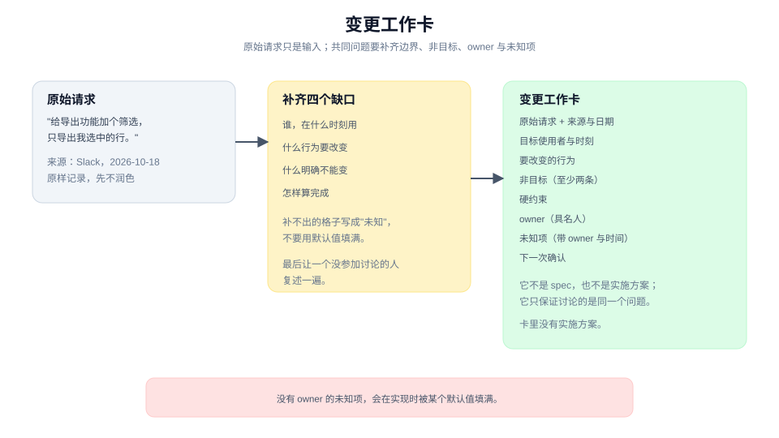
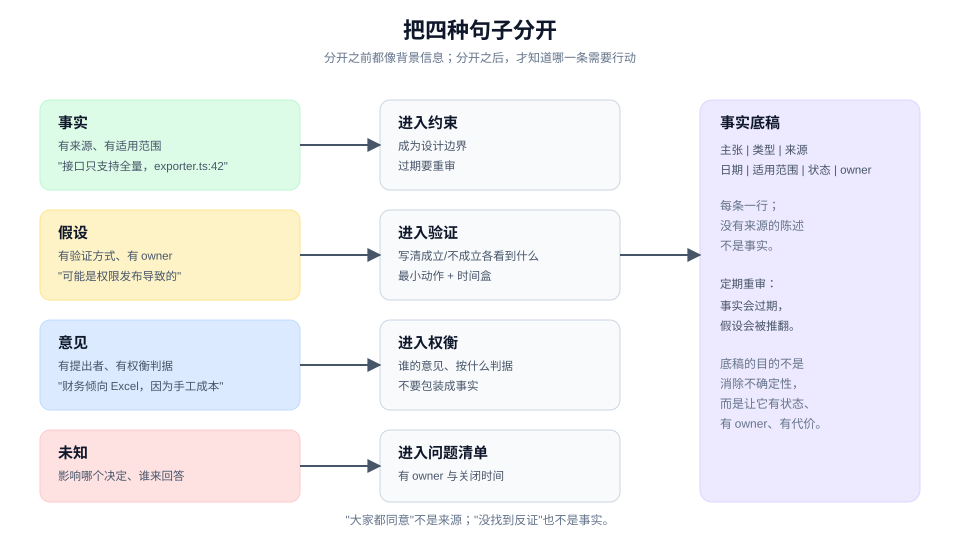
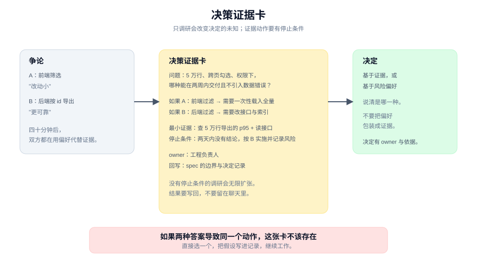
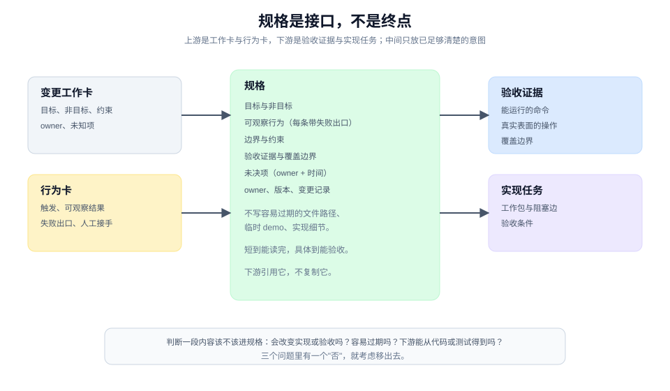

# 定义：把共同问题做扎实

> 本章 4 个实战单元 · [手册目录](./README.md) · [教程地图](../tutorial/README.md)

## 这一章解决什么

大多数返工不是从代码开始的，而是从"我们其实没在解决同一个问题"开始的：目标含糊、边界漂移、事实与猜测混在一起、验收条件缺失。等代码写出来，纠正的单位已经从一句话变成一个 diff。

定义不是写一份漂亮文档。它是一组把模糊请求推进成**可执行、可验收的共同问题**的动作。四个单元对应四种典型卡点：

| 单元 | 卡点 | 带走 |
|---|---|---|
| 1.1 | 请求来了，但说不清要解决什么 | 变更工作卡 |
| 1.2 | 事实、假设、意见混在一起 | 事实底稿与待确认清单 |
| 1.3 | 两个方向都行，争论代替了证据 | 决策证据卡 |
| 1.4 | 意图稳定了，下游仍反复问 | 可执行规格 |

四个单元不是严格流水线。小改动可能只做 1.1 和 1.4；高风险决定会在 1.3 停很久；1.2 则贯穿始终。

---

## 1.1 从手头变更到共同问题

### 工作情境

请求可能来自 Slack、工单、会议或一句口头交代：

> "给导出功能加个筛选，只导出我选中的行。"

团队点头，各自开始理解：有人以为是在导出页加筛选器，有人以为是导出后过滤文件，有人以为要记住上次选择。每个人都对，但每个人想的不是同一件事。

直接开工，会在中途遇到三种返工：范围扩大、边界冲突、验收标准不一致。它们的共同原因是：请求还没有变成共同问题。

### 带走什么

一张**变更工作卡（change card）**：

```text
原始请求：<逐字引用，注明来源与日期>
目标使用者与时刻：<谁，在什么场景下，想完成什么>
要改变的行为：<从什么状态到什么状态>
非目标：<这次明确不做的事，至少两条>
硬约束：<权限、数据、兼容、期限、合规>
owner：<对这次变更负责的具名人>
未知项：<还不知道、但会影响实现的事>
下一次确认：<什么时候、和谁确认什么>
```

它保留未知项，不把未决项写成承诺。它不是 spec，也不是实施方案。

### 做法

**第一步，原样记录请求。** 不要先润色。润色会提前掩盖缺口。注明来源和日期，方便以后判断它是否仍然有效。

**第二步，写"谁，在什么时刻"。** 不要写"用户"。"运营在早会前，把昨天异常订单里自己核对过的几条发给财务"比"运营需要导出"多提供了三个约束：时间压力、数据范围、下游消费者。

**第三步，写行为变化，不写功能名。** "加个筛选"是功能名；"勾选 3 行后导出，文件恰好 3 行；没勾选时保持全量导出"是行为变化。行为变化能被观察，功能名不能。

**第四步，写非目标。** 至少两条。非目标不是"这次不做"的愿望清单，而是防止行为被扩大解释的边界：

- 不做 Excel。
- 不做后台任务。
- 不改全量导出的入口。
- 不记住上次勾选。

**第五步，列硬约束。** 权限、数据保留、兼容性、发布时间、合规要求。硬约束和偏好的区别是：违反它会让方案不可接受，而不只是不够好。

**第六步，把未知项变成有 owner 的问题。** "财务要 CSV 还是 Excel"不是一句待定，它有一个 owner 和一个确认时间。没有 owner 的未知项，会在实现时被默认值填满。

**第七步，指定一个 owner。** 不是"团队"，是一个具名人。owner 不必亲自做所有事，但要对"这一版是否可被依赖"负责。

最后，找一个没参加讨论的人，让他只读这张卡，复述要做什么、不做什么、怎样算完成。复述不出来，说明卡还没写清。

### 人机边界

| agent 可以做 | 人必须做 |
|---|---|
| 检索仓库、工单、分析数据，补齐事实 | 确认目标、优先级与范围 |
| 起草工作卡，指出缺失字段 | 决定非目标与硬约束 |
| 把未知项整理成问题清单 | 指定 owner 与确认时间 |
| 检查措辞是否具体、可观察 | 接受范围风险 |

agent 不应该用默认值填未知项。它可以推荐一个默认值，但要标明"这是推荐，不是决定"。

### 质量门

- "谁/何时"具体到能被另一个人复现，不是"用户"。
- 行为变化能用一句"从 X 到 Y"说清。
- 至少两条非目标，且每条都能挡住一种扩大解释。
- 每个未知项有 owner 和下一次确认点。
- 有且只有一个具名 owner。
- 卡里没有实施方案；它只描述问题与边界。

### 图解



图里把"原始请求"和"共同问题"分开：左边是输入，右边是补齐边界、非目标、owner 与未知项之后的工作定义。中间的四步不是流程装饰，而是四种最常被跳过的缺口。

### 工具角色（可选）

工单模板、文档模板或一张共享表格都能承载工作卡。工具的价值是让字段固定、链接可追踪；它不能替你决定非目标，也不能替你指定 owner。

如果使用 agent，让它先填"事实"和"缺失字段"，再由人补"决定"。不要让 agent 一次生成完整工作卡并直接进入实现。

### 进阶

小、可逆、边界清楚的改动可以只写三行：谁/何时、行为变化、完成判据。不要为了流程而流程。

但只要满足以下任一条件，就值得完整写卡：跨角色、跨系统、有权限或数据风险、需要多人并行、或你发现自己无法用一句话说清"不做什么"。

---

## 1.2 把事实、假设、意见与未知项分开

### 工作情境

讨论进行到一半，桌上混着四种句子：

- "导出接口现在不支持按 id 过滤。"（事实？还是某个人的印象？）
- "财务肯定要 Excel。"（意见？还是已经确认的需求？）
- "可能是权限服务在 14:00 发布导致的。"（假设，但被当成结论。）
- "超大文件怎么办？"（未知，但没人认领。）

如果不在开工前分开，它们会在实现时变成四种不同的债务：基于错误事实的设计、被当成需求的偏好、未经验证的根因、以及被默认值填满的未知。

### 带走什么

一张**事实底稿（evidence ledger）**，加一列待确认清单：

| 主张 | 类型 | 来源 | 日期 | 适用范围 | 状态 | owner |
|---|---|---|---|---|---|---|
| 导出接口只支持全量 | 事实 | `exporter.ts:42` | 2026-10-18 | 当前主干 | 已核实 | — |
| 财务要 Excel | 意见 | 早会口头 | 2026-10-17 | 本季度 | 待确认 | 产品 |
| 14:00 权限发布导致错误率上升 | 假设 | 值班观察 | 2026-10-18 | 生产 | 待验证 | 运维 |
| 5 万行以上的等待策略 | 未知 | — | — | — | 未决 | 产品 + 工程 |

类型只有四种：**事实、假设、意见、未知**。不要用"应该是""大家都觉得"这类模糊状态。

### 做法

**第一步，逐句分类。** 把讨论里的关键主张拆成单句，每句标一个类型。一句话里包含两个主张时，拆开。

**第二步，给事实加来源和适用范围。** 来源可以是代码位置、数据查询、文档、会议记录或具名人确认。没有来源的陈述，先归为假设或意见。

"接口只支持全量"如果是读了代码得出的，来源写 `file:line`；如果是听同事说的，来源写"同事口述，待核实"。两者都可以进底稿，但状态不同。

**第三步，给假设写验证方式。** 一个假设至少要有：

- 如果成立，会看到什么；
- 如果不成立，会看到什么；
- 最小验证动作；
- 谁来做、什么时候做。

没有验证方式的假设，不是假设，是信念。

**第四步，给意见写 owner 和判据。** 意见不是噪音。它通常代表某种偏好或约束，但需要说清"谁的意见"和"按什么判据权衡"。

"财务要 Excel"如果是意见，写成"财务（具名人）倾向 Excel，理由是手工处理成本；判据是每月处理时间"。这样它才能被权衡，而不是被当成事实。

**第五步，把未知变成有 owner 的问题。** 未知项要写清：它会影响哪个决定、谁来回答、什么时候回答。没有影响的未知，可以暂时不追。

**第六步，定期重审。** 事实会过期，假设会被推翻。每次阶段边界，扫一遍底稿：哪些状态需要更新，哪些已确认的事实变成了新的约束。

### 人机边界

| agent 可以做 | 人必须做 |
|---|---|
| 检索代码、日志、文档，补齐事实来源 | 确认真实业务事实与外部承诺 |
| 把讨论拆成单句并初步分类 | 判断某条意见是否代表组织立场 |
| 为假设设计最小验证动作 | 决定是否接受未验证的风险 |
| 维护底稿、标出过期项 | 指定 owner 与关闭条件 |

agent 最容易犯的错，是把"没有找到反证"写成"事实"。要求它明确写出"未找到来源"或"仅基于代码推断"。

### 质量门

- 每行都有类型，没有"应该是"这类模糊状态。
- 每条事实有来源，且来源能打开。
- 每条假设有验证方式和 owner。
- 每条意见有提出者和权衡判据。
- 每个未知项有"影响哪个决定"和"谁来回答"。
- 没有把"大家都同意"当作事实来源。

### 图解



图里四种类型分别流向不同处理：事实进入约束，假设进入验证，意见进入权衡，未知进入问题清单。混在一起时，它们看起来都像"背景信息"；分开之后，才知道哪一条需要行动。

### 工具角色（可选）

表格最适合承载底稿，因为列结构固定、可以筛选状态。文档适合写来源摘录和验证记录。

如果使用 agent，让它先产出"候选底稿"，每条标注它认为的类型和来源；人再逐条确认。不要让它直接宣布"已核实"。

### 进阶

验证也有成本。不是每条假设都值得做实验；判断标准是：它的结果会不会改变你接下来的动作。

如果一条假设无论真假，你的下一步都一样，那就不必验证，直接把它标成"接受的风险"并继续。底稿的目的不是消除所有不确定性，而是让不确定性有状态、有 owner、有代价。

---

## 1.3 拿不定主意时，先获得会改变决定的证据

### 工作情境

两个方向都可行：

- A：在导出页加筛选器，前端过滤。
- B：后端支持按 id 导出，前端只传选择。

会议开了四十分钟，支持 A 的人说"改动小"，支持 B 的人说"更可靠"。没有人能说服对方，因为双方都在用偏好代替证据。

再讨论下去，只有两种结局：职位高的人拍板，或者拖到不得不做。两种都不是好的决策方式。

### 带走什么

一张**决策证据卡（decision evidence card）**：

```text
问题：<一个会改变方向的具体问题>
选项 A：<做什么>
选项 B：<做什么>
如果 A：<接下来的动作>
如果 B：<接下来的动作>
最小证据动作：<读代码 / 查数据 / 原型 / 问一个人 / 小实验>
停止条件：<看到什么就停；时间盒>
owner：<谁决定>
回写：<结论写到哪里>
```

它只处理**会改变决定**的未知。如果两种答案导致同一个动作，这张卡不该存在。

### 做法

**第一步，把争论改写成问题。** "前端过滤还是后端过滤"是选项；真正的问题是"在 5 万行、跨页勾选、权限过滤这三个条件下，哪种实现能在两周内交付且不引入数据错误"。

问题越具体，证据越容易找。

**第二步，写"如果 A / 如果 B"的动作。** 这一列是判断证据价值的标准：

- 如果选 A，接下来会做什么？
- 如果选 B，接下来会做什么？

如果两边动作相同，说明这个决定不影响工作，直接选一个并记录假设即可。

**第三步，选最小证据动作。** 按成本从低到高：

1. 读代码或文档（分钟级）；
2. 查数据或日志（小时级）；
3. 问一个已经知道答案的人（小时级）；
4. 做一个一次性原型（半天到两天）；
5. 小范围实验或灰度（天级）。

先试便宜的。只有便宜的不能回答时，才升级。

**第四步，写停止条件。** 没有停止条件的调研会无限扩张。停止条件可以是：

- 时间盒："两天内没有结论就按 A 实施，并记录风险。"
- 证据阈值："如果 5 万行导出的 p95 超过 5 秒，就选后端。"
- 决策点："拿到三个用户的反馈就停。"

**第五步，执行并记录。** 结果写回卡片：看到了什么、是否支持某个选项、还剩什么不确定。

**第六步，做决定并说明依据。** 决定可以基于证据，也可以基于风险偏好；但要说清是哪一种。不要把偏好包装成证据。

### 人机边界

| agent 可以做 | 人必须做 |
|---|---|
| 读代码、查数据、跑原型、整理证据 | 定义问题的优先级与风险容忍度 |
| 给出推荐选项和理由 | 做最终决定，尤其是不可逆决定 |
| 执行时间盒内的调研 | 决定何时停止调研、接受剩余不确定性 |
| 把结论写回卡片 | 确认结论是否改变了原计划 |

agent 可以推荐，但不能替人承担"选错方向"的责任。反过来，人也不应该让 agent 用更多分析来替代自己的判断。

### 质量门

- 问题具体到能判断"什么证据相关"。
- 两个选项导致不同动作；否则不值得调研。
- 证据动作有成本上限和停止条件。
- 结果被写回，而不是留在聊天里。
- 决定有 owner 和依据；依据区分证据与偏好。

### 图解



图里把"争论"放到左边，"证据动作"放中间，"决定"放右边。关键不是走完流程，而是让每条证据都对应一个会改变的动作；否则它只是更多信息。

### 工具角色（可选）

一次性原型是这一单元最常用的工具。原型的目标不是交付代码，而是回答一个问题；用完就丢，只把结论和指针带回。

agent 很适合做原型：它能快速搭一个可运行的探针。但要让它在开始前写清"这个原型要回答什么、看到什么算回答完毕"，否则原型会变成半个产品。

### 进阶

决策分两类：

- **可逆决定**：选错可以低成本改回。这类决定应该快，70% 信息就够。
- **不可逆决定**：选错会锁死架构、数据或外部承诺。这类决定值得更多证据，也值得明确记录假设。

不要把可逆决定做成不可逆流程，也不要把不可逆决定当成可逆的随手选择。

---

## 1.4 把已经足够清楚的意图固定成可执行规格

### 工作情境

共同问题已经清楚，关键决定也做了。但下游仍在反复问：

- "没有勾选时到底导出什么？"
- "缺失行要报错还是跳过？"
- "列顺序按哪个为准？"

每次回答都靠某个人记得，答案还会在不同人嘴里略有不同。这不是沟通问题，是意图还没有被固定成下游可消费的契约。

### 带走什么

一份**规格（spec）**：

```text
标题与版本：
owner：
目标使用者与时刻：
目标与非目标：
可观察行为（每条带触发、结果、失败出口）：
边界与约束：
验收证据（命令、场景、覆盖边界）：
未决项（带 owner 与时间）：
变更记录：
```

它不是需求发现过程，也不是实现设计。它只固定"已经足够清楚"的意图，让实现、测试和评审引用同一份来源。

### 做法

**第一步，从工作卡和行为卡组装，不要从零写。** 1.1 的工作卡提供目标、非目标、约束与 owner；行为卡提供可观察行为。spec 的工作是组织和补齐，不是重新发明。

**第二步，写用户视角的目标与非目标。** 目标描述"谁在什么时刻得到什么结果"，非目标描述"这次明确不做什么"。不要把实现方案写进目标。

**第三步，逐条写可观察行为。** 每条至少包含：

- 触发条件（Given / When）；
- 可观察结果（Then）；
- 失败出口（没有权限、数据缺失、超时）；
- 人工接手点（如果存在）。

行为条目可以链接到更细的行为卡，但 spec 本身要能独立读懂。

**第四步，写边界与约束。** 权限、数据保留、兼容性、性能上限、外部依赖。约束要写成可检查的条件，不写"尽量快"。

**第五步，写验收证据。** 每条重要行为对应一个验收方式：

- 一条能运行的命令；
- 一个真实表面的操作；
- 一份可对比的产物。

同时写覆盖边界：这条证据证明到哪里为止。没有覆盖边界的"测试通过"，会被误读成"全部兑现"。

**第六步，把未决项留在桌面上。** 未决项不是耻辱。它是防止把猜测写成承诺的机制。每条未决项要有 owner 和时间；没有的，删掉或升级成决定。

**第七步，指定 owner、版本和变更记录。** spec 是活文档，但每次修改要留下"谁、为什么、改了什么"。没有变更记录的 spec，会在多轮之后变成无法判断时效的累积物。

**第八步，让实现者和验证者各读一遍。** 实现者确认它能指导工作；验证者确认它能被验收。两边都读不懂，说明它要么太抽象，要么缺了关键决定。

### 人机边界

| agent 可以做 | 人必须做 |
|---|---|
| 从工作卡、行为卡、讨论中起草 spec | 确认目标、非目标与优先级 |
| 检查行为是否可观察、验收是否可运行 | 批准范围与关键取舍 |
| 找出矛盾、遗漏和未决项 | 决定未决项何时关闭、由谁关闭 |
| 维护版本与变更记录 | 接受残余风险 |

agent 容易把 spec 写成实现说明：文件路径、类名、函数签名。要求它先写"用户看到什么"，实现细节留给设计与任务。

### 质量门

- 每条行为都有触发、可观察结果和失败出口。
- 非目标明确，能挡住至少一种扩大解释。
- 验收证据可运行或可观察，且写了覆盖边界。
- 未决项有 owner 和时间，没有被写成承诺。
- 不包含容易过期的文件路径、临时 demo 或实现细节。
- 有唯一 owner 和变更记录。
- 一个没参加讨论的人，能只读 spec 说出要做什么、不做什么、怎样算完成。

### 图解



图里把 spec 放在中间：上游是工作卡与行为卡，下游是验收证据与实现任务。spec 不是终点，它是把意图交给下游的接口。

### 工具角色（可选）

文档、issue、wiki 都可以承载 spec。关键不是载体，而是：

- 有一个权威位置；
- 有 owner 和版本；
- 下游引用它，而不是复制它。

如果使用 agent，让它检查"每条行为是否可观察""每个验收是否有覆盖边界""未决项是否有 owner"，但不要让它替你批准范围。

### 进阶

spec 的价值在于**减少下游的猜测**，不在于完整。写得太长、太细的 spec 会过期，也会让实现者失去判断空间。

判断一段内容该不该进 spec：

- 它会不会改变实现或验收？
- 它是否容易过期？
- 下游是否能从代码、测试或行为卡里得到它？

三个问题里有一个"否"，就考虑移出去。spec 应该短到能被读完，具体到能被验收。

当方向变化时，不要就地改写旧 spec 冒充新 spec。写新版本，并按 [6.3](./evolve-the-environment.md) 的方式让旧版本退役。

---

## 四个单元怎样接起来

```text
1.1 变更工作卡
   → 1.2 事实底稿（补齐事实、标出假设与未知）
   → 1.3 决策证据卡（对会改变方向的未知做最小验证）
   → 1.4 规格（把已足够清楚的意图固定成契约）
   → 2.1 行为卡与 2.2 模块形状
```

不是每次都要走完。小改动可以只写工作卡的三行；高风险决定可能在 1.3 停很久；1.2 的底稿则应该贯穿整章。

## 常见失败

| 失败 | 表现 | 修正 |
|---|---|---|
| 把请求当问题 | 直接讨论方案，没人能说清"不做什么" | 回到 1.1，补非目标与 owner |
| 把假设当事实 | "应该是权限问题"进入设计 | 回到 1.2，标类型、加验证 |
| 用讨论代替证据 | 会议越开越长，选项没变 | 回到 1.3，写决策证据卡与停止条件 |
| 把 spec 写成实现说明 | 文件路径、类名、临时 demo 混入 | 回到 1.4，先写用户可观察行为 |
| 未决项没有 owner | 实现时被默认值填满 | 每条未决项指定 owner 与时间 |

## 继续阅读

- [设计与计划：让工作可兑现、可委派](./design-and-plan.md)
- [教程 01：从一句模糊的话开始](../tutorial/01-define.md)
- [教程 02：给共同语言一个位置](../tutorial/02-give-words-a-home.md)
- [术语表：变更、产物、共同问题、前沿](../CONTEXT.md)
