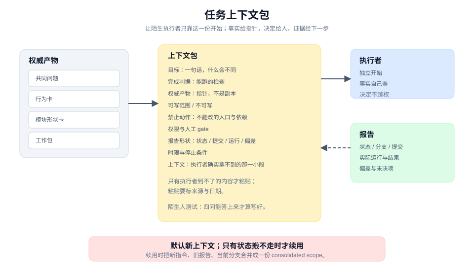
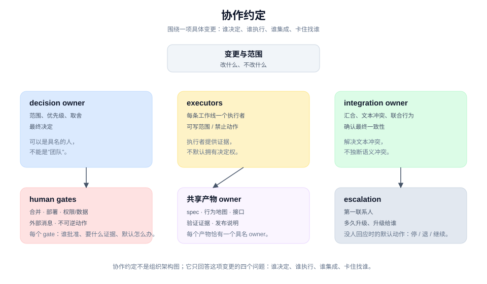
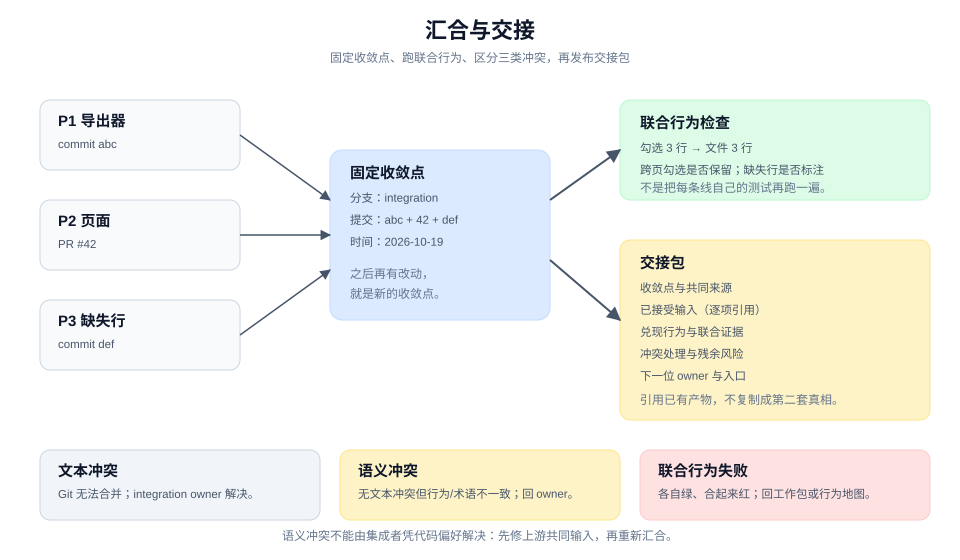

# 委派与协作：让执行者独立，让责任可见

> 本章 3 个实战单元 · [手册目录](./README.md) · [上一章：设计与计划](./design-and-plan.md)

## 这一章解决什么

委派失败通常不是执行者能力不够，而是输入不完整：目标含糊、边界不清、验证没给、责任没有落到人。协作失败通常不是沟通不够，而是"并行"掩盖了共享状态或未决决定。

这一章把"交出去"变成一份可独立执行的上下文（3.1），把"一起做"变成一组可追溯的责任（3.2），把"合回来"变成一次有证据的汇合与交接（3.3）。

| 单元 | 卡点 | 带走 |
|---|---|---|
| 3.1 | 执行者反复问，或者猜错方向 | 任务上下文包 |
| 3.2 | 谁决定、谁审核、谁合并不清楚 | 协作约定 |
| 3.3 | 各自完成，合起来行为不一致 | 汇合与交接包 |

三个单元共享一条原则：**事实给指针，决定给人，证据给下一步。**

---

## 3.1 为一个工作包准备最小上下文

### 工作情境

你把 [2.3](./design-and-plan.md) 的 P2 交给一个 agent。它开始工作，然后问：

- "勾选的边界是当前页还是跨页？"
- "没有勾选时应该怎样？"
- "测试要跑哪一条？"

你回答了三次，它继续。第二天换一个 agent，同样的问题再来一遍。你开始把上下文整段贴进 prompt，prompt 越来越长，执行者仍然会在某个角落猜错。

另一种失败是相反的：你把每一步都写死，执行者只是在替你打字；一旦环境变化，它不会自己判断。

一个好的任务上下文包，既能让陌生执行者独立开始，又保留它在该判断的地方判断。

### 带走什么

一份**任务上下文包（task context packet）**：

```text
目标：一句话，完成后什么会不同
完成判据：可运行的检查，或可观察结果
权威产物：共同问题、行为卡、模块形状、工作包（给指针）
可写范围：允许改哪些文件或目录
禁止动作：不能改的入口、不能加的依赖、不能做的重构
权限与人工 gate：哪些可自己做，哪些必须等人
报告形状：状态、分支/提交、实际运行、偏差、未决项
时限与停止条件：到点返回部分结果
上下文：执行者确实拿不到的那一小段（尽量用指针）
```

它不是一份完整的历史记录，而是**执行者开始工作所需的最小事实集合**。

### 做法

**第一步，从工作包出发，不要从聊天记录出发。** P2 的目标行为、可写范围、验收检查已经在 [2.3](./design-and-plan.md) 里。上下文包是把这些翻译成执行者能独立消费的形式。

**第二步，把目标写成一句可判断的话。** "改善导出体验"不是目标；"勾选 3 行后点击导出，下载文件恰好 3 行，列头与全量导出一致"是目标。

**第三步，给指针，不给副本。** 权威产物已经有位置，就写位置：

```text
共同问题：docs/changes/export-selection.md
行为卡：同文件 §3
模块形状：同文件 §4
```

只有执行者确实到不了的内容才粘贴：另一个系统里的对话、只有你知道的外部约束、无法访问的工单摘录。粘贴要标明来源和日期，避免变成第二套真相。

**第四步，写清可写范围与禁止动作。** 只写"改导出页"不够，执行者可能为了通过测试去改 exporter。把不可写范围写出来：

- 不改 `exporter/` 的接口；
- 不改全量导出入口；
- 不新增状态库依赖；
- 不重构共享组件。

禁止动作不是不信任，而是让越界可检查。

**第五步，给一条能跑的验收检查。** 不要写"确保正确"，写命令或场景：

```text
验收：
- 运行 pnpm test export-page，必须全绿。
- 手工或 E2E：勾选 3 行，下载文件 3 行，表头一致。
```

验收要能在执行者的环境里运行。如果依赖你本地的服务或数据，就把启动方式一并给出。

**第六步，写权限与人工 gate。** 明确：

- 哪些动作可以直接做（读代码、跑测试、开 draft PR）；
- 哪些必须等人（合并、部署、改共享配置、给客户发消息）；
- 卡住时找谁、多久算超时。

对 agent 尤其重要：它会把"没有禁止"理解成"可以做"。把不可逆动作单独列出来。

**第七步，规定报告形状。** 报告不是越长越好，而是固定字段：

```text
状态：完成 / 部分完成 / 阻塞
分支与提交：
实际运行了什么，结果如何
与 brief 的偏差
未决项与建议下一步
```

固定字段让不同执行者的报告可以并排比较，也防止"我改好了"这种无法验收的汇报。

**第八步，默认新上下文，只有状态搬不走时才续用。** 新 agent 带完整包开始，比让旧 agent 在长对话里回忆更可靠。只有新工作确实依赖它持有的状态（未提交改动、正在跑的服务、本地 checkout）时才续用，并把新指令显式重申。

最后做一次陌生人测试：找一个没参加讨论的人，只读上下文包，回答"要做什么、能改哪里、怎样算完成、卡住找谁"。四问有一问答不上来，包还没写好。

### 人机边界

| agent 可以做 | 人必须做 |
|---|---|
| 从工作包起草上下文包 | 确认目标、范围与优先级 |
| 检查指针是否可解析、验收是否可运行 | 决定权限与人工 gate |
| 找出缺失字段与隐含假设 | 决定禁止动作与风险容忍度 |
| 维护报告模板与状态 | 接受偏差与残余风险 |

agent 可以建议"这个动作应该可以直接做"，但权限由人给。不要把授权写成一句"自主完成"，那等于把所有判断都交出去。

### 质量门

- 执行者不需要看上一段聊天就能开始。
- 每个权威产物都有可解析的指针。
- 目标有一句可判断的完成判据。
- 可写范围与禁止动作都写清。
- 验收检查能在执行者环境里运行。
- 权限与人工 gate 明确；不可逆动作被单独列出。
- 报告字段固定，能支持验收。
- 有时限和停止条件。

### 图解



图里把"上下文包"放在中间：左边是权威产物，右边是执行者与报告。关键不是包有多长，而是执行者能否只靠它开始，以及报告能否被独立验收。

### 工具角色（可选）

issue 模板、任务卡、agent brief 都能承载上下文包。工具的价值是字段固定、指针可追踪；它不能替你决定范围和权限。

如果使用 agent，让它先填"事实与指针"，再由人补"权限与禁止动作"。不要让 agent 自己批准自己的权限。

### 进阶

包的大小要匹配任务：

- 一个命令能完成的任务，包可以缩成一段话，但仍要写目标、范围、验收、报告。
- 跨系统、跨团队的任务，包需要更多指针和 gate，而不是更多散文。

续用旧上下文时，把新指令、旧报告、当前分支合并成一份 consolidated scope，再交给执行者。不要依赖"它应该记得"。

---

## 3.2 为同一项变更安排人、agent 与会话

### 工作情境

一个变更同时有三条工作线：你在改导出器，一个 agent 在改页面，另一个 agent 在补测试。三份 brief 都写得很清楚，但仍然出问题：

- 两个 agent 改了同一个共享组件；
- 页面 agent 自己决定了"没有勾选时禁用按钮"，而产品 owner 的想法不同；
- 测试 agent 和实现 agent 对"完成"的理解不一致；
- 合并时没人知道该由谁拍板。

这不是 brief 的问题，而是缺少一份**协作约定**：谁对什么负责、谁能决定、谁负责合、卡住找谁。

### 带走什么

一份**协作约定（collaboration agreement）**：

```text
变更与范围：这次变更是什么，边界在哪
权威产物：spec、行为地图、工作包、验证证据
artifact owner：每个共享产物一个具名人
decision owner：谁对范围、优先级、取舍作最终决定
executors：谁执行哪条工作线
integration owner：谁负责汇合与最终一致性
write scopes：每条线可写 / 不可写的范围
permissions：哪些动作可直接做，哪些需要批准
human gates：不可逆、外部、高风险动作的停点
escalation：卡住找谁、多久、默认怎么办
completion：什么证据算完成
```

它围绕**一项具体变更**，不是组织架构图，也不是所有人的角色表。

### 做法

**第一步，先写变更与范围。** 协作约定不是从"谁是谁"开始，而是从"这次要改变什么、不改什么"开始。范围不清，角色分工只会把混乱分得更细。

**第二步，每个共享产物指定一个 artifact owner。** 共享产物包括 spec、行为地图、接口、验证证据、发布说明。owner 不必亲自编辑，但要对"哪一版可被依赖"负责。

没有 owner 的共享产物，会在并行工作中被改出多个版本，最后没人知道哪个是真的。

**第三步，把决定权、执行权、集成权分开。** 三个角色可以由同一个人兼任，但要显式写出来：

- **decision owner**：对范围、优先级、取舍作最终决定。
- **executor**：完成工作包，提供证据。
- **integration owner**：负责汇合、解决文本冲突、确认联合行为。

一个人可以同时是 decision owner 和 integration owner，但不能因为"他在执行"就默认他拥有决定权。

**第四步，写每条线的可写范围。** 范围要具体到目录、文件或模块。两条线不能同时写同一片区域；如果必须，就显式串行化，或指定一个写者。

共享可变状态先分开，再谈并行。这条规则在 [2.3](./design-and-plan.md) 和 [3.3](#33-让并行工作重新汇合并可交接) 都会再次出现，因为它是并行失败最常见的原因。

**第五步，列出 human gates。** 至少包括：

- 合并到主干；
- 部署或暴露给真实用户；
- 改权限、认证、计费、数据删除；
- 给客户或外部系统发消息；
- 任何不可逆操作。

每个 gate 写清：谁批准、需要什么证据、没有批准时默认怎么办。

**第六步，写升级路线。** 卡住时最怕的是"不知道找谁"。升级路线至少回答：

- 第一联系人是谁；
- 多久没有回应就升级；
- 升级给谁；
- 没人回应时的默认动作（停止、回退、继续）。

默认动作很重要。没有默认，工作会在等待中停摆；默认太激进，又可能越过 gate。

**第七步，写完成证据。** 每条线完成时留下什么：提交、测试结果、真实表面证据、未覆盖项。完成证据要能被 integration owner 独立复核，而不是只接受执行者的自述。

**第八步，参与者和范围变化时重写。** 协作约定不是一次性的。新增一条工作线、换一个执行者、范围扩大，都要更新约定；否则旧约定会变成一张过期的组织图。

### 人机边界

| agent 可以做 | 人必须做 |
|---|---|
| 起草协作约定、检查字段完整性 | 指定 artifact owner 与 decision owner |
| 维护可写范围与 gate 清单 | 批准权限与例外 |
| 检测共享写入与范围重叠 | 决定升级路线与默认动作 |
| 汇总完成证据 | 接受残余风险与最终责任 |

agent 不能成为 accountable owner。它可以执行、建议、提供证据，但"这一版可以被依赖"的责任必须由具名人承担。

### 质量门

- 每个共享产物恰有一个具名 owner。
- decision owner、executor、integration owner 被显式区分。
- 每条工作线有可写范围，重叠区域已经串行化或分给一个写者。
- human gates 列出批准人、证据和默认动作。
- 升级路线能回答"卡住了找谁、多久、默认怎么办"。
- 完成证据可被 integration owner 独立复核。
- 约定围绕这次变更，不是组织架构图。

### 图解



图里把"谁决定、谁执行、谁集成"分成三条通道，共享产物只通过 owner 更新。关键不是角色多，而是每条通道都有名字和边界。

### 工具角色（可选）

文档、issue、协作卡都能承载约定。工具的价值是让 owner、gate 和升级路线可见；它不能替人承担责任。

如果使用 agent，让它检查"是否有共享产物没有 owner""是否有两条线写同一片区域""是否有 gate 没有批准人"。这些是结构检查，不涉及价值判断。

### 进阶

协作约定可以借用 RACI 的思路，但不要照搬。对一项变更，最有用的是四个问题：

- 谁决定？
- 谁执行？
- 谁集成？
- 卡住找谁？

四个问题答清楚，比一张完整矩阵更实用。

小团队可以一人兼任多个角色，但要写出来。写出来的目的不是形式，而是让"默认由谁负责"变得可见；没有写出来的默认，通常在出事时才会被发现。

---

## 3.3 让并行工作重新汇合并可交接

### 工作情境

三条工作线都完成了：

- 导出器有了新接口和测试；
- 页面接上了勾选与下载；
- 测试补了缺失行场景。

每条线的测试都绿了，PR 也都过了评审。合并之后，你手动走了一遍：勾选 3 行，下载文件却有 4 行。再一看，页面传的是"当前页勾选"，导出器按"全部勾选"处理，两边各自都对，合起来不对。

这类失败不是文本冲突，Git 不会提示。它是**语义冲突**：两条线对同一个词、同一个状态或同一个责任的理解不同。

> 与 pstack 的边界：pstack 没有"语义冲突"分类。它的对应是 `orchestrate` 的单一 stacker 处理文本冲突、`separate-before-serializing-shared-state` 消除共享写入。把语义冲突单列出来并要求回上游 owner，是本手册的扩展。

汇合与交接包的作用，是让"合回来"成为一次有证据的联合验证，而不是把几个绿 PR 堆在一起。

### 带走什么

一份**汇合与交接包（convergence and handoff package）**：

```text
收敛点：分支、提交、时间
共同来源：spec、行为地图、接口、工作包
已接受输入：每条工作线的提交/PR/产物，逐项引用
兑现行为：这次汇合实际兑现了哪些行为
联合验证：在收敛点上跑过的真实路径与结果
冲突处理：文本冲突、语义冲突、联合行为失败，各自怎么处理
残余风险：未覆盖、未验证、已知限制
下一位 owner 与入口：从哪里开始，先读什么
```

它引用已有产物，不复制 spec、决定或 diff 作为第二套真相。

### 做法

**第一步，固定收敛点。** 写清分支、提交和时间。所有验证都在这个点上做；之后再有改动，就是新的收敛点，需要重新验证。

**第二步，逐项列出已接受的输入。** 每条工作线贡献了什么：提交、PR、产物、决定。不要写"几条线都合了"，要写"P1 的 commit abc、P2 的 PR #42、P3 的 commit def"。

**第三步，跑联合行为检查。** 不是把每条线自己的测试再跑一遍，而是选几条跨线的行为，在收敛点上走真实路径：

- 勾选 3 行，下载文件 3 行；
- 跨页勾选，选择是否保留；
- 删除 1 行，缺失是否标注；
- 无权限用户，页面是否拒绝。

每条检查记录：命令或操作、输入、结果、覆盖边界。

**第四步，区分三类冲突。** 汇合时可能遇到：

| 类型 | 表现 | 处理 |
|---|---|---|
| **文本冲突** | Git 无法自动合并 | integration owner 解决，保留双方意图 |
| **语义冲突** | 没有文本冲突，但行为/术语/权限不一致 | 回到对应 artifact 或 decision owner，更新共同输入后再合 |
| **联合行为失败** | 各自绿，合起来红 | 定位是哪条线的假设不成立，回到工作包或行为地图 |

语义冲突不能由集成者凭代码偏好解决。它通常意味着上游的共同问题、词卡或接口需要更新；先修上游，再重新汇合。

**第五步，更新权威产物。** 汇合后，spec、行为地图、接口、验证证据可能都变了。把实际兑现的行为、未覆盖项和残余风险写回权威位置，而不是只留在 PR 描述里。

**第六步，发布交接包。** 交接包是索引，不是副本：

- 当前状态：哪些行为已兑现、哪些没有；
- 关键决定：这次汇合确认或改变了什么；
- 证据：测试、真实路径、复现步骤的指针；
- 未决项：谁负责、什么时候；
- 下一位入口：先读什么、从哪里开始。

**第七步，让下一位从交接包开始。** 如果下一位仍然要问"现在是什么状态"，交接包就没写好。它应该能让一个没参加这轮工作的人，在十分钟内知道从哪里接。

### 人机边界

| agent 可以做 | 人必须做 |
|---|---|
| 汇总输入、生成交接包草稿 | 确认哪些行为算兑现 |
| 跑联合行为检查、记录证据 | 解决语义冲突与优先级 |
| 检测文本冲突与明显的行为不一致 | 决定是否接受残余风险 |
| 维护收敛点与未决项 | 指定下一位 owner 与入口 |

integration owner 可以解决文本冲突，但不能替 decision owner 决定语义。一个常见的越权是：集成者为了让合并通过，悄悄改了行为或放宽了验收。

### 质量门

- 收敛点固定，所有验证都在同一点上。
- 每条输入都有引用，不是"都合了"。
- 至少跑过一条跨线联合行为，并记录覆盖边界。
- 三类冲突被区分；语义冲突有对应 owner，不由集成者独断。
- 权威产物已更新，实际兑现与未覆盖都写回。
- 交接包引用而不复制；下一位能只读它开始。
- 残余风险有 owner 和下一步。

### 图解



图里把多条工作线收束到一个收敛点，再分叉到"联合验证"和"交接包"。关键不是合并动作，而是收敛点上的联合行为证据。

### 工具角色（可选）

集成分支、PR、交接文档都能承载这个过程。工具的价值是固定收敛点、保留引用；它不能替人判断语义冲突。

如果使用 agent，让它汇总输入、跑联合检查、生成交接包草稿。语义冲突和"是否接受残余风险"必须由人决定。

### 进阶

汇合不是一次性的。长任务会反复汇合：每合入一条线，收敛点就变了。每次都要重新确认联合行为，而不是相信上一次的绿。

交接包也不是越长越好。它应该短到能被读完，具体到能让人开始；细节通过指针指向已有产物。

当工作跨会话、跨 harness 或跨团队时，交接包比聊天记录可靠，因为它有固定入口和可解析的证据。聊天记录只能作为补充。

---

## 三个单元怎样接起来

```text
3.1 任务上下文包：让一个执行者独立开始
   → 3.2 协作约定：让多个执行者不互相踩，责任可见
   → 3.3 汇合与交接：让并行结果重新成为一个可继续的状态
   → 第 4 章：验证
```

三者的共同点是**把隐含状态外化**：上下文包外化输入，协作约定外化责任，交接包外化当前状态。

## 常见失败

| 失败 | 表现 | 修正 |
|---|---|---|
| 上下文包变成聊天记录 | 越写越长，执行者仍要问 | 回到指针与固定字段 |
| 权限没写 | agent 做了不可逆动作 | 补 human gates 与禁止动作 |
| 共享产物无 owner | 多个版本，没人知道哪个算数 | 每个产物指定一个 owner |
| 决定权默认归执行者 | 执行者顺手改了范围 | 显式区分 decision / execution / integration |
| 伪并行 | 两条线写同一片区域 | 先分开，或指定一个写者 |
| 只做文本合并 | 各自绿，合起来行为不对 | 跑联合行为检查，处理语义冲突 |
| 交接包复制一切 | 出现第二套真相 | 只放索引与指针 |

## 继续阅读

- [验证：证明兑现的是承诺](./verify.md)
- [教程 07：委派出去，保持控制](../tutorial/07-delegate-and-keep-control.md)
- [教程 08：证明兑现的是原承诺](../tutorial/08-prove-the-promise.md)
- [术语表：任务上下文包、协作约定、交接包](../CONTEXT.md)
