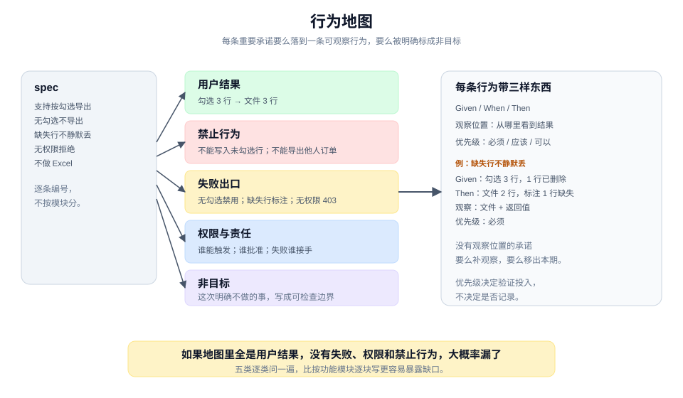
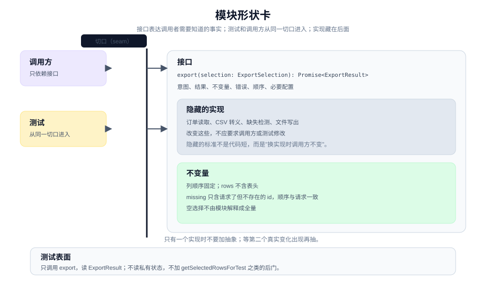
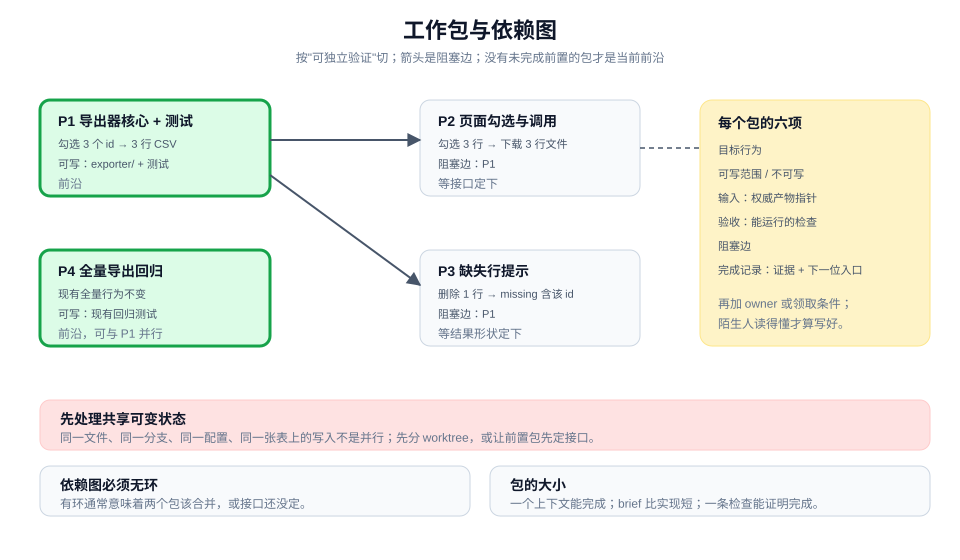

# 设计与计划：让工作可兑现、可委派

> 本章 3 个实战单元 · [手册目录](./README.md) · [上一章：定义](./define.md)

## 这一章解决什么

定义回答了"要什么"，这一章回答"怎样把它变成可以独立完成、可以验证、可以交接的工作"。

核心不是画一张架构图，而是三件事：

1. 把 spec 里的承诺变成一组**可观察行为**；
2. 把这些行为放进一个**可测试的模块形状**；
3. 把形状切成有阻塞边、有验收条件的**工作包**。

三个单元对应三种典型卡点：

| 单元 | 卡点 | 带走 |
|---|---|---|
| 2.1 | 承诺很多，但没人能说清哪条算兑现 | 行为地图 |
| 2.2 | 能写，但测试必须看内部状态 | 模块形状卡 |
| 2.3 | 工作太大，无法交给一个人或一个上下文 | 工作包与依赖图 |

产物之间的关系：

```text
spec（1.4）
  → 行为地图（2.1）
  → 模块形状卡（2.2）
  → 工作包与依赖图（2.3）
  → 构建与验证（第 3、4 章）
```

---

## 2.1 先把承诺变成可观察的行为

### 工作情境

spec 里写着：

> 支持按勾选导出的订单。

这句话人人同意，但实现、测试和评审会各自解释：

- 实现可能只做了"勾选后传 id"；
- 测试可能只断言"调用了导出接口"；
- 评审可能只检查"代码看起来对"；
- 没有人覆盖"没有勾选""行被删除""无权限"。

单条行为卡能解决一条承诺；当承诺有十几条时，你需要一张**行为地图**：把承诺按结果、失败、权限、人工接手和非目标组织起来，并给每条标出观察位置。

### 带走什么

一张**行为地图（behavior map）**：

```text
承诺来源：spec 版本 / 工作卡
行为分类：
- 用户结果：用户能看到或得到什么
- 禁止行为：系统绝不能做什么
- 失败出口：出错时看到什么、留下什么
- 权限与责任：谁能触发、谁批准、谁接手
- 非目标：这次明确不做
每条行为：Given / When / Then + 观察位置 + 优先级
```

它不是测试清单，也不是验收标准的堆叠。它是一张**承诺到观察的映射**：每条重要承诺要么落到一条行为，要么被明确标成非目标。

### 做法

**第一步，从 spec 提取承诺，逐条编号。** 不要按功能模块分，先按"用户结果、禁止、失败、权限、非目标"五类分。分类会暴露缺口：如果一张地图里全是用户结果，没有失败和权限，大概率漏了。

**第二步，每条承诺写一张行为卡。** 行为卡的四段是：

- **Given**：前置条件，具体到数据量和状态。
- **When**：触发动作。
- **Then**：可观察结果。
- **观察位置**：从哪里看到这个结果。

以导出功能为例：

| 承诺 | Given | When | Then | 观察位置 |
|---|---|---|---|---|
| 只导出勾选行 | 12 行订单，勾选 3 行 | 点击导出 | 文件 3 行数据 | 下载文件 |
| 无勾选不导出 | 0 行勾选 | 点击导出 | 按钮禁用，提示 | 页面状态 |
| 缺失行不静默丢 | 勾选 3 行，其中 1 行已删除 | 点击导出 | 文件 2 行，结果标注 1 行缺失 | 文件 + 返回值 |
| 无权限拒绝 | 无导出权限的用户 | 点击导出 | 403，页面提示无权限 | 接口响应 + 页面 |

**第三步，补齐五类缺口。** 逐类问：

- **禁止行为**：有没有"绝不能发生"的事？例如：不能把未勾选的行写进文件；不能把其他人的订单导出；不能在无权限时生成文件。
- **失败出口**：网络失败、数据缺失、超时、部分成功，各看到什么？
- **权限与责任**：谁能触发？谁批准高风险操作？失败时谁接手？
- **非目标**：这次明确不做什么？写成可检查的边界。
- **不可观察的承诺**：有没有"更快""更稳""更好用"这类无法直接观察的承诺？要么补一个观察位置，要么移出本期。

**第四步，排优先级。** 不是所有行为同等重要。按风险排：

- **必须**：涉及权限、数据正确性、资金、不可逆操作。
- **应该**：主要用户路径、常见失败。
- **可以**：体验优化、罕见边界。

优先级决定验证投入，不决定是否记录。低优先级行为也要在地图上，否则会被悄悄扩大解释。

**第五步，检查冲突与重叠。** 两条行为是否在同一触发下给出不同结果？是否有一条行为的失败出口与另一条的用户结果矛盾？例如"无权限时返回空文件"与"不能生成文件"就冲突。

**第六步，让实现者和验证者各读一遍。** 实现者确认每条行为可实现；验证者确认每条行为可观察。任何一方说不清，说明行为还需要拆或补观察位置。

### 人机边界

| agent 可以做 | 人必须做 |
|---|---|
| 从 spec 提取候选承诺，起草行为卡 | 确认用户结果与业务规则 |
| 检查每条行为是否有观察位置 | 决定优先级与可接受风险 |
| 找出冲突、遗漏、不可观察的承诺 | 决定哪些承诺移出本期 |
| 把行为地图整理成可引用结构 | 确认权限、责任与人工接手点 |

agent 不能发明用户结果。它可以根据 spec 和代码推断"应该是这样"，但推断必须标成候选，由人确认。

### 质量门

- spec 里每条重要承诺，要么落到至少一条行为，要么被明确标成非目标。
- 每条行为有观察位置；没有观察位置的，不是行为。
- 失败出口具体到"用户看到什么、系统留下什么、下一步是什么"。
- 权限与人工接手点有具名 owner。
- 禁止行为写成可检查的条件，不是"要注意安全"。
- 实现者和验证者都能只读地图说出"怎样算兑现"。

### 图解



图里把 spec 放在左边，五类行为放在中间，观察位置与优先级放在右边。关键不是分类本身，而是每条承诺都能沿着图找到自己的观察位置。

### 工具角色（可选）

文档或表格都能承载行为地图。表格的优势是能筛选"没有观察位置"或"没有 owner"的行。

如果使用 agent，让它先产出候选行为清单并标出缺口，再由人确认。不要让它同时决定行为和验收，否则它会用实现反推行为。

### 进阶

行为地图不必一次写全。先覆盖"必须"和"应该"两档，等实现推进再补罕见边界。

但有一类行为不能拖：**权限、数据正确性、不可逆操作**。它们一旦漏掉，后补的成本远高于提前写一行。

行为地图也不是测试计划。它描述"什么算兑现"，测试只是获取证据的一种方式；有些行为需要真实表面、人工确认或运行信号才能验证。

---

## 2.2 设计可实现、可测试的模块形状

### 工作情境

行为地图已经清楚，但代码还没开始。你面临几个形状选择：

- 把导出逻辑写进页面组件，测试只能通过点击按钮跑；
- 抽一个 `ExportService`，但接口里全是内部步骤；
- 为了测试加一个 `getSelectedRowsForTest()`；
- 引入 repository、factory、adapter，但只有一个实现。

这些选择不会立刻报错，它们会在三个月后变成"改一处、牵五处"和"测试很慢、没人愿意跑"。

模块形状卡的作用，是在写实现之前，把接口、切口、隐藏的实现和不变量固定下来。

### 带走什么

一张**模块形状卡（module shape card）**：

```text
模块：<按它负责的一组共同变化的行为命名>
接口：<调用者需要知道的意图、结果、不变量、错误、顺序、配置>
切口：<调用者和测试共同观察的公共位置>
隐藏：<实现细节，改变时不应影响调用者>
不变量：<永远成立的条件>
测试表面：<测试从哪里进入，能观察什么>
非目标：<这次不做的抽象与扩展>
```

它描述的是模块的外部形状，不是文件结构，也不是实现步骤。

### 做法

**第一步，按"共同变化的行为"找模块边界。** 不要按框架、文件夹或数据库表命名。问：哪些行为总是一起变化？哪些行为有独立的生命周期？

导出功能里，"把选中的订单转成 CSV 并返回文件"是一组共同变化的行为；"页面怎样显示按钮"是另一组。它们可以是两个模块。

**第二步，用调用者的语言写接口。** 接口不是内部步骤的列表，而是调用者正确使用模块必须知道的全部事实：

- 可表达的业务意图；
- 可观察结果；
- 不变量；
- 失败方式；
- 顺序约束；
- 必要配置。

反例：

```ts
interface OrderExporter {
  loadOrders(ids: string[]): Promise<Order[]>;
  filterSelected(orders: Order[], ids: string[]): Order[];
  writeCsv(rows: Order[]): string;
  zip(content: string): Blob;
}
```

这是实现的四个步骤，不是接口。调用者被迫知道内部流程，任何一步改变都会破坏调用方。

正例：

```ts
type ExportSelection = { orderIds: string[]; format: "csv" };
type ExportResult = { file: Blob; rows: number; missing: string[] };

interface OrderExporter {
  export(selection: ExportSelection): Promise<ExportResult>;
}
```

调用者只需要知道"给一批 id，拿一个文件、行数和缺失列表"。

**第三步，选一个切口。** 切口是调用者和测试共同跨越、观察外部行为的位置。对上面的接口，切口就是 `export`。

判断切口是否合适：

- 测试只调用 `export`，读 `ExportResult`：成立。
- 测试必须读组件内部状态：切口太深，或者状态放错了地方。
- 测试要访问数据库旁路确认写入：结果没有被接口表达出来。

**第四步，列出被隐藏的实现。** 隐藏什么，决定了模块有多深：

- 订单从哪里读；
- CSV 怎样转义、用什么换行；
- 缺失行怎样检测；
- 文件在内存里生成还是流式写出。

隐藏的标准不是"代码短"，而是**改变实现时，调用者和测试不需要改**。

**第五步，写下不变量。** 不变量与具体输入无关，是模块永远保证的事：

- 输出列顺序固定；
- `rows` 不包含表头；
- `missing` 只包含请求了但不存在的 id，顺序与请求一致；
- 空选择不由模块解释成全量。

不变量是测试的锚点，也是评审时判断"这个改动是否破坏契约"的依据。

**第六步，画 `not implemented` 草图。** 先写类型、签名和伪代码，不写逻辑：

```ts
class CsvOrderExporter implements OrderExporter {
  async export(selection: ExportSelection): Promise<ExportResult> {
    // 1. 读取存在的订单
    // 2. 记录缺失的 id
    // 3. 按固定列顺序写 CSV
    // 4. 返回 file / rows / missing
    throw new Error("not implemented");
  }
}
```

此时改接口很便宜。等实现和测试都写完再改，成本会落在所有调用方。

**第七步，用行为地图走一遍测试路径。** 至少拿三条行为走：

- 正常勾选导出；
- 无勾选；
- 缺失行。

如果某条行为无法从公共切口观察，先改形状，不要加测试专用接口。测试专用接口会让测试依赖内部状态，也会诱使实现为了测试而变形。

**第八步，检查是否过度抽象。** 只有一个实现时，不要加 repository、factory、adapter。等第二个真实变化出现再抽。判断标准是"现在是否有两种真实的变化需要"，不是"以后可能"。

### 人机边界

| agent 可以做 | 人必须做 |
|---|---|
| 根据行为地图提出 2-3 个形状候选 | 决定公共接口与不可逆契约 |
| 画类型草图、写 `not implemented` 骨架 | 判断抽象是否值得 |
| 用行为走查测试路径 | 确认切口与所有权 |
| 指出泄漏、过浅的 wrapper、测试专用接口 | 接受或拒绝形状 |

形状有争议时，让 agent 给出多个候选并说明取舍，不要让它直接选一个然后实现。争议本身是信息：它说明接口可能有多种合理解释。

### 质量门

- 测试只通过公共切口，不读私有状态。
- 接口表达调用者需要知道的全部事实，而不是内部步骤。
- 有明确的切口和测试表面。
- 不变量写成可检查的条件。
- 错误方式明确：什么情况下抛错、返回什么。
- 没有测试专用接口，没有单调用 wrapper，没有"以后可能"的抽象。
- 换一个实现（例如换 CSV 库）时，调用方和测试不需要改。

### 图解



图里把接口和实现分开，测试与调用方从同一切口进入。关键不是"层数"，而是测试和调用方看到的是不是同一组事实。

### 工具角色（可选）

类型草图、伪代码、一次性原型都能验证形状。原型尤其适合验证"测试能不能从切口走通"，但原型用完就丢，不要把原型代码直接变成产品。

agent 很适合生成多个形状候选。要求它每个候选写清"接口、隐藏、测试路径、取舍"，再由人选。

### 进阶

深模块的判断标准是**杠杆**：小接口隐藏较多相关行为与实现复杂度。不是代码行数多，也不是层数多。

一个模块是否该拆，问三个问题：

- 它是否有独立的生命周期？
- 它是否有一组共同变化的行为？
- 它的调用者是否需要知道不同的东西？

三个都是"是"，拆；有一个"否"，先不要拆。

---

## 2.3 拆成可以推进、可以交接的小工作

### 工作情境

形状定了，工作还是一整块："把勾选导出做完"。

直接交给一个 agent，它会自己决定顺序；顺序不一定错，但你没有同意过。想并行，又不知道哪些能同时做；想交接，又说不清一个包到哪里算完成。

工作包的作用，是把"一整块"变成一组**可独立验证、有阻塞边、可交接**的单元。

### 带走什么

一张**工作包列表**，加一张**依赖图（DAG）**：

```text
包 ID：
目标行为：兑现哪条行为卡
可写范围：允许改哪些文件或目录
输入：需要先读的权威产物与代码位置
验收检查：一条能运行的命令或可观察结果
阻塞边：必须先完成哪个包
完成记录：留下什么证据，下一位从哪里开始
owner / 领取条件：
```

依赖图是这些包与阻塞边的有向无环图。当前**前沿（frontier）**是没有未完成前置的包。

### 做法

**第一步，按"可独立验证"切，不按文件或层切。** 一个包完成后，应该能演示或验证一条行为。反例："改 exporter 模块""写测试""前端部分"。正例："导出器接受 3 个 id，返回 3 行 CSV，并有测试证明"。

**第二步，给每个包写六件事。** 目标行为、可写范围、输入、验收检查、阻塞边、完成记录。

六件事里最容易漏的是"可写范围"和"阻塞边"：

- 没有范围，并行工作会互相覆盖；
- 没有阻塞边，顺序会靠猜。

**第三步，画依赖图，找前沿。** 把包画成节点，依赖画成箭头。先做前沿，能让后续工作尽快解锁。

```text
P1 导出器核心 + 测试
   ├── P2 页面勾选与调用
   └── P3 缺失行提示

P4 全量导出回归检查（独立，可与 P1 并行）
```

当前前沿是 P1 和 P4；P2、P3 等 P1。

**第四步，检查环。** 依赖图里不能有环。有环说明两个包互相需要对方的产物，通常意味着它们应该合成一个包，或者接口还没定。

**第五步，先处理共享可变状态。** 两个包如果会写同一个文件、同一个分支、同一个配置项或同一张表，它们就不是真并行。先分开，再谈并行：

- 不同包用不同文件或不同 worktree；
- 共享类型或接口由前置包先定；
- 需要同一份迁移脚本时，把迁移单独成前置包。

不要用锁掩盖共享写入。锁会让并行退化成串行，还会引入新的失败模式。

**第六步，控制包的大小。** 一个好的包通常满足：

- 一个上下文能完成；
- 一天到几天，而不是几周；
- 一条验收检查能证明完成；
- brief 比实现短。

如果 brief 写得比实现还长，包可能太大，或者验收条件还没想清。

**第七步，指定 owner 或领取条件。** 每个包要么有具名 owner，要么有明确的领取条件（谁能领、需要什么权限）。没有 owner 的包，会在并行工作时变成无人区。

**第八步，做陌生人测试。** 让一个没参加讨论的人只读包描述，回答问题：

- 这个包要兑现什么行为？
- 允许改哪里？
- 怎样算完成？
- 它等谁？

四个问题有一个答不上来，包还没写好。

### 人机边界

| agent 可以做 | 人必须做 |
|---|---|
| 根据行为地图提出切分方案 | 决定优先级与交付顺序 |
| 检测共享可变状态与依赖环 | 决定并行度与资源 |
| 起草每个包的六项字段 | 指定 owner 与领取条件 |
| 维护依赖图与完成记录 | 接受范围与风险 |

agent 可以建议"这两个包可以并行"，但"是否真的并行"取决于团队、环境和共享资源，最终由人决定。

### 质量门

- 每个包本身可演示或可验证，不是"改完某个文件"。
- 每个包有可写范围，且有明确的不可写边界。
- 每个包有验收检查，能独立运行或观察。
- 依赖图无环；当前前沿明确。
- 共享可变状态已经分开，或者被显式串行化。
- 每个包有 owner 或领取条件。
- 一个陌生人能只读包描述开始工作，不需要问上一段聊天。

### 图解



图里把工作包画成节点，阻塞边画成箭头，前沿用高亮标出。关键不是图画得漂亮，而是每个节点都能独立验收，且共享写入被提前处理。

### 工具角色（可选）

issue tracker、项目板或一张表都能承载工作包。工具的价值是依赖关系可见、状态可追踪；它不能替你决定切分和优先级。

如果使用 agent，让它维护依赖图和完成记录，并检查"是否有环""是否有共享写入""是否每个包都有验收"。不要让它自动把包派给自己不认识的执行者。

### 进阶

切分的粒度不是越细越好。包太小会产生大量交接成本；包太大则无法独立验证。判断标准是"能否独立验证"和"brief 是否比实现短"。

并行也不是越多越好。真正的并行需要：

- 独立的可写范围；
- 独立的验收；
- 不共享可变状态；
- 有足够的评审与集成能力。

没有这些条件，串行反而更快。

---

## 三个单元怎样接起来

```text
2.1 行为地图：什么算兑现
   → 2.2 模块形状卡：测试从哪里进入，实现隐藏什么
   → 2.3 工作包：谁来做、按什么顺序、怎样算完成
   → 第 3 章：委派与协作
   → 第 4 章：验证
```

行为地图是验收的来源，模块形状卡是测试的切口，工作包是委派与并行的单位。三者不一致时，先回到上游修，不要在下游打补丁。

## 常见失败

| 失败 | 表现 | 修正 |
|---|---|---|
| 行为不可观察 | 测试只能断言"调用了方法" | 回到 2.1，补观察位置 |
| 接口泄漏实现 | 调用者被迫按内部步骤调用 | 回到 2.2，用调用者语言重写接口 |
| 测试专用接口 | 为了测试暴露私有状态 | 改切口，不要加后门 |
| 过度抽象 | 只有一个实现却加了多层 | 等第二个真实变化出现 |
| 包按层切 | 每个包完成后都不能演示 | 回到 2.3，按可独立验证切 |
| 伪并行 | 两个包写同一文件 | 先分开，或显式串行化 |

## 继续阅读

- [委派与协作：让执行者独立，让责任可见](./delegate-and-collaborate.md)
- [教程 03：让一个承诺变成可观察行为](../tutorial/03-make-a-promise-observable.md)
- [教程 04：设计一个可测试的形状](../tutorial/04-design-a-testable-shape.md)
- [教程 05：把工作切成可委派的单元](../tutorial/05-cut-work-into-delegable-units.md)
- [术语表：行为地图、模块形状卡、工作包、前沿](../CONTEXT.md)
