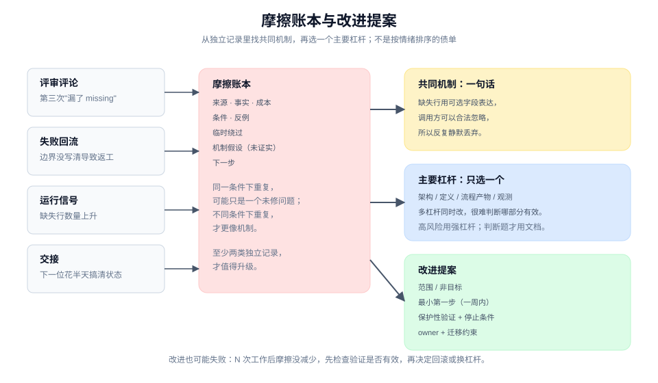
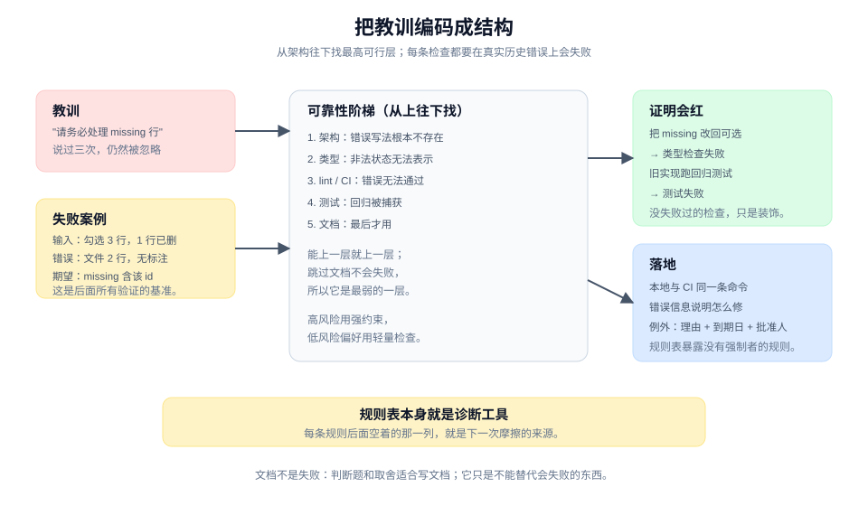
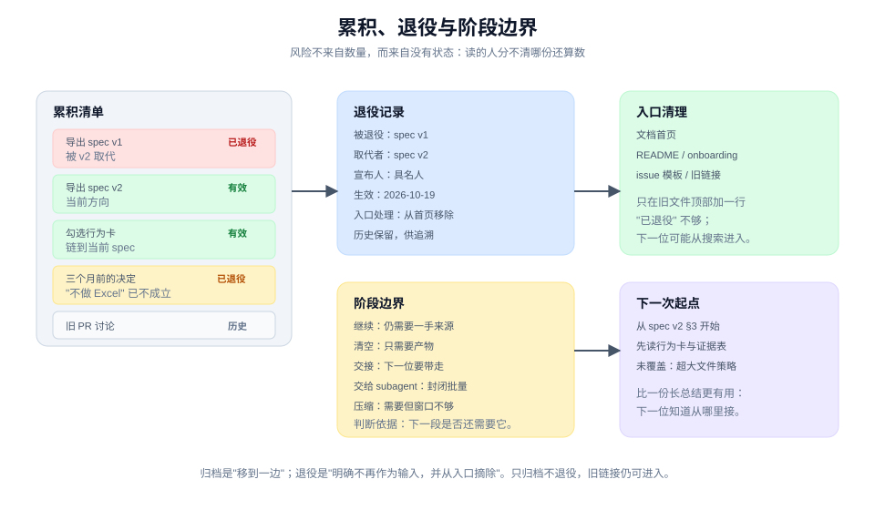

# 让环境变好：把摩擦变成下一轮的优势

> 本章 3 个实战单元 · [手册目录](./README.md) · [上一章：交付、运行与演进](./ship-run-and-evolve.md)

## 这一章解决什么

同一个纠正反复出现，说明当前的做法缺一条结构性约束；spec 和决定越积越多、方向开始漂移，说明缺少退役与阶段边界。

这一章把"下次注意"换成仓库里的检查，把"历史包袱"换成有状态的记录：

| 单元 | 卡点 | 带走 |
|---|---|---|
| 6.1 | 同一类摩擦反复出现，但每次只修当前实例 | 摩擦证据账本 + 改进提案 |
| 6.2 | 同一条指令写了第二次，仍然被忽略 | 一条会失败的结构约束 |
| 6.3 | 旧 spec 越积越多，没人知道哪份还算数 | 退役记录 + 阶段边界计划 |

三个单元共同回答一个问题：**下一次运行，凭什么会比这一次更好？**

---

## 6.1 把反复摩擦变成有证据的改进

### 工作情境

一轮工作结束，你发现三件事：

- 评审里第三次出现"忘记处理 missing 行"；
- 一个失败回流最后发现是需求边界没写清；
- 交接时下一位花了半天才搞清当前状态。

团队的反应通常是：

- 在群里说"下次注意"；
- 在文档里加一段"请务必检查 missing"；
- 或者反过来，直接上一个"大重构"，但没有证据说明它能解决哪一类摩擦。

前者没有留下任何会失败的东西；后者可能解决了别的问题，也可能只是把摩擦换了个形状。

摩擦账本的作用，是先把"反复发生什么、成本多少、共同条件是什么"记录下来，再决定改哪里。

### 带走什么

一张**摩擦证据账本（friction evidence ledger）**：

```text
来源：评审 / 失败回流 / 运行信号 / 交接 / 交付
事实：发生了什么
成本：返工时间、延迟、事故、沟通轮次
条件：在什么情况下发生
反例：哪些相似情况没有发生
临时绕过：这次怎么绕过的
假设：共同机制可能是什么（标明未证实）
下一步：观察 / 结构化 / 写进 skill / 退役
```

以及一份**改进提案（friction improvement proposal）**：

```text
共同机制：一句话
实际成本：证据支持的成本
主要杠杆：架构 / 定义 / 流程产物 / 观测
范围：改哪里，不改哪里
非目标：这次不解决什么
最小第一步：一周内能做完的动作
owner：
迁移约束：现有工作怎么继续
保护性验证：什么证明改进有效
停止条件：什么情况下放弃或回滚
```

### 做法

**第一步，收集独立记录。** 摩擦不能靠印象。至少找两类独立来源：评审评论、失败回流、运行信号或交接记录。同一件事在不同来源里重复出现，才值得升级。

**第二步，按共同条件关联，不按表面相似关联。** 两次"忘记 missing"可能都是同一类问题：结果形状没有强制表达缺失。也可能一次是需求没写，一次是测试没覆盖。表面相似不等于共同机制。

记录反例：哪些看起来相似的情况没有发生？反例会防止过度概括。

**第三步，量化成本。** 成本可以是返工小时、延迟天数、事故影响、沟通轮次。没有成本，改进就没有优先级；只有情绪，改进就会变成"谁声音大谁赢"。

**第四步，写共同机制。** 一句话，能解释多次事件：

> 导出结果用可选字段表达缺失，调用方可以合法地忽略它，所以缺失行反复被静默丢弃。

如果写不出一句能解释多次事件的话，说明还没有找到机制，先继续观察。

**第五步，选主要杠杆。** 四类杠杆：

| 杠杆 | 适合 | 例子 |
|---|---|---|
| **架构** | 错误写法可以根本不存在 | 把状态收敛到一个 owner |
| **定义** | 边界、验收或术语不清 | 补一条词卡或行为卡 |
| **流程产物** | 交接、评审或工作包缺字段 | 加一个必填字段或检查表 |
| **观测** | 问题发生但看不见 | 加一个信号或日志 |

选一个主要杠杆，不要同时改四样。多杠杆的改进很难判断哪一部分有效。

这四类是**改进的切入点**，不是可靠性排序。选定切入点后，落地仍按 6.2 的阶梯：架构 → 类型/lint → 测试 → 文档；流程产物属于最后一档，不要因为它容易改就把它当成强约束。

**第六步，写范围与非目标。** 改进最容易失控的地方是"顺手一起改"。写清这次改哪里、不改哪里；非目标要能挡住至少一种扩大解释。

**第七步，定义最小第一步与保护性验证。** 最小第一步应该是一周内能完成的动作，例如：

- 给 `ExportResult.missing` 加必填约束；
- 在评审模板里加一行"缺失行如何处理"；
- 加一个信号，观察缺失行数量。

保护性验证是"怎么知道它有效"：同类摩擦在接下来 N 次工作中是否减少，或者新检查是否在历史错误上会失败。

**第八步，指定 owner 与停止条件。** owner 对改进负责；停止条件说明什么时候放弃或回滚。没有停止条件的改进，会变成永久的技术债。

### 人机边界

| agent 可以做 | 人必须做 |
|---|---|
| 汇总评审、失败、信号、交接记录 | 判断哪些摩擦值得投入 |
| 聚类、找共同条件、提出机制假设 | 确认机制与优先级 |
| 起草改进提案与最小第一步 | 决定范围、非目标与资源 |
| 实现检查、收集验证数据 | 接受成本与残余摩擦 |

agent 可以指出"这三件事可能是同一个机制"，但不能替人决定"这个摩擦是否值得现在解决"。优先级是人的判断。

### 质量门

- 摩擦来自至少两类独立记录。
- 有成本，不只是感受。
- 有共同机制的一句话解释，且有反例。
- 主要杠杆只有一个，范围与非目标清楚。
- 最小第一步可在一周内完成。
- 有保护性验证与停止条件。
- 有 owner。

### 图解



图里把评审、失败、信号、交接的记录汇到账本，再经过"共同机制"筛成一份提案。关键不是记录多少，而是能否从多次事件里提炼出一个可改的机制。

### 工具角色（可选）

评审记录、事故记录、交接包、复盘文档都能作为摩擦来源。工具的价值是保留独立证据；它不能替你判断哪些事件属于同一类。

如果使用 agent，让它做聚类和草案，不要让它直接开一个"大重构"。提案要由人确认优先级和范围。

### 进阶

摩擦分两类：

- **局部摩擦**：某个人、某个会话的偶发问题。记录即可，不必升级。
- **系统性摩擦**：在多个工作线、多个执行者身上重复出现。值得结构化。

判断标准不是"发生了两次"，而是"是否在不同的条件下重复出现"。同一条件下的两次，可能只是同一个未修的问题；不同条件下的重复，才更像机制。

改进也可能失败。如果 N 次工作后摩擦没有减少，先检查保护性验证是否有效，再决定回滚或换杠杆。不要因为"已经投入了"就继续加码。

---

## 6.2 把教训编码成结构

### 工作情境

你已经在评审里说过三次："导出结果要标注缺失行。"

第三次之后，你把它写进了文档："请务必处理 missing 行。"下一次，另一个 agent 仍然漏了。

这不是执行者不认真，而是**文档是最弱的一层约束**：跳过它没有任何东西会失败。要让它不再发生，需要把教训编码成结构。

### 带走什么

一条**结构化约束（structural constraint）**：在可靠性阶梯上尽可能高的一层，让同类错误无法通过、无法编译或至少无法合入。

可靠性阶梯，从强到弱：

```text
1. 架构：让错误写法根本不存在
2. 类型：让非法状态无法表示
3. lint / CI：让错误无法通过，错误信息说明怎么修
4. 测试：让回归被捕获
5. 文档 / 规范：最后才用，因为跳过它没有任何东西会失败
```

### 做法

**第一步，把教训写成一个失败案例。** 不要写"要注意 missing"，写：

```text
输入：勾选 3 行，其中 1 行已删除。
错误输出：文件 2 行，没有标注缺失。
期望：文件 2 行，结果包含 missing: ["id-2"]。
```

这个案例是后面所有验证的基准。

**第二步，找最高可行层。** 从架构开始问，逐层下降：

- **架构**：能不能让"没有 missing 的结果"根本无法构造？例如把结果形状改成必须显式给出 `missing`，或者把导出结果与缺失检查合并成一个操作。
- **类型**：能不能让 `missing` 成为必填字段，而不是可选？能不能用判别式联合表示"完整结果"与"部分结果"？
- **lint / CI**：如果类型表达不了，能不能加一条检查，让构造结果时漏掉 `missing` 直接报错？错误信息要说明该用什么 API。
- **测试**：加一条回归测试，用上面的失败案例，确保旧代码会红。
- **文档**：只有前面都不可行时，才写文档，并附一个失败例子。

**第三步，证明它会失败。** 每条新检查都要在一个真实历史错误上运行，确认它会红。没有失败过的检查，只是装饰。

对类型检查：把字段改回可选，确认编译失败；对 lint：用旧写法，确认报错；对测试：在旧实现上运行，确认失败。

**第四步，让错误信息可行动。** 一条只说"invalid"的检查，会让人去搜文档。好的错误信息直接说怎么修：

```text
error: ExportResult.missing is required.
Construct it with completeResult(rows) or partialResult(rows, missing).
```

**第五步，本地和 CI 跑同一条命令。** 本地通过、CI 不通过，或者反过来，说明"通过"在两边含义不同。同一条命令、同一份配置，才能让检查可信。

**第六步，给例外一个出口。** 有些历史代码暂时无法满足新检查。例外要写在违规那一行上，带理由、到期日、批准人，而不是散在文档里。

没有例外的检查，会被整体关掉；例外没有到期日，会永久留下。

**第七步，维护规则表。** 在 agent instruction file 或工程规范里维护一张表：

| 规则 | 强制者 |
|---|---|
| 结果必须标注缺失行 | `ExportResult.missing` 必填 + 类型检查 |
| 不允许直接 import 内部模块 | 架构边界 + lint |
| 新 API 必须迁移所有调用者 | CI 检查 |

规则表本身不强制任何东西，但它会让"没有强制者的规则"显形。空着的那一列，就是下一次摩擦的来源。

**第八步，定期删除。** 当一条规则已经不可能被违反，或者约束已经内化到架构里，删掉它。规则也会腐烂；保留一堆不再需要的检查，会让真正的检查被噪声淹没。

### 人机边界

| agent 可以做 | 人必须做 |
|---|---|
| 把教训写成失败案例 | 确认规则是否值得强制 |
| 实现类型、lint、测试或 CI 检查 | 批准例外与到期日 |
| 证明检查在历史错误上会失败 | 决定本地与 CI 的强制范围 |
| 维护规则表 | 决定何时删除规则 |

agent 可以提出"这条应该用类型解决"，但不能自己批准例外，也不能因为检查难写就降级成文档。

### 质量门

- 教训被写成一个可重放的失败案例。
- 约束在最高可行层，不是一上来就写文档。
- 检查在真实历史错误上真的会红。
- 错误信息说明怎么修。
- 本地和 CI 跑同一条命令。
- 例外有理由、到期日、批准人。
- 规则表里每条规则都有强制者，或者被明确标为缺口。
- 不再需要的规则被删除。

### 图解



图里把"教训"放在左边，经过失败案例，沿可靠性阶梯选择约束，最后在 CI 与本地同时生效。关键不是层级多高，而是这条约束真的会失败。

### 工具角色（可选）

类型系统、lint、测试框架、CI 都是约束的载体。工具的价值是让违反可被自动发现；它不能替你决定哪条规则值得强制。

如果使用 agent，让它先写失败案例，再逐层尝试约束。不要让它直接写一段"请注意"就宣布完成。

### 进阶

约束也有成本：

- 误报会让团队忽略检查；
- 过强的类型会让简单改动变复杂；
- CI 检查太慢会拖慢反馈。

所以约束要按风险分级：高风险错误用强约束，低风险偏好用轻量检查或文档。

"棘轮"（ratchet）是一种折中：当错误模式已经遍地都是，只拦新增，不要求一次性清理存量。它让新代码先干净，再逐步迁移旧代码。

文档不是失败。对判断题、取舍和背景，文档是合适的载体；它只是不能替代"会失败的东西"。把判断题写成检查，会制造假的安全感。

---

## 6.3 多轮之后收回累积的承诺与上下文

### 工作情境

项目跑了半年。你打开文档目录：

- 一份导出 spec v1，一份 v2，一份"最终版"；
- 十几个 ticket，有的已关闭，有的还开着；
- 几份交接包，指向不同的分支；
- 一份三个月前的决定记录，说"不做 Excel"，但上个月已经做了。

下一位参与者（人或 agent）打开入口，读到 v1，按旧方向开始实现。你花了一天解释"那已经不作数了"。

问题不是文档太多，而是**没有状态**：读的人无法分辨哪一份还算数。

### 带走什么

一份**累积清单**、若干**承诺退役记录（promise retirement record）**，以及一份**阶段边界计划（phase boundary plan）**。

累积清单（accumulated corpus）：

| 产物 | 状态 | 取代者 | owner |
|---|---|---|---|
| 导出 spec v1 | 已退役 | v2 | 产品 |
| 导出 spec v2 | 有效 | — | 产品 |
| 勾选行为卡 | 有效 | — | 工程 |
| 旧 PR 讨论 | 历史 | — | — |
| 三个月前的决定记录 | 已退役 | 新决定 | 产品 |

promise retirement record（承诺退役记录）：

```text
被退役：导出 spec v1
取代者：spec v2（链接）
宣布人：<具名人>
生效时间：2026-10-19
原因：范围与非目标变化；v1 的"不做 Excel"已失效
入口处理：从文档首页移除；v1 顶部加一行指向 v2
保留：历史记录保留，供追溯
```

阶段边界计划：

```text
下一段工作：实现导出 v2 的缺失行提示
继续 / 清空 / 交接 / 压缩：清空
理由：下一段只需要 spec v2、行为卡和当前证据，不需要本段对话
先读：spec v2 §3、行为卡、承诺-证据表
未覆盖：超大文件等待策略
```

### 做法

**第一步，列累积清单。** 把 spec、ticket、决定、交接包、运行记录都列出来。不要只列"文档"；代码里的 TODO、注释里的旧决定、issue 里的结论也算。

**第二步，给每份标状态。** 只有四种：

- **有效**：当前方向的权威输入。
- **已退役**：被新版本取代，不再作为输入。
- **历史**：保留供追溯，不作为当前输入。
- **未知**：需要 owner 确认。

"未知"不是失败，它是待办。但未知不能长期存在；它会变成方向漂移的入口。

如果只有一部分失效，把它标成"已退役"，并在退役记录里写清哪一部分仍被引用；不要发明第五种状态。

**第三步，按当前方向判断权威，不按时间。** 最新的文档不一定有效；最旧的也不一定失效。判断依据是：它是否代表当前方向、是否被 owner 确认。

**第四步，写退役记录。** 退役不是删除，也不是就地改写。它是一次被记录的作废决定，至少写清：

- 被退役的是什么；
- 被什么取代；
- 谁宣布；
- 从何时起失效；
- 从哪些入口摘除；
- 历史是否保留。

**第五步，摘除入口。** 退役记录写完，还要把旧产物从当前入口移除：文档首页、README、onboarding 链接、issue 模板。只在旧文件顶部加一行"已退役"不够，因为下一位可能从搜索或旧链接进入。

**第六步，决定阶段边界。** 一轮工作结束、换会话、换 agent、上下文快满时，都是一个阶段边界。选择：

| 选择 | 什么时候 |
|---|---|
| **继续** | 下一段仍需要这一段作为一手来源，窗口够 |
| **清空** | 下一段只需要已保存的产物 |
| **交接** | 下一位需要一份可携带的交接包 |
| **交给 subagent** | 下一段是封闭的批量工作 |
| **压缩** | 仍需要这一段，但窗口不够 |

判断依据不是"感觉差不多了"，而是：**下一段工作是否仍需要这一段作为一手来源？** 不需要就清空或交接；需要但窗口不够，就压缩。

**第七步，写下一次运行的起点。** 一句话：

```text
下一次从 spec v2 §3 开始；先读行为卡和承诺-证据表；
未覆盖项是超大文件等待策略。
```

这比一份长总结更有用。它让下一位不必读完整段历史，也知道从哪里接。

**第八步，定期重审。** 累积不是一次性的。每次方向变化、每个大版本、每次交接，都重扫一遍清单。退役记录会过期，新产物会加入。

### 人机边界

| agent 可以做 | 人必须做 |
|---|---|
| 盘点产物、检测引用与入口 | 确认哪份代表当前方向 |
| 起草退役记录与阶段边界计划 | 宣布退役、指定取代者 |
| 找出从旧入口进入的链接 | 决定保留什么历史 |
| 维护清单与索引 | 接受方向变化的代价 |

agent 可以指出"这份 spec 已经三个月没有被引用，且与当前行为卡冲突"，但不能自己宣布退役。退役是方向和责任的判断。

### 质量门

- 每份累积产物有状态，没有长期"未知"。
- 有效集合足够小，新参与者能一次读完。
- 每份退役有记录：取代者、宣布人、生效时间、入口处理。
- 旧产物从当前入口摘除，不只是加一行提示。
- 阶段边界有明确选择和理由。
- 下一次运行的起点写清：从哪开始、先读什么、哪些未覆盖。
- 历史保留，但没有被当成当前输入。

### 图解



图里把累积产物分成有效、已退役、历史三类，退役记录把旧产物从入口摘除，阶段边界决定下一段带什么上下文。关键不是清理多少，而是读者能分辨哪份还算数。

### 工具角色（可选）

文档索引、决策日志、交接包、链接检查都能支撑这个过程。工具的价值是让状态和引用可见；它不能替你判断哪份代表当前方向。

如果使用 agent，让它做盘点和链接检查，不要让它自动退役。退役需要 owner 的明确决定。

### 进阶

累积的风险不来自数量，而来自没有状态。一个只有三份文档但状态不清的项目，比一个有三十份文档但每份都有状态的项目更危险。

退役不等于归档。归档是"移到一边"，退役是"明确它不再作为输入，并从入口摘除"。只归档不退役，下一位仍然可能从旧链接进入。

阶段边界也不是越频繁越好。频繁清空会丢失一手上下文；从不清空会让窗口被旧信息占满。判断标准始终是：下一段是否还需要它作为一手来源。

---

## 六章之后：手册到这里完整

这一章是手册的最后一章。回看整本手册，它其实只做一件事：**把软件工作从"某个人脑子里的状态"变成"一组可检查、可交接的产物"。**

- 定义：把请求变成共同问题。
- 设计与计划：把承诺变成行为、形状和工作包。
- 委派与协作：把工作交出去，把责任留下。
- 验证：把"完成"变成证据。
- 交付与运行：把变更安全地放进真实环境。
- 让环境变好：把这一轮的摩擦变成下一轮的优势。

六章不是一条必须顺序走完的流水线。真实工作会在它们之间来回：验证发现定义错了，回到第 1 章；交付信号说明设计不对，回到第 2 章；同一类失败反复出现，进入第 6 章。

手册的价值不在于被读完，而在于卡住时能查到对应的方法。

## 常见失败

| 失败 | 表现 | 修正 |
|---|---|---|
| 用"下次注意"代替结构 | 同一纠正反复出现 | 回到 6.2，写失败案例并找约束 |
| 没证据就大重构 | 改完不知道有没有效 | 回到 6.1，先建摩擦账本 |
| 只加文档 | 文档没人读，错误照旧 | 往可靠性阶梯上方找约束 |
| 检查在历史错误上不会红 | 看起来有约束，实际是装饰 | 用真实失败案例验证 |
| 旧 spec 仍挂在入口 | 下一位按旧方向实现 | 回到 6.3，退役并摘除入口 |
| 只归档不退役 | 旧链接仍可进入 | 明确"不再作为输入" |
| 阶段边界靠感觉 | 该清空时继续，该继续时清空 | 用"是否仍需要一手来源"判断 |

## 继续阅读

- [教程 11：让环境在下一轮更好](../tutorial/11-improve-the-environment.md)
- [教程之后：按下一道坎找手册](../tutorial/after-tutorial.md)
- [回到手册目录](./README.md)
- [术语表：摩擦、结构化约束、方向漂移、承诺退役、阶段边界](../CONTEXT.md)
