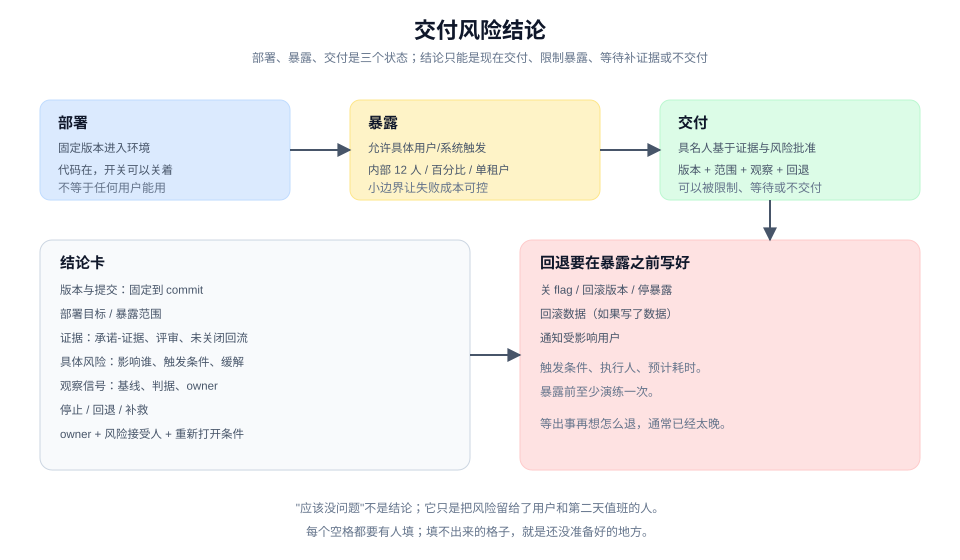
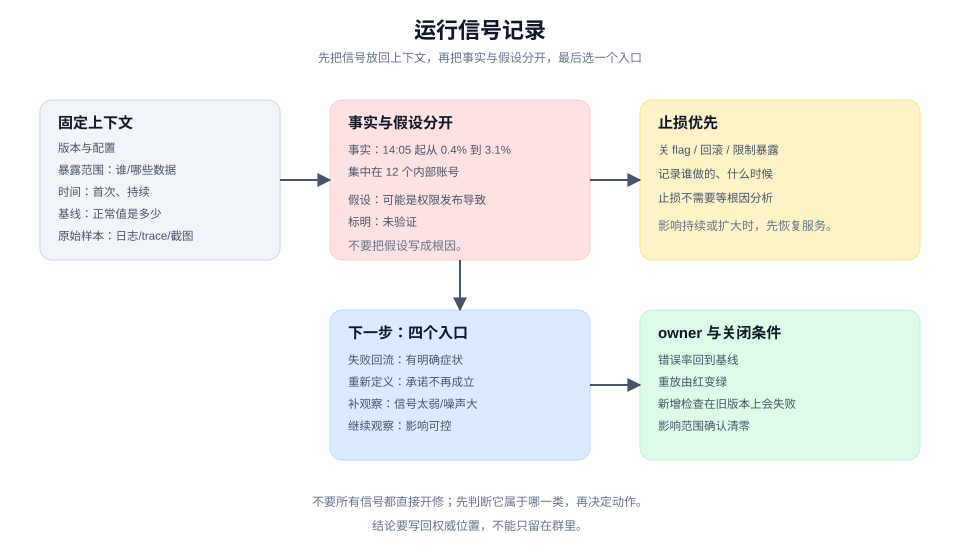
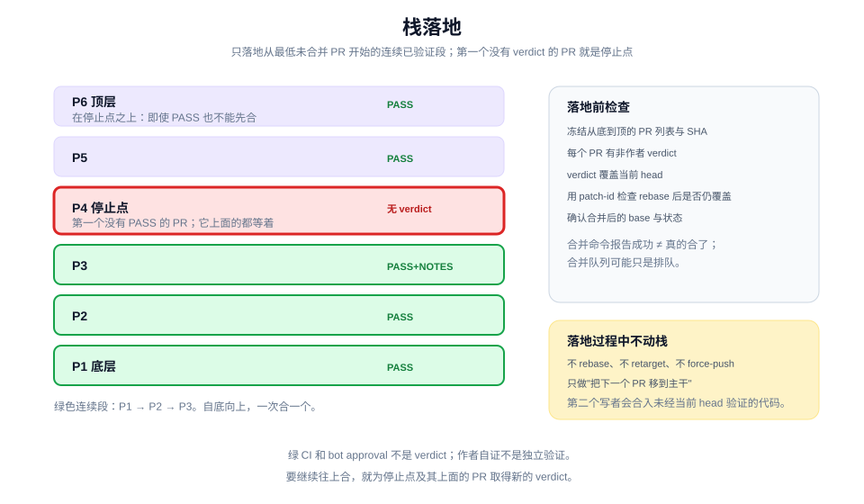

# 交付、运行与演进：让变更安全地进入真实环境

> 本章 3 个实战单元 · [手册目录](./README.md) · [上一章：验证](./verify.md)

## 这一章解决什么

合入不等于交付，部署不等于允许用户触发，CI 绿不等于可以发布。

这一章把"进入真实环境"拆成三个可复核的动作：

| 单元 | 卡点 | 带走 |
|---|---|---|
| 5.1 | 上线靠"应该没问题"和一堆绿 | 交付风险结论 |
| 5.2 | 线上信号来了，团队直接开修 | 运行信号记录 |
| 5.3 | 一串 PR 都绿了，不知道怎么落地 | 栈、verdict、连续落地段与停止点 |

三个单元的共同点是：**把不可逆的动作变成有证据、有 owner、有回退的决定。**

---

## 5.1 在交付前给出可接受的风险结论

### 工作情境

版本要上线了。团队的状态是：

- CI 全绿；
- 评审都过了；
- 承诺-证据表大部分兑现；
- 还有两项"未覆盖"，但大家都说"应该没问题"。

没有人能回答：

- 这次对谁开放？所有客户，还是内部用户？
- 出问题时看哪个信号？谁来看？
- 如果必须撤回，撤回的是什么？代码、开关，还是数据？
- 谁对"可以上线"这个决定负责？

把合入当成交付，是这一节要处理的第一个误解。

### 带走什么

一张**交付风险结论（release risk decision）**：

```text
版本与提交：固定到 commit
部署目标：环境
暴露范围：谁能触发；哪些数据/区域/租户
证据：承诺-证据表、评审结论、未关闭回流
运行前提：配置、迁移、依赖、容量
具体风险：可能发生什么，影响谁
暴露限制：flag、百分比、内部用户、只读
观察信号：指标、日志、反馈；基线与判据
停止/回退/补救：谁在什么条件下做什么
owner：谁对这次交付负责
风险接受人：谁接受残余风险
重新打开条件：什么情况下重新评估
结论：现在交付 / 限制暴露 / 等待补证据 / 不交付
```

结论只能从最后四个里选。"应该没问题"不是结论。

### 做法

**第一步，固定版本。** 写清 commit、构建产物和配置版本。不要用"最新主干"作为版本；它会在你写文档的时候变化。

**第二步，分开部署、暴露、交付。** 三个词不是同义词：

- **部署**：把固定版本放进一个环境。
- **暴露**：允许具体用户、agent 或外部系统真正触发。
- **交付**：具名人基于证据、风险、观察和恢复能力，批准某版本在某范围内可用。

一个版本可以已部署但未暴露（代码在，开关关着）；可以暴露给内部用户但未全面交付。把三者分开，才能说清"现在到底进行到哪一步"。

**第三步，收集证据。** 至少包括：

- 承诺-证据对照表：哪些兑现、哪些未覆盖；
- 双轴评审结论：有没有未关闭的阻塞项；
- 失败回流记录：有没有未关闭的失败；
- 真实表面证据：关键行为在目标环境跑过没有。

证据不足时，结论应该是"等待补证据"或"限制暴露"，不是"先上再看"。

**第四步，写具体风险。** 不要写"可能有风险"，写：

- 超大文件等待策略未定义，可能导致长时间挂起；
- 权限拦截若发生在导出之后，用户可能先下载到空文件；
- 新索引在高峰期可能增加写入延迟。

每条风险写影响谁、触发条件、当前缓解措施。没有缓解措施的风险，要由风险接受人明确接受。

**第五步，定暴露范围。** 第一次交付不要直接对所有人开放。可选的小边界：

- 内部用户或设计伙伴；
- feature flag 控制的百分比；
- 单个租户或单个区域；
- 只读路径，先不写数据。

暴露范围越小，失败成本越可控，观察信号也越有意义。

**第六步，定观察信号与停止条件。** 为这次交付选 2 到 4 个信号，并记录基线：

| 信号 | 基线 | 判据 |
|---|---|---|
| 导出错误率 | 0.3% | > 2% 关闭 flag |
| p95 导出耗时 | 1.8s | > 10s 关闭 flag |
| missing 行数量 | 未知 | 突增时查上游删除逻辑 |

每个信号要有：谁看、多久看一次、超过阈值谁有权停。没有 owner 的信号，会在出事时没人负责。

**第七步，写回退方案，并在暴露前验证。** 回退不只是"回滚代码"：

- 关闭 feature flag；
- 回滚版本；
- 停止暴露；
- 回滚数据（如果写了数据）；
- 通知受影响用户。

回退方案要写清触发条件、执行人、预计耗时，并在暴露前至少演练一次。等出事再想怎么退，通常已经太晚。

**第八步，指定 owner 与风险接受人，记录结论。** owner 对交付负责；风险接受人对残余风险负责。两者可以是同一人，但要写出来。

结论写进一个可引用的位置，并同步给相关人：

```text
结论：限制暴露。v1.4.0 对内部运营 12 人开放，flag 控制。
未覆盖：超大文件策略；403 页面提示只在 staging 验证。
重新打开条件：错误率连续 1 小时正常，且 3 位运营确认可用。
```

### 人机边界

| agent 可以做 | 人必须做 |
|---|---|
| 汇总证据、检查缺口 | 决定暴露范围与交付时机 |
| 跑发布前检查、验证回退 | 接受残余风险 |
| 起草风险结论与观察计划 | 指定 owner 与风险接受人 |
| 执行有授权的部署或开关操作 | 批准不可逆动作 |

agent 可以建议"限制暴露"，但它不能替人接受风险，也不能在没有明确授权时部署或合并。对 agent 来说，"没有禁止"不等于"可以发布"。

### 质量门

- 版本固定到 commit，目标环境明确。
- 部署、暴露、交付三个状态写清。
- 证据覆盖主要承诺；未覆盖项被列出。
- 风险具体到影响谁、触发条件、缓解措施。
- 暴露范围小于"所有人"，或有明确理由。
- 观察信号有基线、判据、owner。
- 回退方案可执行，并在暴露前验证过。
- 有 owner 与风险接受人。
- 结论是四个允许值之一。

### 图解



图里把"部署、暴露、交付"分成三个状态，把观察与回退放在暴露之前。关键不是流程完整，而是每个空格都有人填。

### 工具角色（可选）

发布清单、feature flag、canary、审批流都能承载这个过程。工具的价值是让状态可见、回退可执行；它不能替你判断风险是否可接受。

如果使用 agent，让它做证据汇总与发布前检查，不要让它自己批准发布。对不可逆动作，保留明确的人工 gate。

### 进阶

交付决定可以按可逆性分级：

- **可逆**：关 flag、回滚版本，几分钟内恢复。可以更快，但仍要有观察与 owner。
- **部分可逆**：写了数据、发了通知、改了外部状态。需要更严格的暴露范围和回退方案。
- **不可逆**：删除数据、对外承诺、资金操作。需要独立验证、明确批准和更强的观察。

对 agentic 功能，交付前还要确认：

- 工具调用的权限是最小集合；
- 失败时安全停止，而不是继续尝试；
- 有真实运行证据，而不只是单元测试；
- 暴露范围内的人知道如何报告问题。

---

## 5.2 从运行信号开启下一轮变更

### 工作情境

上线第二天，错误率从 0.4% 升到 3.1%，集中在一批内部账号。团队的反应通常是：

- 有人在群里说"可能是权限服务的问题"；
- 有人直接开了一个修复 PR；
- 有人去查日志，但没有记录查了什么；
- 有人说"先观察一下"，但没人定义观察多久、看什么。

三个小时后，错误率自己回落了，团队松一口气。下周同样的问题再次出现，仍然没有人知道原因。

运行信号记录的作用，是先把信号放回固定上下文，再决定下一步；而不是把每条信号都直接变成一次修复。

### 带走什么

一份**运行信号记录（operational signal record）**：

```text
版本与配置：commit、构建、配置项
暴露范围：谁/哪些数据/哪些区域
时间：首次出现、持续时间、时区
基线：正常值是多少
原始样本：日志、trace、截图、查询
已观察事实：看到什么，不解释
已确认影响：影响了谁、多少、是否持续
止损：做了什么，谁做的，什么时候
未知：还不知道什么
原因假设：可能是什么，标明未验证
下一步：失败回流 / 重新定义 / 补观察 / 继续观察
owner：
```

它不是事故根因结论，也不是需求或 ticket。它先把"发生了什么"和"我们准备做什么"分开。

### 做法

**第一步，固定上下文。** 信号只有在版本、配置、暴露范围和时间下才有意义。同一个错误率，在 12 个内部用户和全量用户下含义完全不同。

**第二步，记录基线与原始样本。** 没有基线，"3.1%" 无法判断严重程度。原始样本要保留：日志片段、trace ID、查询语句、截图。不要只写"错误率上升"。

**第三步，区分事实与假设。** 只写能观察到的：

```text
事实：14:05 起导出错误率从 0.4% 升到 3.1%，集中在 12 个内部账号。
假设：可能是权限接口在 14:00 的发布导致；尚未验证。
```

事实和假设混在一起，会让下一轮从猜测开始。

**第四步，先止损。** 如果影响持续或扩大，先恢复服务：关 flag、回滚、限制暴露。止损不需要等根因分析完成，但要记录动作和影响。

**第五步，选择下一步入口。** 一条信号可能通向四个方向：

| 下一步 | 什么时候 |
|---|---|
| **失败回流** | 有明确症状，需要诊断与修复 |
| **重新定义** | 信号说明原承诺不再成立或范围错了 |
| **补观察** | 信号太弱或噪声太大，先加观测 |
| **继续观察** | 影响可控，等更多样本 |

不是所有信号都直接开修。先判断它属于哪一类，再决定动作。

**第六步，指定 owner 与关闭条件。** owner 不一定是最先看到信号的人。关闭条件可以是：

- 错误率回到基线；
- 重放从红变绿；
- 新增检查在旧版本上会失败；
- 影响范围确认清零。

**第七步，把结论写回权威位置。** 如果信号导致定义变化，更新 spec；如果导致设计变化，更新模块形状卡；如果只是实现错误，走失败回流。不要让结论只留在群里。

### 人机边界

| agent 可以做 | 人必须做 |
|---|---|
| 查询指标、日志、trace | 判断影响与优先级 |
| 记录事实、生成样本 | 决定止损与暴露调整 |
| 提出原因假设并标未验证 | 确认根因与关闭条件 |
| 执行有授权的止损动作 | 接受残余风险 |

agent 可以 7×24 盯着信号，但它不能替人判断"这个影响是否可以接受"。也不要把"agent 说可能是 X"写成"根因是 X"。

### 质量门

- 信号有版本、配置、暴露范围和时间。
- 有基线，不只是当前值。
- 原始样本可打开。
- 事实与原因假设分开。
- 影响范围已确认或有明确的未知。
- 止损动作被记录。
- 下一步是四个入口之一，有 owner 和关闭条件。
- 没有把未验证的假设写成根因。

### 图解



图里把信号放回交付上下文，再把事实与假设分开，最后分流到四个入口。关键不是马上修，而是先知道自己在看什么。

### 工具角色（可选）

可观测性平台、日志、trace、告警都能承载信号记录。工具的价值是保留原始证据和上下文；它不能替你判断相关性。

如果使用 agent，让它做信号收集和初步归约，把大 artifact 放在子任务里处理，主线程只留结论。不要让它自动把信号变成修复 PR。

### 进阶

信号有不同强度：

- **领先信号**：延迟、队列长度、错误预算消耗，能在用户受影响前提示问题。
- **滞后信号**：错误率、投诉、退款，通常已经在影响用户。
- **噪声**：一次性抖动、已知的周期性变化。

不要用单点噪声触发大改动。先看趋势、基线、相关维度，再决定是否行动。

对 agentic 功能，还要看行为信号：

- 工具调用失败率；
- 权限拒绝率；
- 任务完成率与人工接手率；
- 同一任务的重复尝试次数。

这些信号能暴露"代码没错，但 agent 行为不对"的问题。

---

## 5.3 按顺序落地一组变更

### 工作情境

一个功能被切成 6 个 PR，形成一条栈。每个 PR 都绿了，评审也过了。现在要落地。

问题来了：

- 从哪个开始合并？
- 每个 PR 都真的验证过吗，还是只看 CI？
- 中途某个 PR 被 rebase，之前的验证还算数吗？
- 第 4 个 PR 卡住了，第 5、6 个能不能先合？
- 合并命令报告成功，但真的合进去了吗？

栈落地不是"点六次 merge"。它需要独立 verdict、连续落地段、补丁指纹检查和明确的停止点。

### 带走什么

一份**落地计划**，包含：

```text
栈的冻结顺序：从底到顶的 PR 列表
每个 PR 的 verdict：PASS / PASS+NOTES / FAIL，以及验证者
连续已验证段：从最低未合并 PR 开始，连续通过到哪里
补丁指纹：verdict 对应的 patch-id 与当前 head 的 patch-id
落地顺序：自底向上，一次一个
停止点：第一个没有 PASS 的 PR
落地确认：合并后的状态、base、SHA
残余风险与下一段计划
```

### 做法

**第一步，冻结栈。** 在开始落地前，记录从底到顶的 PR 列表和每个 PR 的 head SHA。落地过程中不要改栈的拓扑；任何 rebase、retarget 或 force-push 都会让旧 verdict 失效。

**第二步，为每个 PR 取得独立 verdict。** 验证者不能是写这份代码的人。verdict 只有三种：

- `PASS`：在真实表面上验证通过；
- `PASS+NOTES`：通过，但有需要注意的限制；
- `FAIL`：没有通过。

绿 CI 和 bot approval 不是 verdict。它们证明"构建通过"或"没有已知问题"，不证明"用户路径可用"。

**第三步，从最低未合并 PR 开始，找连续已验证段。** 自底向上走：

- 第一个没有 `PASS` 或 `PASS+NOTES` 的 PR 就是停止点；
- 它下面的 PR 构成连续已验证段；
- 它上面的 PR 即使通过，也不能先合，因为它们依赖下面的代码。

一个例外：某个 PR 的改动不依赖下面未验证的代码，可以单独移到主干并重新验证。不要因为"看起来独立"就跳过验证。

**第四步，检查 verdict 是否仍覆盖当前 head。** 一次 rebase 会改变提交 SHA，但可能不改变补丁内容。用 `git patch-id` 比较 verdict 时的 SHA 和当前 head：

- 补丁相同：旧 verdict 仍可覆盖；
- 补丁不同：需要重新验证，或至少重新跑受影响的检查。

如果差异只在测试、文档或 lint 配置，并且能证明构建结果相同，可以保留旧 verdict；否则不要。

**第五步，自底向上，一次合一个。** 先合连续段最低的未合并 PR。合并后：

- 读回状态，确认 base 是主干、状态是 merged；
- 把下一个 PR 的 base 移到主干；
- 把它的补丁移到合并结果上；
- 用 `--force-with-lease` 推送，并重新检查 verdict 是否仍覆盖。

合并命令报告成功，不等于真的合了。合并队列可能只是排队，auto-merge 可能只是武装。必须读回状态。

**第六步，落地过程中不动栈。** 除了"把下一个 PR 移到主干"这个必要动作，不要 rebase、retarget 或 force-push 其他分支。一个正在落地的栈被第二个写者改动，很容易合入未经当前 head 验证的代码。

**第七步，在停止点停下。** 连续段合完后，停在第一个没有 verdict 的 PR。要继续，就要为它和它上面的 PR 取得新的 verdict；这是新的一轮，不是"顺手再合一个"。

**第八步，记录落地结果。** 写清：

- 哪些 PR 合了，怎么确认的；
- 每个 verdict 是谁给的，覆盖哪个 SHA；
- 哪些没合，为什么；
- 下一段需要什么。

### 人机边界

| agent 可以做 | 人必须做 |
|---|---|
| 冻结栈、整理 verdict | 授予落地权限 |
| 跑独立验证、记录证据 | 决定是否接受残余风险 |
| 执行有授权的合并与 retarget | 批准不可逆动作 |
| 检查 patch-id 与合并状态 | 决定停止点之后是否继续 |

agent 可以在明确授权下执行落地，但"是否授权合并"必须由人给。不要把"CI 绿了"当成默认授权。

### 质量门

- 栈在落地前冻结，顺序和 SHA 已记录。
- 每个 PR 有非作者的 verdict。
- 连续段从最低未合并 PR 开始，停止点明确。
- 旧 verdict 覆盖当前 head，或有补丁指纹证据。
- 自底向上，一次一个，合并后读回状态。
- 落地过程中没有改栈拓扑。
- 结果被记录，未合项有下一步。

### 图解



图里把栈画成自底向上的序列，verdict 标在每个 PR 上，停止点标在第一个没有 PASS 的位置。关键不是合得多快，而是只合连续验证过的那一段。

### 工具角色（可选）

代码托管平台的合并队列、auto-merge、CLI 都能执行落地。工具的价值是状态可读、顺序可控；它不能替你判断 verdict 是否仍覆盖当前代码。

如果使用 agent，让它做验证、patch-id 检查和状态读回，不要让它自行扩大落地范围。每一次扩大都需要新的授权和 verdict。

### 进阶

栈落地的风险主要来自"看起来通过"：

- CI 绿了，但没跑真实路径；
- verdict 覆盖旧 SHA，rebase 后代码变了；
- 合并队列排队了，但没真正合并；
- 下面的 PR 没合，上面的先合了。

减少风险的办法不是更快的合并，而是更小的连续段、更独立的验证和更明确的停止点。

如果一次落地失败，先回退到最后一个已验证的合并点，再重新评估栈。不要在失败后继续往上合，试图"用后面的改动掩盖前面的问题"。

---

## 三个单元怎样接起来

```text
5.1 交付风险结论：决定以什么范围进入真实环境
   → 5.2 运行信号记录：从真实环境的事实开始下一轮
   → 5.3 栈落地：把一组已验证的变更按顺序合入
   → 第 6 章：把摩擦变成下一轮的环境
```

三者都围绕"不可逆动作"：交付决定暴露范围，信号决定是否止损，落地决定代码进入主干。每一个都需要证据、owner 和停止条件。

## 常见失败

| 失败 | 表现 | 修正 |
|---|---|---|
| 把合入当交付 | 合了就说"上线了" | 回到 5.1，分开部署/暴露/交付 |
| 没有暴露边界 | 第一次就对所有人开放 | 用 flag、内部用户、百分比 |
| 没有观察信号 | 出问题靠用户投诉 | 定 2-4 个信号、基线与 owner |
| 没有回退方案 | 出事时现场想办法 | 暴露前写清并演练 |
| 信号直接变修复 | 没记录上下文就开改 | 回到 5.2，先记录再分流 |
| 把假设当根因 | "就是权限服务的问题" | 标未验证，补证据 |
| 只看 CI 就落地 | 绿了就合 | 独立 verdict + 真实表面 |
| 旧 verdict 复用 | rebase 后直接合 | patch-id 检查或重新验证 |
| 跳过停止点 | 上面的 PR 先合 | 只合连续段，停在第一个缺口 |

## 继续阅读

- [让环境变好：把摩擦变成下一轮的优势](./evolve-the-environment.md)
- [教程 10：交付、观察、开始下一轮](../tutorial/10-ship-observe-and-loop.md)
- [教程 11：让环境在下一轮更好](../tutorial/11-improve-the-environment.md)
- [术语表：交付风险结论、运行信号、栈、独立验证者](../CONTEXT.md)
