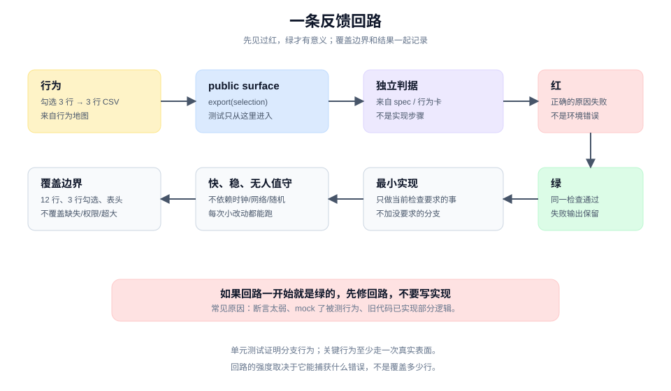
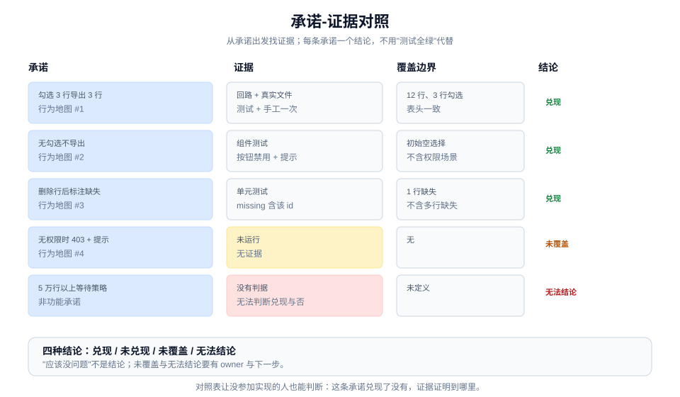
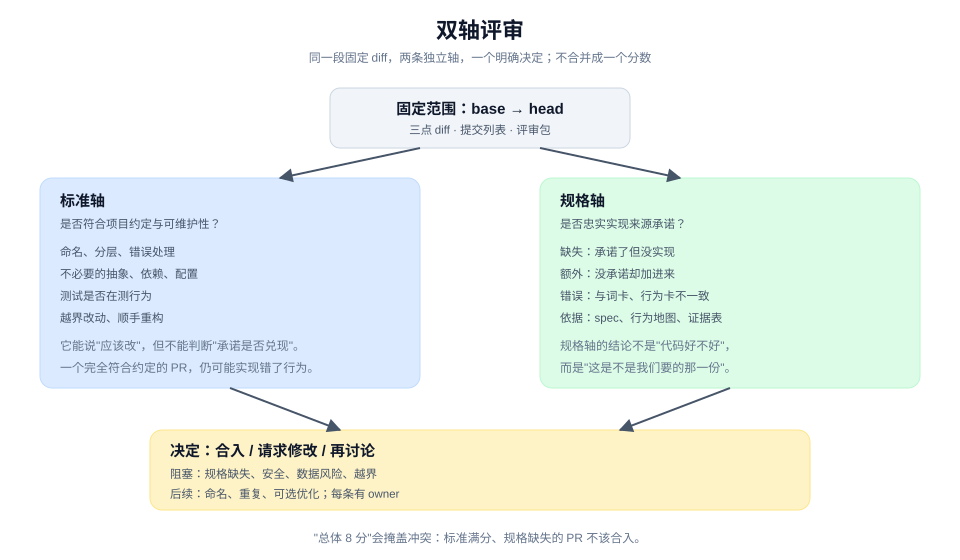
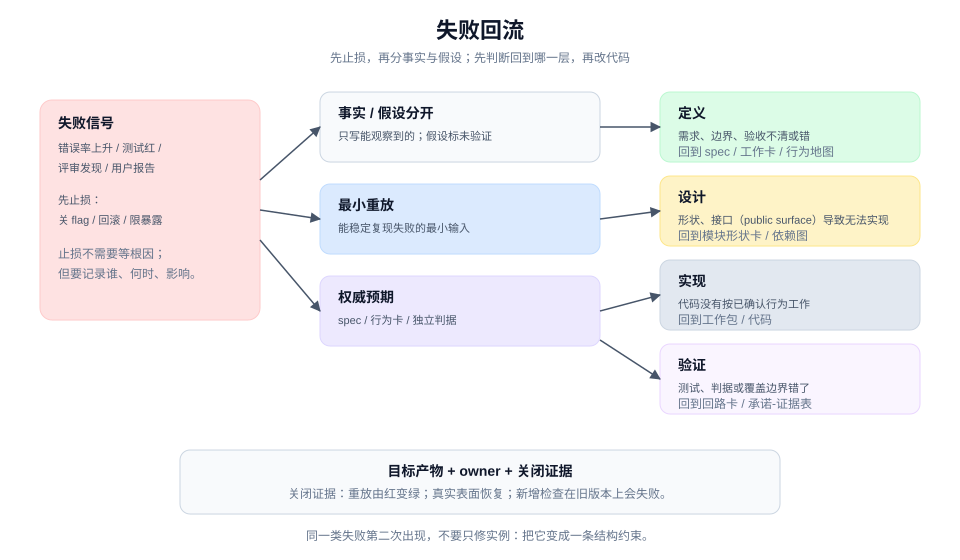

# 验证：证明兑现的是承诺

> 本章 4 个实战单元 · [手册目录](./README.md) · [上一章：委派与协作](./delegate-and-collaborate.md)

## 这一章解决什么

"测试绿了"只是某条分支的行为通过，不等于用户承诺兑现。一个改动可能通过所有测试，却漏掉权限、失败出口或真实用户路径；也可能测试写得很漂亮，但测的是实现而不是行为。

验证不是最后一道检查，而是四种能力：

| 单元 | 卡点 | 带走 |
|---|---|---|
| 4.1 | 改完只能靠肉眼判断，失败信号不稳定 | 回路卡 |
| 4.2 | 测试很多，但说不清哪条对应哪条承诺 | 承诺-证据对照表 |
| 4.3 | 评审要么挑刺，要么放行 | 双轴评审结论 |
| 4.4 | 失败后直接改代码，根因可能在别处 | 失败回流记录 |

四个单元共享一条判断：**证据要能指向一条承诺，并且说清它证明到哪里为止。**

---

## 4.1 建立能让问题显形的反馈回路

### 工作情境

你准备验证导出功能。可选的方式很多：

- 打开应用，手工点一遍；
- 跑一遍已有测试，看到绿色；
- 写一条新测试，断言"调用了导出接口"；
- 让 agent 说"我已经验证过了"。

这些方式都能给出"看起来没问题"，但只有一部分能在**行为出错时变红**。手工点击不稳定、不可重复；已有测试可能没覆盖勾选；断言"调用了接口"在接口存在时永远绿；agent 的自述不是证据。

反馈回路的任务，是让"这条行为坏了"变成一个稳定、快速、可重复的失败信号。

### 带走什么

一张**回路卡（feedback loop card）**：

```text
行为：<来自行为地图的一条行为>
public surface：<测试和调用方共同进入的位置>
独立判据：<预期从哪里来；不是从实现反推>
触发与输入：<命令、fixture、操作步骤>
预期结果：<可观察的成功/失败信号>
运行时间：<大致时长>
覆盖边界：<证明到哪里为止；不覆盖什么>
稳定性：<是否依赖时钟、网络、随机顺序>
```

它不是测试文件的替代品，而是这条回路为什么可信的说明。

### 做法

**第一步，只选一条行为。** 从 [2.1](./design-and-plan.md) 的行为地图里挑一条"必须"或"应该"的行为。一次只建一条回路，避免写出一堆互不相关的测试。

以"勾选 3 行导出 3 行"为例。

**第二步，确定 public surface。** 从 [2.2](./design-and-plan.md) 的模块形状卡里找公共 public surface。测试只从这里进入：

- 调用 `export(selection)`；
- 读 `ExportResult`；
- 不读私有字段，不调用测试专用方法。

如果找不到 public surface，先回去修形状，不要用后门测试。

**第三步，写独立判据。** 预期必须来自共同问题、词卡、行为卡或已确认的 spec，不能来自"实现大概会返回什么"。

```text
Given：12 行订单，id 2、5、9 存在。
When：export({ orderIds: ["2","5","9"], format: "csv" })。
Then：rows === 3；CSV 有 3 行数据；第一行等于全量导出的表头。
```

"调用 `filterSelected` 后返回 3 行"不是独立判据，它测的是实现步骤。

**第四步，先让它红。** 在写实现之前运行回路，确认它因为**正确的原因**失败：

- 失败信息指向"未实现"或"结果为空"；
- 不是环境错误、导入错误、fixture 写错。

如果它一开始就是绿的，说明这条回路没有覆盖你要证明的行为。常见原因：断言太弱、mock 了被测行为、旧代码已经实现了部分逻辑。先修回路，再写实现。

**第五步，让回路快、稳、可无人值守。** 一条好回路：

- **快**：几秒到几十秒，能在每次小改动后运行；
- **稳**：同一输入重复运行结果一致，不依赖时钟、网络、随机顺序；
- **可无人值守**：失败时自己退出并给出原因，不需要人点界面。

如果必须依赖真实网络或人工操作，把回路降级成更窄的检查，再用真实表面做补充验证。不要让"必须有人看着"成为唯一证据。

**第六步，记录覆盖边界。** 一条绿证明到哪里为止，要和结果一起记录：

```text
覆盖：12 行数据、3 行勾选、表头一致。
不覆盖：缺失行、无权限、5 万行以上、跨页勾选。
```

没有覆盖边界的"通过"，会被下一位误读成"全部兑现"。

**第七步，用真实表面补强。** 单元测试证明分支行为，不证明用户路径。对关键行为，至少走一次真实表面：

- 打开应用；
- 勾选 3 行；
- 点击导出；
- 打开文件数行数。

真实表面会暴露测试看不到的问题：按钮状态、下载文件名、权限拦截位置、浏览器兼容。

### 人机边界

| agent 可以做 | 人必须做 |
|---|---|
| 建回路、写测试、跑命令 | 确认独立判据来自哪里 |
| 找出不稳定、过慢、过弱的检查 | 决定可接受的覆盖边界 |
| 在真实表面执行操作并捕获证据 | 判断证据是否足以支持决定 |
| 维护回路卡与结果 | 接受残余风险 |

agent 最常见的越界，是为了让回路变绿而改预期或放宽断言。要求它先说明"为什么这条预期不对"，由人确认后才能改。

### 质量门

- 如果建了回路，它在实现之前真的红过，且失败原因正确。
- 没有便宜、可重复的检查时，不硬造测试；改用最接近的回归检查或真实表面证据，并写清覆盖边界（`tdd` 的 skip 规则）。
- 预期来自 spec/行为卡，不来自实现步骤。
- 测试只通过公共 public surface，不读私有状态。
- 回路可重复、足够快、能无人值守运行。
- 覆盖边界写清楚，不覆盖项有名字。
- 关键行为至少有一次真实表面证据。
- 没有为了变绿而削弱断言。

### 图解



图里把"红"放在"绿"之前，把"独立判据"放在 public surface 旁边。关键不是测试数量，而是这条回路在目标风险上会不会失败。

### 工具角色（可选）

测试框架、控制面、CI 都能承载回路。工具的价值是让失败可重复、结果可追踪；它不能替你判断"这条预期是否正确"。

如果使用 agent，让它先写回路并运行到红，再写实现。不要让它一次写完实现和测试，那样测试很容易变成实现的镜像。

### 进阶

回路的价值取决于它**能捕获什么错误**，不是它覆盖多少行。一条永远绿的测试，比没有测试更危险，因为它制造了虚假的安全感。

对 flaky 回路，先确定化：

- 固定时间、随机种子和顺序；
- 用 fake 替代网络，但不要 fake 被测行为；
- 把不稳定的部分抽成可注入的依赖。

如果一条回路必须依赖生产环境，它就不是单元回路；把它当作运行信号，按 [5.2](./ship-run-and-evolve.md) 处理。

---

## 4.2 验证兑现的是不是最初承诺

### 工作情境

实现完成了，回路也绿了。你打开测试报告：几十条测试通过，覆盖率 80%。

但有人问："无权限时页面显示什么？"你发现没有测试；"删除行后会不会静默少一行？"有测试，但只断言了"没有抛错"；"5 万行以上呢？"没人知道。

这时"测试全绿"回答不了"承诺兑现了没有"。你需要一张把承诺和证据对起来的表。

### 带走什么

一张**承诺-证据对照表（promise-to-evidence map）**：

| 承诺 | 行为 | public surface | 独立判据 | 证据 | 覆盖边界 | 结论 | owner |
|---|---|---|---|---|---|---|---|
| 勾选 3 行导出 3 行 | 文件 3 行 | export | 行为卡 | 回路 + 真实文件 | 12 行、3 行勾选 | 兑现 | 工程 |
| 无勾选不导出 | 按钮禁用 | 页面 | 行为卡 | 组件测试 | 初始状态 | 兑现 | 前端 |
| 删除行标注缺失 | missing 含 id | export | 行为卡 | 单元测试 | 1 行缺失 | 兑现 | 工程 |
| 无权限 403 | 页面提示 | 接口 + 页面 | 权限规则 | 未运行 | 无 | 未覆盖 | 安全 |
| 5 万行等待策略 | 未定义 | — | — | — | — | 无法结论 | 产品 |

它不是测试目录，也不是覆盖率报告。它回答的是：每条承诺有没有证据、证据证明到哪里、结论是什么。

### 做法

**第一步，从承诺出发，不从测试出发。** 先列 spec 和行为地图里的重要承诺，再去寻找证据。反过来做，会得到"测试能覆盖什么就写什么"的清单，漏掉没有测试的承诺。

**第二步，一行一条承诺。** 重要承诺不要合并。合并会让"部分兑现"看起来像"兑现"。

**第三步，填证据指针。** 证据可以是：

- 测试文件与用例名；
- 真实表面的操作记录、截图、视频；
- 接口响应或日志；
- 性能测量与基线；
- 评审记录或人工确认。

证据要能打开。写"已测试"不算证据。

**第四步，记录环境与覆盖边界。** 同一条证据在不同环境下的含义不同：

- 在本地通过，不等于在 staging 通过；
- 单元测试通过，不等于真实用户路径通过；
- 一次运行通过，不等于稳定。

覆盖边界要写具体："12 行数据、3 行勾选、当前筛选条件"，不是"主要场景"。

**第五步，给每条一个结论。** 只有四种：

- **兑现**：有证据，且证据覆盖了声明的范围。
- **未兑现**：证据显示行为不对。
- **未覆盖**：没有证据，或证据不覆盖这条承诺。
- **无法结论**：证据冲突、环境不可用，或判据本身不清楚。

不要写"应该没问题"。"应该"不是结论，它把判断留给了下一位。

**第六步，自己复核关键证据。** 不要只看执行者的报告。至少：

- 打开一条测试，读断言；
- 跑一次真实路径；
- 检查证据指针是否指向当前版本。

如果证据是视频或截图，确认它对应的是这次改动，而不是上一版。

**第七步，记录残余风险与下一步。** 未覆盖和无法结论不是失败，它们是交接内容：

```text
未覆盖：无权限 403 的页面提示；5 万行以上等待策略。
残余风险：权限拦截若发生在导出之后，用户可能先下载到空文件。
下一步：补一条 403 的 E2E；与产品确认超大文件策略。
```

### 人机边界

| agent 可以做 | 人必须做 |
|---|---|
| 建立对照表、收集证据指针 | 确认哪些承诺重要、优先级如何 |
| 运行检查、比对结果 | 接受"未覆盖"与残余风险 |
| 标出证据缺口与冲突 | 决定是否继续交付 |
| 维护结论与 owner | 对"兑现"作最终确认 |

agent 不能因为"测试全绿"就把所有行标成兑现。它必须逐条给出证据；没有证据的行，只能标未覆盖。

### 质量门

- 每条"必须"和"应该"的承诺都有一行。
- 每行有证据指针或明确的"无证据"。
- 覆盖边界具体到数据、环境、路径。
- 结论只用四种，没有"应该没问题"。
- 未覆盖与无法结论有 owner 和下一步。
- 关键证据被独立复核过，不是只读报告。
- 对照表能让没参加实现的人判断"这条承诺兑现了没有"。

### 图解



图里把承诺放在左列，证据与覆盖边界放在右列，结论用四种状态标出。关键不是"全绿"，而是能区分兑现、未覆盖和无法结论。

### 工具角色（可选）

表格最适合承载对照表，因为它能筛选"未覆盖"和"无法结论"。文档适合写证据摘录与残余风险。

如果使用 agent，让它生成初稿并标出缺口，再由人逐条确认结论。不要让 agent 用测试通过率替代逐条判断。

### 进阶

证据强度与成本要匹配风险：

- 低风险改动可以用单元测试加一次真实路径；
- 权限、资金、数据删除需要独立验证和更严格的覆盖边界；
- agentic 功能还要验证工具调用、权限边界和失败时的行为。

不是每条承诺都值得同等证据。但每条"必须"承诺都应该有结论，哪怕结论是"未覆盖，风险已接受"。

---

## 4.3 评审变更是否真的值得合入

### 工作情境

PR 已经打开，diff 不大，测试绿了，执行者说"按 brief 做完了"。

评审很容易滑向两种模式：

- **挑刺模式**：命名、格式、注释、可以拆的函数。改完更整齐，但没人回答"是否兑现承诺"。
- **放行模式**：测试都绿，看起来没问题，点合并。三天后发现无权限路径没处理。

评审要同时回答两个不同的问题：**这改动是否符合项目约定？它是否忠实实现了来源承诺？** 这两条是独立的轴，不能合并成一个"总体感觉"。

> 与 pstack 的边界：pstack 的对应机制是 `interrogate` 的 frozen intent、rubric 与 code-quality lens，输出是单一 lead verdict 加四个桶。把它拆成 two-axis review（双轴评审）报告，是本手册的扩展；锚点见 [`PROVENANCE.md`](../PROVENANCE.md)。

### 带走什么

一份**合入评审包（merge review packet）**，加一个 **two-axis review（双轴评审）结论**：

```text
固定范围：base -> head，三点 diff，提交列表
来源材料：spec、行为地图、承诺-证据对照表
约定材料：项目规范、相关 ADR、既有模式
验证材料：回路结果、真实表面证据、未覆盖项
标准轴结论：发现 + 严重度 + 处理
规格轴结论：缺失 / 额外 / 错误 + 处理
决定：合入 / 请求修改 / 再讨论
决定 owner：
```

它不是一份评分，而是一组让决定可复核的材料。

### 做法

**第一步，固定评审范围。** 写清 base、head 和三点 diff。所有评审者看同一段变更，不凭记忆各自选范围。

**第二步，准备评审包。** 至少包括：

- 目标分支与 fixed point；
- 三点 diff 与提交列表；
- 来源 spec、行为地图、承诺-证据表；
- 项目约定与相关 ADR；
- 验证结果与残余风险；
- 决定 owner。

评审包的作用是让"看什么"和"凭什么判断"一致，而不是让每个人从聊天记录里重建。

**第三步，做标准轴。** 只看这一轴时，问：

- 命名、分层、错误处理是否符合仓库现有约定？
- 有没有引入不必要的抽象、依赖或配置？
- 测试是否在测行为，而不是镜像实现？
- 有没有越界改动、无关格式化、顺手重构？
- 新增复杂度是否值得？

标准轴可以提出"应该改"，但它不判断"承诺是否兑现"。一个完全符合约定的 PR，仍然可能实现错了行为。

**第四步，做规格轴。** 只看这一轴时，把 diff 放回来源材料：

- **缺失**：承诺了但没有实现的行为。
- **额外**：没有承诺、但被顺手加进来的行为。
- **错误**：实现了，但和词卡、行为卡或边界不一致。

规格轴的结论不是"代码好不好"，而是"这份改动是否就是我们要的那一份"。

**第五步，两轴并排，不合并成分数。** 把发现放在同一张表里，标出轴、严重度和处理：

| 轴 | 发现 | 严重度 | 处理 |
|---|---|---|---|
| 标准 | 新增了不必要的状态库依赖 | 高 | 本 PR 移除 |
| 标准 | 两个按钮组件重复 | 中 | 后续 PR 合并 |
| 规格 | 无权限 403 的页面提示未实现 | 高 | 本 PR 补上 |
| 规格 | 5 万行以上未定义 | 中 | 标未覆盖，下一轮处理 |

合并成一个分数会掩盖冲突：标准轴满分、规格轴缺失的 PR，不应该因为"代码漂亮"而合入。

**第六步，区分阻塞与后续。** 每条发现只归两类：

- **阻塞**：不修不能合。通常是规格缺失、安全问题、数据风险、越界改动。
- **后续**：可以合，但要有明确下一步和 owner。

"后续"不是"永远不做"。它要进 issue 或下一个工作包。

**第七步，给出决定。** 决定要有 owner 和依据：

```text
决定：请求修改后合入。
阻塞：补 403 页面提示；移除新增状态库依赖。
后续：合并重复按钮；5 万行策略另开工作包。
依据：规格轴 1 项缺失；标准轴 1 项越界。
决定 owner：<具名人>。
```

如果两轴都通过，也要写清"通过了什么"和"哪些没有覆盖"，而不是一句 LGTM。

**第八步，对 agentic 改动加一层检查。** 如果改动涉及 agent 的工具调用、权限或自主行为，评审还要看：

- 工具调用的权限边界是否最小；
- 失败时是否安全停止，而不是继续尝试；
- 是否有 eval 或真实运行证据，而不只是单元测试；
- 提示词或 skill 改动是否改变了行为，而不仅是文字。

这些检查属于规格轴，不要塞进标准轴。

### 人机边界

| agent 可以做 | 人必须做 |
|---|---|
| 生成 diff、整理评审包 | 决定评审范围与风险容忍度 |
| 跑标准轴与规格轴检查 | 判断阻塞与后续 |
| 指出越界、缺失、额外行为 | 作最终合入决定 |
| 汇总两轴结论 | 接受残余风险 |

agent 可以参与评审，但作者不能是唯一的评审者；对高风险改动，评审者应与作者独立，最好来自不同模型或不同人。

### 质量门

- 评审范围固定在同一段三点 diff。
- 两轴都做了，且并排报告。
- 规格轴明确区分缺失、额外、错误。
- 阻塞与后续分开，每条有 owner。
- 决定有具名 owner 和依据。
- 没有把两轴压成一个分数。
- 高风险或 agentic 改动有额外的权限与失败检查。

### 图解



图里把固定 diff 放在中间，两条轴分别从约定和承诺出发，最后汇到一个决定。关键不是两轴都"通过"，而是它们不能被互相抵消。

### 工具角色（可选）

代码评审工具、diff、评审模板都能承载评审包。工具的价值是范围固定、讨论可追踪；它不能替你判断哪条发现是阻塞。

如果使用 agent，让它分别产出标准轴和规格轴报告，再由人合并成决定。不要让它用一个"总体评分"代替两轴。

### 进阶

评审深度应与风险匹配：

- 低风险、局部改动可以轻量评审；
- 权限、数据、资金、不可逆操作需要更严格的规格轴和独立验证；
- 大范围重构需要额外的等价性证据。

评审不是越严格越好。过度评审会让小改动排队，也会让评审者把注意力花在格式上。关键是让阻塞项被看见。

---

## 4.4 失败时知道应该回到哪里

### 工作情境

线上错误率上升，或者一个测试突然失败。团队的第一反应通常是改代码：

- 加一个 guard；
- 重试一次；
- 把失败的测试改松；
- 把症状盖住。

这些动作可能让信号暂时消失，但根因可能在定义、设计或验证。如果每次都从"实现"开始修，同一类失败会反复出现。

失败回流记录的作用，是在动手之前先判断：这次失败应该回到哪个工作面。

> 与 pstack 的边界：四分类（定义 / 设计 / 实现 / 验证）是本手册的扩展。pstack 的对应机制是 `fix-root-causes` 的"追到第一次出错的位置"，以及 `architect` Phase E 的"草图错了就丢弃重画"。

### 带走什么

一份**失败回流记录（failure routing record）**：

```text
已观察事实：看到什么，时间、范围、样本
影响与止损：影响了谁；先做了什么止损
最小重放：怎样稳定复现
权威预期：来自 spec / 行为卡 / 独立判据
已排除项：查过但不成立的原因
首要回流分类：定义 / 设计 / 实现 / 验证
目标产物：回到哪个 artifact 或工作面
owner：谁负责修复与关闭
关闭证据：什么证明它真的修好了
```

它不是根因结论，也不是事故报告。它先把事实、止损和路由分开。

### 做法

**第一步，先止损。** 线上问题优先恢复服务：关闭开关、回滚版本、限制暴露。止损不需要等根因分析完成。

止损动作要记录：谁做的、什么时候、影响了什么。不要把止损和修复混在一起。

**第二步，记录事实，不记录猜测。** 只写能观察到的：

- 错误率从多少到多少；
- 影响哪些用户、哪些请求；
- 第一次出现的时间；
- 样本或 trace。

原因假设单独一栏，标明"未验证"。

**第三步，做最小重放。** 找一个能稳定复现失败的最小输入或步骤。重放的价值是让"修好了"可检查，而不是靠感觉。

如果无法复现，记录尝试过什么、缺什么环境或数据。不要在没有重放的情况下宣布根因。

**第四步，找权威预期。** 判断"这到底是不是 bug"，需要一份权威预期：

- spec 说了什么；
- 行为卡说了什么；
- 独立判据是什么；
- 如果没有权威预期，这可能是定义缺失。

没有权威预期的失败，不能直接归为"实现错误"。

**第五步，分类回流。** 只选一个**首要**分类：

| 分类 | 含义 | 回到哪里 |
|---|---|---|
| **定义** | 需求、边界、验收本身不清或错了 | spec / 工作卡 / 行为地图 |
| **设计** | 形状、接口（public surface）导致行为无法正确实现或验证 | 模块形状卡 / 依赖图 |
| **实现** | 代码没有按已确认的行为工作 | 工作包 / 代码 |
| **验证** | 测试、判据或覆盖边界错了，或者根本没有 | 回路卡 / 承诺-证据表 |

一个失败可能有多个原因，但首要分类决定先回哪里。先修最上游的那个，再处理下游。

**第六步，路由给 owner。** 失败回流不是"谁发现谁修"。把它交给对应工作面的 owner：

- 定义问题 → 产品/需求 owner；
- 设计问题 → 技术 owner；
- 实现问题 → 执行者；
- 验证问题 → 测试/验证 owner。

如果 owner 不在场，记录并升级，不要自己替他们决定。

**第七步，定义关闭证据。** 什么证明它真的修好了：

- 重放从红变绿；
- 真实表面恢复；
- 错误率回到基线；
- 新增的检查在旧版本上会失败。

关闭证据要能被独立复核，不能只写"已修复"。

**第八步，重复失败升级为结构问题。** 如果同一类失败第二次出现，不要只修当前实例。按 [6.2](./evolve-the-environment.md) 的方式，把它变成一条结构约束。

### 人机边界

| agent 可以做 | 人必须做 |
|---|---|
| 收集事实、做最小重放 | 决定止损与影响范围 |
| 提出分类假设与证据 | 确认权威预期 |
| 跑诊断、提出修复 | 决定优先级与资源 |
| 准备关闭证据 | 接受残余风险与最终关闭 |

agent 可以诊断和提出路由，但不能替人决定"这是不是可接受的风险"，也不能在没有权威预期时自行定义"正确行为"。

### 质量门

- 事实与原因假设分开。
- 线上止损先于根因分析。
- 有最小重放，或明确记录为什么无法重放。
- 有权威预期；没有的，标为定义缺失。
- 首要回流分类明确，且目标产物具体。
- 有 owner 和关闭证据。
- 同一类失败第二次出现时，有结构化的下一步。

### 图解



图里把失败放在左边，先分事实与假设，再经过重放和权威预期，最后路由到四个工作面。关键不是找到"罪魁祸首"，而是先回到正确的那一层。

### 工具角色（可选）

事故记录、调试器、trace、测试都能承载回流记录。工具的价值是保留事实和证据；它不能替你判断"应该回到哪一层"。

如果使用 agent，让它先做事实收集和最小重放，再提出分类。不要让它直接改代码；先确认路由。

### 进阶

"五个为什么"可以作为提问工具，但不要把它当成固定仪式。复杂系统里的失败通常有多个原因，首要分类只是决定先修哪里，不意味着其他原因不存在。

对 agentic 功能，失败回流还要看：

- 是模型判断错，还是工具调用错；
- 是权限边界不清，还是提示词歧义；
- 是单次随机失败，还是稳定缺陷。

这些分类会影响修复位置：改代码、改 skill、改权限，还是改定义。

---

## 四个单元怎样接起来

```text
4.1 回路卡：让一条行为可红可绿
   → 4.2 承诺-证据表：把多条回路与承诺对上
   → 4.3 双轴评审：判断改动是否值得合入
   → 4.4 失败回流：失败时回到正确的工作面
   → 第 5 章：交付与运行
```

回路是原子证据，对照表是承诺级证据，评审是合入级判断，回流是失败后的纠偏。四者不能互相替代。

## 常见失败

| 失败 | 表现 | 修正 |
|---|---|---|
| 只写绿，没见过红 | 测试通过但不知道它能否捕获错误 | 回到 4.1，先运行到红 |
| 断言实现步骤 | 重构就误报 | 改成可观察行为 |
| 用测试通过率代替承诺 | 覆盖率很高，关键行为没测 | 回到 4.2，逐条对照 |
| 把两轴压成一个分数 | 标准满分掩盖规格缺失 | 回到 4.3，并排报告 |
| 失败直接改代码 | 症状消失，根因还在 | 回到 4.4，先分类再修 |
| 语义冲突当文本冲突 | 合并成功，行为不对 | 交给对应 owner，更新共同输入 |

## 继续阅读

- [交付、运行与演进：让变更安全地进入真实环境](./ship-run-and-evolve.md)
- [教程 06：先建立反馈，再改实现](../tutorial/06-build-a-feedback-loop.md)
- [教程 08：证明兑现的是原承诺](../tutorial/08-prove-the-promise.md)
- [教程 09：评审变更是否值得合入](../tutorial/09-review-for-merge.md)
- [术语表：独立判据、覆盖边界、失败回流记录](../CONTEXT.md)
