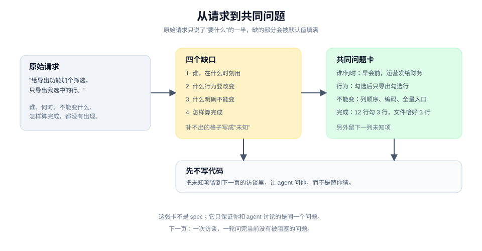

# 从这里开始：先把请求说清

> 教程 00 / 12 · 上一页：[教程地图](./README.md) · 下一页：[01 从一句模糊的话开始](./01-define.md)

## 眼前困惑

你知道 agent 能写代码。你给它一句"给导出功能加个筛选，只导出我选中的行"，它很快给出了方案，甚至直接改了文件。但你看完不确定：它是不是理解成了"给导出页加一个筛选器"？没勾选任何行时它会导出什么？列顺序会不会变？

这种不确定不是 agent 能力不够，而是**请求还没有变成一个共同问题**。原始请求里通常只有"要什么"的一半：没有谁在什么时刻用、没有什么必须保持不变、没有怎样算完成。缺的部分，agent 只能用自己的默认值补；默认值不一定错，但你没有同意过。



这一页只做一件事：把一个原始请求补成一张四行请求卡。先不写代码，也不要求 agent 动手。

## 现在动作

### 1. 原样写下你刚才想说的话

不要先润色。把"给导出功能加个筛选，只导出我选中的行"原样写下来。润色会提前掩盖缺口。

### 2. 补齐四个缺口

| 缺口 | 要回答的问题 | 反例 |
|---|---|---|
| **谁，在什么时刻** | 谁在什么场景下会用它？他当时想完成什么？ | "用户"太宽；"导出的人"仍然不知道时刻 |
| **什么行为要改变** | 从什么状态到什么状态？触发条件是什么？ | "加个筛选"没有说筛选作用于本次导出还是长期设置 |
| **什么明确不能变** | 现有入口、格式、权限、默认行为里，哪些必须保留？ | 不说就会得到"顺手重构了导出器" |
| **怎样算完成** | 用什么数据、走哪条路径、看到什么结果，才算兑现？ | "能导出"不是判据 |

拿同一个请求补一遍：

- **谁，在什么时刻**：运营在早会前，需要把昨天异常订单里自己核对过的那几条发给财务。
- **什么行为要改变**：勾选若干行后点导出，文件只包含勾选行；没有勾选时保持现有的全量导出。
- **什么不能变**：CSV 的列顺序和编码不变；全量导出的入口和权限不变；不新增后台任务。
- **怎样算完成**：用一份 12 行数据勾 3 行导出，下载文件恰好 3 行，列头与顺序和全量导出一致；不勾选时导出 12 行。

### 3. 把不确定留在桌面上

补不出来的格子，不要猜。写成"未知"：

- 财务需要的是 CSV 还是 Excel？
- 勾选行跨页时，选择是否保留？
- 导出文件名要不要带筛选条件？

未知项不是失败。它是下一轮访谈的输入。

### 4. 先不要写代码

现在让 agent 动手，它会用默认值填满这些未知。先把它留到下一页：让 agent 问你，而不是替你猜。

## 可见成果

你手上应该有一张四行卡，加上一小列未知项：

```text
谁/何时：
行为变化：
不能变：
完成判据：
未知项：
```

这张卡还不是 spec。它只保证一件事：你和 agent 讨论的是同一个问题，而不是各自想象中的那个。

## 休息点

可以停在这里。你已经完成了从"一句请求"到"一个可被追问的问题"的转变。这本身就能过滤掉一大类返工。

如果你现在就要动手，至少把四行卡贴进对话，并要求 agent 在提出方案前先复述它。

## 下一段

下一页 [01 从一句模糊的话开始](./01-define.md) 会做一次真正的访谈：agent 一轮问完当前能问的问题，每个问题带推荐答案；事实它自己查，决定由你作；最后它复述，你来纠正。

如果你更想先看这套方法在完整生命周期里的位置，回到 [教程地图](./README.md) 或直接查 [手册：定义](../manual/define.md)。
