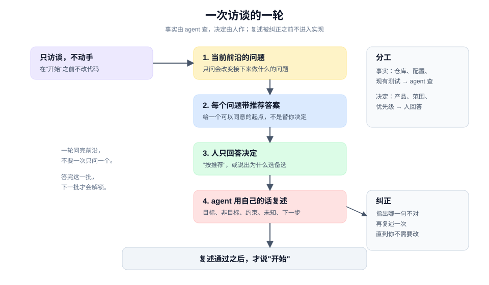

# 从一句模糊的话开始：让 agent 先问你

> 教程 01 / 12 · 上一页：[00 从这里开始](./00-start-here.md) · 下一页：[02 给共同语言一个位置](./02-give-words-a-home.md)

## 眼前困惑

你把 [00](./00-start-here.md) 的四行卡贴进对话，agent 立刻回了一份实施方案：改哪个组件、加什么参数、大概几步。看起来都对，但你不知道它是真的理解了"没勾选时保持全量导出"，还是只是把最像的模式补全了。

更麻烦的是，你也不确定自己有没有说全。让 agent 直接开工，等于让它替你把没说的部分决定掉。

## 现在动作

这一页做一次**访谈**：在动手之前，让 agent 逐轮提问，把当前能问清的问题问完；事实它自己查，决定由你作；最后它复述，你来纠正。

不是每个请求都值得这样停一次。可逆、边界清楚的小改动，pstack 的默认是直接做、做完让人纠正（`never-block-on-the-human`）；只有真正的产品取舍、不可逆动作，或你明确要求"先访谈"时，才把访谈当作前置门。这一页刻意选了一个"需求没说清"的例子，是为了让你看见访谈的形状，不是要求你每次开工都先停一轮。



### 1. 先约定：只访谈，不动手

在对话开头放一段明确的边界：

```text
在我说"开始"之前，不要改代码，也不要给完整实施方案。

先做一次访谈：
- 只问那些答案会改变你接下来做什么的问题。
- 每个问题给出你的推荐答案和一句理由。
- 仓库、配置、现有测试里能查到的事实，你自己去查，不要问我。
- 一轮问完当前所有没有被其他问题阻塞的问题，不要一次只问一个。
- 问完后，用你自己的话复述：目标、非目标、约束、未知项、下一步。
- 复述完停下，等我说"开始"。
```

这段约定的核心不是礼貌，而是**把事实和决定分开**。事实由 agent 查，决定由你作。它替你查是效率；它替你决定是越权。

### 2. 一轮问完当前能问的问题

"当前能问的问题"有一个可操作的判断：**这个问题的答案，会不会改变我接下来做什么？** 不会改变的问题，现在不值得问。

同时，只有前置问题已经有答案的问题才进入这一轮。比如"导出文件名要不要带筛选条件"依赖"筛选是否只作用于本次导出"；后者没定，前者问了也只能得到猜测。

把这一轮叫**当前可问的问题**：在当前已知条件下，可以直接回答的那批问题。

如果 agent 一次抛来 20 个问题，让它按"哪些会改变实现"排序，先答 当前可问的问题。答完这一批，下一批才会解锁。

### 3. 每个问题带推荐答案

一个没有推荐答案的问题，把全部判断成本推给你。更好的形式是：

```text
问：没有勾选任何行时，导出应该怎么做？
推荐：保持现有的全量导出。理由：这是当前默认行为，改动它会影响没有使用筛选的人。
备选：禁用导出按钮，并提示"请先选择行"。
```

推荐答案不是替你决定，而是给你一个可以同意的起点。你可以说"按推荐"，也可以说"不，选备选，因为财务会误点"。

### 4. 你只回答决定

一次真实的访谈轮次可能长这样：

| 问题 | Agent 的推荐 | 你的回答 |
|---|---|---|
| 筛选只作用于本次导出，还是记住上次选择？ | 只作用于本次 | 按推荐 |
| 没勾选时保持全量，还是禁用？ | 保持全量 | 按推荐 |
| 跨页勾选是否保留？ | 保留，放在组件状态里 | 保留，但刷新后清空 |
| 列顺序和编码？ | 查现有导出器，保持一致 | 按推荐，另外确认文件名格式 |
| 财务要 CSV 还是 Excel？ | 无法从代码判断，需要你确认 | CSV，本期不做 Excel |

注意最后一行：agent 没有替你猜"财务要什么"，而是明确说这是它查不到的决定。这就是正确的分工。

### 5. 让它复述，你来纠正

访谈结束不等于理解一致。让 agent 用**它自己的话**复述，而不是把你的话整理成条目：

```text
我理解你要的是：
- 目标：运营勾选异常订单后，只导出勾选的行，发给财务。
- 非目标：不做 Excel；不改全量导出入口；不加后台任务。
- 约束：列顺序与编码不变；跨页选择保留，但刷新后清空。
- 未知：导出文件名是否要带筛选条件；财务是否会要求多个 sheet。
- 下一步：先确认文件名，再改导出器。

我还不确定的是：刷新后清空选择，会不会让运营在长列表里重复勾选？
```

复述里最有价值的是最后一句。它把一个新的风险放回桌面，而不是假装所有问题都关了。

你要做的只有一件事：指出哪一句不对。纠正之后，再让它复述一次，直到你不需要改。

### 6. 停在复述之后

复述通过后，仍然不要立刻开工。先确认三件事：

1. 四行卡上的"未知项"是否都变成了"决定"或"明确不做的非目标"。
2. 有没有一个新的未知项，是你刚才没想到的。
3. 下一步是否小到可以在一轮里完成。

都确认了，再说"开始"。

## 可见成果

一页共同问题（shared problem）：

```text
目标：
非目标：
约束：
完成判据：
已决定：
仍未决：
下一步：
```

它把 [00](./00-start-here.md) 的四行卡扩成七栏：目标、非目标、约束、完成判据、已决定、仍未决、下一步。非目标、已决定、仍未决、下一步是这一轮新增的；它们让你在开工前就能看出，哪些地方仍然依赖 agent 的默认值。

## 休息点

可以停在这里。你已经完成了一次可重复的访谈，并且得到一份人和 agent 都能引用的共同问题。下一次遇到模糊请求，重复这一页即可。

不需要每次都问满五轮。小改动可能一轮就够；关键是每一轮都问完 当前可问的问题，并且由人回答决定。

## 下一段

下一页 [02 给共同语言一个位置](./02-give-words-a-home.md) 处理另一个常见缺口：你和 agent 说的是同一个词，但含义不同。它会用两三个词做一次最小实验，让你看见分歧，而不是等实现出来才发现。

想先看完整方法，查 [手册：定义](../manual/define.md)；想先看这一页在生命周期里的位置，回到 [教程地图](./README.md)。
