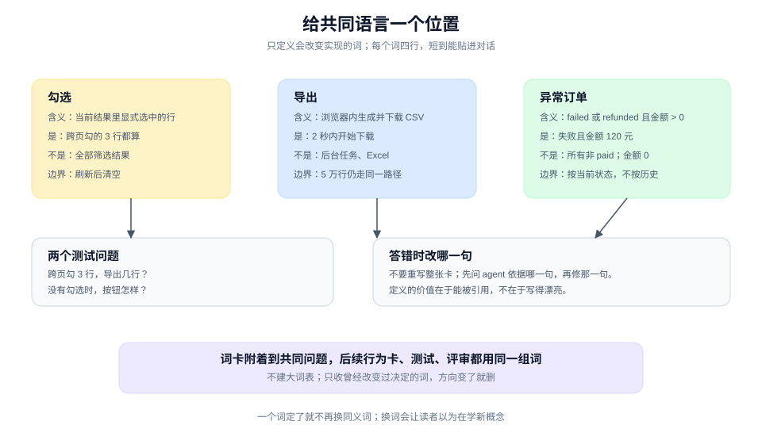

# 给共同语言一个位置：三个词，决定实现会不会跑偏

> 教程 02 / 12 · 上一页：[01 从一句模糊的话开始](./01-define.md) · 下一页：[03 让一个承诺变成可观察行为](./03-make-a-promise-observable.md)

## 眼前困惑

访谈之后，你和 agent 对"要做什么"已经一致。但实现仍然可能跑偏，因为你们用的词不是同一个意思。

比如"勾选"：是当前页勾选，还是跨页保留？"导出"：是浏览器下载一个文件，还是提交一个后台任务？"异常订单"：是按状态筛选出来的一类，还是人工标记过的一类？

这些词在对话里听起来都懂。等到代码写出来，你才发现 agent 选的是另一种解释，而它并没有违反你说的任何一句话。



## 现在动作

### 1. 只挑会改变行为的词

不是所有词都值得定义。判断标准很简单：**如果把它解释成 A 或 B，写出来的代码会不会不同？** 会，才是候选。

一次只挑 2 到 3 个。挑多了会变成一份没人读的词表。

用 [01](./01-define.md) 的例子，三个候选是：勾选、导出、异常订单。

### 2. 给每个词写一张四行卡

一张词卡只回答四件事：

```text
含义：一句话定义。
是：一个正例。
不是：一个最容易被误认成它的反例。
边界：最容易混淆的那个情形。
```

以"勾选"为例：

```text
含义：用户在当前筛选结果里显式选中的订单行。
是：运营在第 1 页勾了 2 行，翻到第 2 页又勾了 1 行；这 3 行都算勾选。
不是：筛选结果里的全部行；没有勾选时不算"全选"。
边界：刷新页面后，勾选清空，不跨会话保留。
```

"导出"的卡：

```text
含义：在浏览器里生成并下载一个 CSV 文件，本次请求内完成。
是：点导出后 2 秒内开始下载，文件包含表头。
不是：提交后台任务后发邮件；不是生成 Excel。
边界：行数超过 5 万时仍走同一条路径，本期不做分片。
```

"异常订单"的卡：

```text
含义：状态为 failed 或 refunded，且金额大于 0 的订单。
是：失败且金额 120 元的订单。
不是：所有状态不是 paid 的订单；金额为 0 的测试单不算。
边界：退款后又重新支付的订单，按当前状态算，不按历史算。
```

### 3. 用两个问题测试它有没有落地

定义写完不等于 agent 会用。用两个具体问题测一下：

1. "用户在第 1 页勾了 2 行，翻到第 2 页又勾了 1 行，导出几行？"
2. "没有任何勾选时，导出按钮应该怎样？"

如果 agent 的回答和词卡不一致，不要重写一遍词卡；先问它依据的是哪一句，然后修正那一句。定义的价值在于能被引用，不在于写得漂亮。

### 4. 把词卡放进共同问题

词卡不是独立文档。把它附加到 [01](./01-define.md) 的共同问题里，并让后续的行为卡、测试和评审都使用同一组词。

一个词一旦定了，就不要再换同义词。"勾选"不要一会儿写成"选中"，一会儿写成"选择"。换词会让读者以为在学新概念，也会让 agent 重新猜一次。

### 5. 不要建大词表

词表只收**曾经改变过决定**的词。一个没有人会误解的词，写进去只是噪音；一份 30 个词的词表，通常意味着其中 25 个没有承担判断。

词表也会腐烂。每次项目方向变化时，回头删掉不再使用的词，比不断追加更重要。

## 可见成果

三张词卡，以及一段被更新过的共同问题：

```text
勾选：当前筛选结果里显式选中的行；跨页保留，刷新清空。
导出：浏览器内生成并下载 CSV；不是后台任务，不是 Excel。
异常订单：failed 或 refunded 且金额大于 0；按当前状态算。
```

它们应该短到能贴进对话，又具体到能回答"这个边界算不算"。

## 休息点

可以停在这里。你已经把最容易在实现阶段爆发的歧义提前处理掉了。

不需要为每个项目都建词表。只有当你发现"同一个词，两个人理解不同"时，才值得做这一页。

## 下一段

下一页 [03 让一个承诺变成可观察行为](./03-make-a-promise-observable.md)，会从共同问题里挑出一条承诺，写成一张带观察位置、失败出口和人工接手点的行为卡。词卡会成为那张卡的用词基础。

想先看完整方法，查 [手册：定义](../manual/define.md)；想回到教程起点，见 [教程地图](./README.md)。
