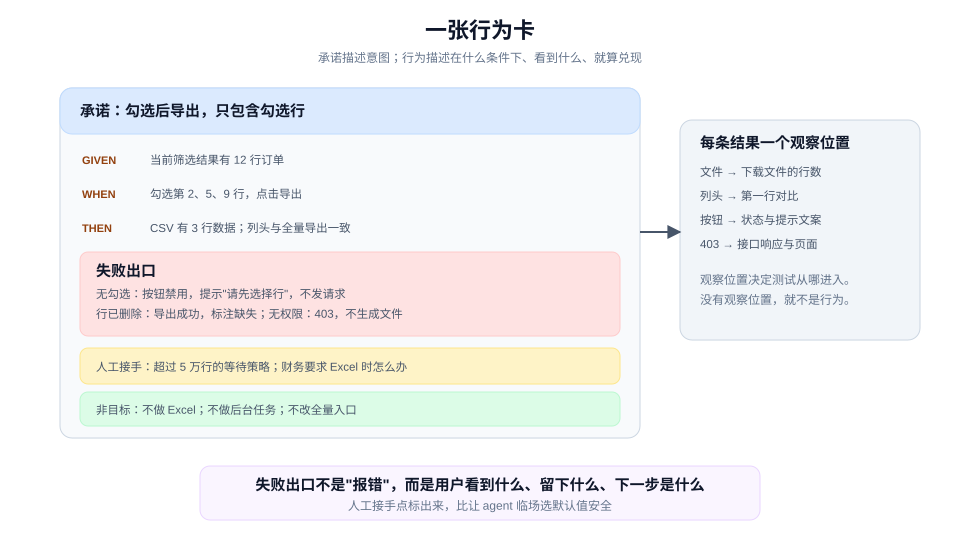

# 让一个承诺变成可观察行为

> 教程 03 / 12 · 上一页：[02 给共同语言一个位置](./02-give-words-a-home.md) · 下一页：[04 设计一个可测试的形状](./04-design-a-testable-shape.md)

## 眼前困惑

共同问题里写着"支持按勾选导出的订单"。这句话人人同意，但没有人能说清它是否兑现了：

- 勾选 3 行，文件里有 3 行，算兑现吗？
- 文件里多了表头，算不算"只包含勾选行"？
- 没有勾选时按钮禁用，算不算符合预期？
- 导出失败时，用户看到什么？

这不是测试写得不够多，而是承诺还没有变成**可观察行为**。承诺描述意图，行为描述"在什么条件下、看到什么、就算兑现"。




## 现在动作

### 1. 只挑一条承诺

不要一次把整份 spec 变成行为。挑一条会影响用户、权限、风险或人工责任的承诺；这一条走通，其余可以重复同一形状。

继续用导出功能：**用户勾选若干行后导出，文件只包含勾选行。**

### 2. 写触发、动作、可观察结果

一条行为至少有三段：

```text
Given：当前筛选结果里有 12 行订单。
When：用户勾选第 2、5、9 行，点击导出。
Then：下载的 CSV 恰好有 3 行数据，列头与全量导出一致。
```

三段都要具体到能被另一个人复现。"用户导出勾选行"不是 Then，因为它没有说看到什么。

### 3. 补失败出口

只写成功路径的行为卡，会在第一个异常上失效。至少补三类：

- **没有勾选**：按钮禁用，并提示"请先选择行"；不发请求。
- **勾选行已被别人删除**：导出成功，但结果里标注 1 行缺失；不静默丢行。
- **没有导出权限**：返回 403，页面提示"无权限"，不生成文件。

失败出口不是"报错"三个字。它要说明用户看到什么、系统留下什么、下一步是什么。

### 4. 标出人工接手点

有些情况 agent 不应该自己决定：

- 文件超过 5 万行时，是继续等，还是提示用户缩小范围？
- 财务要求 Excel 时，是拒绝，还是先导出 CSV 再手工转换？

这些是产品决定。在行为卡上标"人工接手"，比让 agent 临场选一个默认值更安全。

### 5. 写非目标

非目标不是"这次不做"的清单，而是**防止行为被扩大解释**的边界：

- 不做 Excel。
- 不做后台任务。
- 不改全量导出的入口。
- 不记住上次勾选。

没有非目标，评审时很容易把"顺手支持一下"当成合理要求。

### 6. 确认观察位置

每条可观察结果都要有一个具体的观察位置：

| 结果 | 观察位置 |
|---|---|
| 文件只有 3 行 | 下载文件的行数 |
| 列头一致 | 文件第一行与全量导出的第一行 |
| 无勾选时按钮禁用 | 页面按钮状态与提示文案 |
| 无权限时 403 | 接口响应与页面提示 |

观察位置决定了测试从哪里进入。如果一条行为找不到观察位置，它还不是行为，只是意图。

## 可见成果

一张行为卡：

```text
承诺：勾选后导出，只包含勾选行。

Given：当前筛选结果有 12 行。
When：勾选第 2、5、9 行，点击导出。
Then：CSV 有 3 行数据；列头与全量导出一致。

失败出口：
- 无勾选：按钮禁用，提示"请先选择行"。
- 行已删除：导出成功，结果标注 1 行缺失。
- 无权限：403，页面提示"无权限"，不生成文件。

人工接手：
- 超过 5 万行时的等待策略。
- 财务要求 Excel 时的处理方式。

非目标：不做 Excel；不做后台任务；不改全量入口；不记住上次勾选。
```

## 休息点

可以停在这里。你现在有一条能被复现、能被观察、也能被拒绝的行为，而不是一句人人点头的承诺。

不需要为每条承诺都写完整卡。先写最关键的一条，等它走通验证，再决定其余是否值得同一待遇。

## 下一段

下一页 [04 设计一个可测试的形状](./04-design-a-testable-shape.md)，会把这张行为卡放进一个具体的接口和切口里：测试从哪里进入、实现隐藏什么、哪些不变量必须成立。

想先看完整方法，查 [手册：设计与计划](../manual/design-and-plan.md)；想回到教程起点，见 [教程地图](./README.md)。
