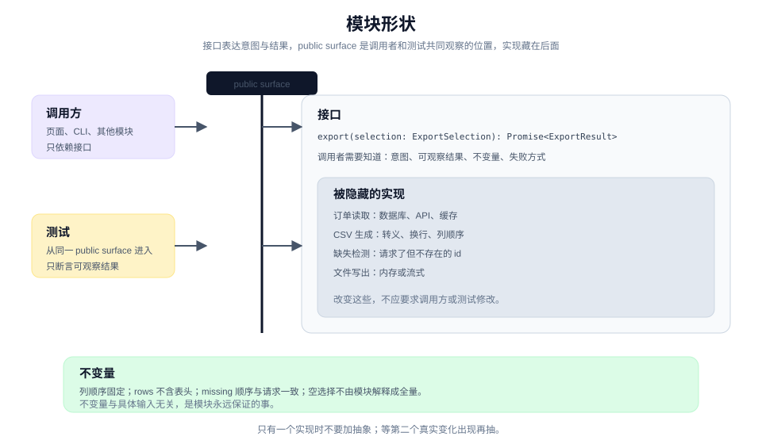

# 设计一个可测试的形状

> 教程 04 / 12 · 上一页：[03 让一个承诺变成可观察行为](./03-make-a-promise-observable.md) · 下一页：[05 把工作切成可委派的单元](./05-cut-work-into-delegable-units.md)

## 眼前困惑

行为卡已经写清楚了：勾选 3 行，导出 3 行。但真要写代码时，形状有很多种：

- 导出逻辑塞进页面组件，测试只能通过点击按钮来跑。
- 抽一个 `ExportService`，但接口里全是内部步骤：`loadOrders`、`filterSelected`、`writeCsv`、`zip`。
- 为了测试，加一个 `getSelectedRowsForTest()`。

第一种测起来慢，第二种把实现暴露成接口，第三种让测试依赖私有状态。三种都会让后面的改动变贵。



这一页只做一件事：先画一个**能用一条行为卡走通**的模块形状，再写实现。


## 现在动作

### 1. 先写接口，不写实现

接口是调用者正确使用模块必须知道的全部事实：

- 它接受什么意图（不是内部步骤）；
- 它返回什么可观察结果；
- 它保证哪些不变量；
- 它会以什么方式失败；
- 它有什么顺序或配置要求。

对导出功能，一个够用的接口可以是：

```ts
type OrderId = string;

type ExportSelection = {
  orderIds: OrderId[];      // 用户勾选的行
  format: "csv";            // 本期只有一种
};

type ExportResult = {
  file: Blob;               // 可直接下载
  rows: number;             // 实际写入的数据行数
  missing: OrderId[];       // 勾选但已不存在的行
};

interface OrderExporter {
  export(selection: ExportSelection): Promise<ExportResult>;
}
```

这个接口没有暴露"怎样查订单""怎样拼 CSV""怎样处理缺失行"。调用者只需要知道意图和结果。

### 2. 定一个切口

切口（seam）是调用者和测试共同跨越、观察外部行为的位置。在这里，切口就是 `OrderExporter.export`。

判断切口是否合适，看测试需不需要越过它：

- 测试只调用 `export`，读 `ExportResult`，不读私有字段：切口成立。
- 测试必须知道组件内部的 `selectedRows` 状态：切口太深，或者状态不该放在那里。
- 测试要访问数据库旁路来确认写了什么：说明结果没有被接口表达出来。

### 3. 隐藏实现

切口之后的部分都应该是实现细节：

- 订单从哪里读（数据库、API、缓存）；
- CSV 怎样转义、用什么换行；
- 缺失行怎样检测；
- 文件在内存里生成还是流式写出。

隐藏的标准不是"代码短"，而是**改变实现时，调用者和测试不需要改**。如果换一个 CSV 库就要改测试，说明库的细节漏到了接口上。

### 4. 先画 `not implemented` 草图

在写逻辑之前，把类型、签名和一段伪代码放下来：

```ts
class CsvOrderExporter implements OrderExporter {
  async export(selection: ExportSelection): Promise<ExportResult> {
    // 1. 按 orderIds 读取存在的订单
    // 2. 记录缺失的 id
    // 3. 用固定列顺序写 CSV
    // 4. 返回 file / rows / missing
    throw new Error("not implemented");
  }
}
```

草图的作用是让形状先被看见。此时改接口很便宜；等实现写完再改，成本会落在测试和调用方。

### 5. 用行为卡走一遍测试路径

拿 [03](./03-make-a-promise-observable.md) 的行为卡，从切口走一遍：

```text
Given：12 行订单，其中 id 2、5、9 存在。
When：export({ orderIds: ["2","5","9"], format: "csv" })。
Then：result.rows === 3；解析 result.file 得到 3 行数据；列头固定。
```

如果这条路径走不通，先改形状，不要先写测试去迁就形状。常见的信号：

- 测试需要构造大量与行为无关的对象；
- 测试需要等待真实网络或真实文件系统；
- 测试只能断言"调用了某个内部方法"。

### 6. 写下不变量

不变量是这个模块永远保证的事，和具体输入无关：

- 输出列顺序固定，不随输入变化。
- `rows` 等于实际写入的数据行数，不包括表头。
- `missing` 只包含请求了但不存在的 id，顺序与请求一致。
- 没有勾选时，调用方不应调用 `export`；模块本身不把空选择解释成全量。

最后一条尤其重要：它把"空选择怎么办"留在调用方，而不是让导出器猜。这是边界纪律，也是防止行为被扩大解释的一种方式。

### 7. 只加真正需要的东西

不要为了"以后可能"加抽象：

- 只有一个 CSV 实现时，不需要 `ExportFormatFactory`。
- 只有一种数据来源时，不需要 repository 接口。
- 没有第二种输出目标时，不需要 port 和 adapter。

等第二个真实变化出现，再抽。这个判断会在 [手册：设计与计划](../manual/design-and-plan.md) 里展开。

## 可见成果

一张模块形状卡：

```text
接口：OrderExporter.export(selection) -> ExportResult
切口：export 方法
隐藏：订单读取、CSV 生成、缺失检测、文件写出
不变量：
- 列顺序固定
- rows 不含表头
- missing 顺序与请求一致
- 空选择不由模块解释成全量
失败：无权限 -> 抛 PermissionError；读取失败 -> 抛 ReadError
非目标：不做 Excel；不做后台任务；不做通用导出框架
```

它应该短到能贴进任务 brief，又具体到能指导测试从哪里进入。

## 休息点

可以停在这里。你已经有了一条行为、一个切口和一组不变量。下一步才是决定谁来实现、在哪里实现。

如果形状还有争议，先不要进入实现。用一个一次性原型验证两种形状的差异，比在代码里改来改去便宜。

## 下一段

下一页 [05 把工作切成可委派的单元](./05-cut-work-into-delegable-units.md)，会把这条行为和这个模块形状放进一个有边界、有验收条件、可以交给另一个人或 agent 的工作包里。

想先看完整方法，查 [手册：设计与计划](../manual/design-and-plan.md)；想回到教程起点，见 [教程地图](./README.md)。
