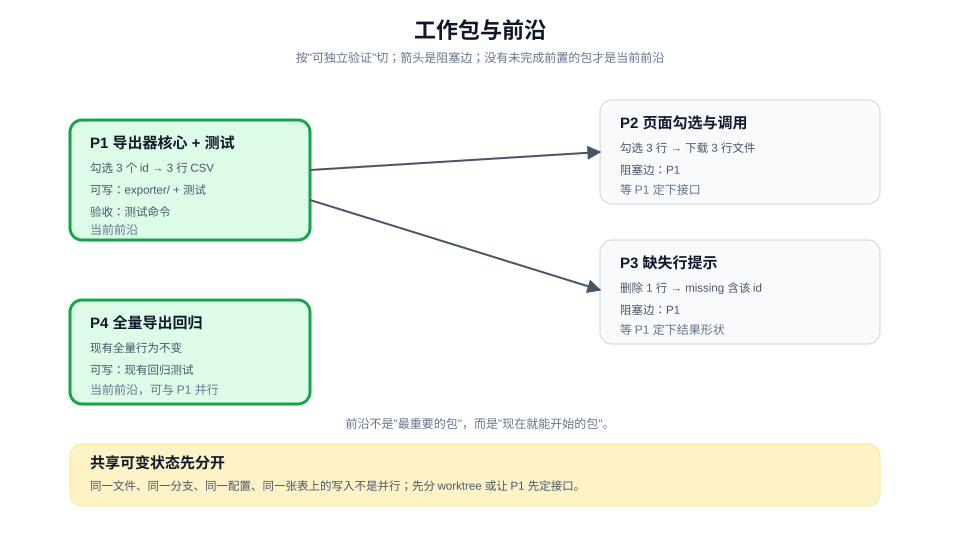

# 把工作切成可委派的单元

> 教程 05 / 12 · 上一页：[04 设计一个可测试的形状](./04-design-a-testable-shape.md) · 下一页：[06 先建立反馈，再改实现](./06-build-a-feedback-loop.md)

## 眼前困惑

形状有了，行为卡有了，但工作还是一整块："把勾选导出做完"。你不知道该先做什么、哪些能同时做、什么时候可以交给别人。

如果直接把它丢给一个 agent，它会自己决定顺序。顺序不一定错，但你没有同意过；中途出问题时，也很难说清是哪一步偏了。



## 现在动作

### 1. 按"可独立验证"切，不按文件或层切

一个工作包应该满足：完成后本身可以演示或验证，而不只是"改完了某个文件"。

反例：

- "改 exporter 模块"：改完不一定能验证。
- "写测试"：测试本身不交付行为。
- "前端部分"：按层切，完成后仍然不能演示。

正例：

- "导出器接受 3 个 id，返回 3 行 CSV，并有测试证明"：可以独立验证。
- "没有勾选时按钮禁用，并提示"：可以独立验证。

### 2. 每个包写六件事

```text
目标行为：这个包兑现哪一条行为卡。
可写范围：允许改哪些文件或目录。
输入：需要先读的权威产物与代码位置。
验收检查：一条能运行的命令或一个可观察结果。
阻塞边：必须先完成哪个包。
完成记录：留下什么证据，下一位从哪里开始。
```

六件事里最容易漏的是"可写范围"和"阻塞边"。没有范围，并行工作会互相覆盖；没有阻塞边，顺序会靠猜。

### 3. 画阻塞边，找出当前前沿

把包画成节点，依赖画成箭头：

```text
P1 导出器核心 + 测试
   ├── P2 页面勾选与调用
   └── P3 缺失行提示

P4 全量导出回归检查（独立，可与 P1 并行）
```

当前**前沿（frontier）**是 P1 和 P4：它们没有未完成的前置。P2 和 P3 要等 P1。

前沿不是"最重要的包"，而是"现在就能开始的包"。先做前沿，能让后续工作尽快解锁。

### 4. 先处理共享可变状态

两个包如果会写同一个文件、同一个分支、同一个配置项或同一个数据库，它们就不是真并行。先分开，再谈并行：

- 不同包用不同文件或不同 worktree；
- 共享的类型或接口由 P1 先定，其他包只消费；
- 需要同一份迁移脚本时，把迁移单独成一个前置包。

不要用锁来掩盖共享写入。锁会让并行退化成串行，还会引入新的失败模式。

### 5. 给每个包一个完成检查

完成检查不是"代码写完了"，而是：

- 一条命令能跑；
- 或一个真实表面上的操作能看到结果；
- 或一份证据能指向具体文件、行数、响应。

如果写不出完成检查，这个包可能还太大，或者还没有变成可观察行为。

## 可见成果

一张工作包表：

| 包 | 目标行为 | 可写范围 | 验收检查 | 阻塞边 |
|---|---|---|---|---|
| P1 | 勾选 3 个 id，导出 3 行 CSV | `exporter/`、`exporter.test.ts` | 测试：12 行数据选 3 行，结果 3 行且表头一致 | 无 |
| P2 | 页面勾选后调用导出，下载文件 | `export-page/` | 手工或 E2E：勾选 3 行，下载文件 3 行 | P1 |
| P3 | 缺失行在结果中标注 | `exporter/`、`export-page/` | 测试：删除 1 行后导出，`missing` 含该 id | P1 |
| P4 | 全量导出行为不变 | `exporter/` 的回归测试 | 现有全量测试全绿 | 无 |

以及一句当前前沿：**P1 和 P4 可以开始；P2、P3 等 P1。**

## 休息点

可以停在这里。你现在可以决定：自己做 P1，把 P4 交给别人；或者反过来。工作不再是一整块，而是一组有边界、有检查、有顺序的单元。

不需要把每个包都切得很小。包太小会产生大量交接成本；判断标准是"能否独立验证"，不是行数。

## 下一段

下一页 [06 先建立反馈，再改实现](./06-build-a-feedback-loop.md)，会拿 P1 做一次完整的红绿循环：先写一条会失败的检查，再写最小实现让它通过，并留下可复核的证据。

想先看完整方法，查 [手册：设计与计划](../manual/design-and-plan.md)；想回到教程起点，见 [教程地图](./README.md)。
