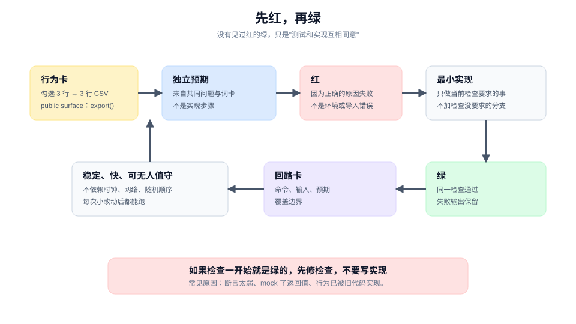

# 先建立反馈，再改实现

> 教程 06 / 12 · 上一页：[05 把工作切成可委派的单元](./05-cut-work-into-delegable-units.md) · 下一页：[07 委派出去，保持控制](./07-delegate-and-keep-control.md)

## 眼前困惑

你决定先做 P1。最自然的做法是打开编辑器，把导出器写出来，再补测试。写完运行一下，测试绿了，看起来完成了。

但"绿了"可能只证明测试和实现互相一致。如果测试是从实现反推出来的，它会在实现错的时候一起错；如果测试只覆盖了顺利路径，它会在边界上沉默。你需要的是先看见红，再看见绿。

这条规则有前提：存在一条便宜、可重复、能变红的检查。找不到这样的检查时，按 `tdd` 的规则不要硬造新测试，改用最接近的回归检查或真实表面证据，并写清覆盖边界。为了走完红绿流程而造一条坏测试，比不写测试更糟。



## 现在动作

### 1. 从行为卡找 public surface

回到 [03](./03-make-a-promise-observable.md) 的行为卡和 [04](./04-design-a-testable-shape.md) 的模块形状：

- 行为：勾选第 2、5、9 行，导出 3 行 CSV，表头一致。
- public surface：`OrderExporter.export(selection)`。
- 观察位置：返回的 `rows`、`file` 的内容。

测试只从这里进入，不读导出器内部状态。

### 2. 写独立预期，不写实现镜像

独立预期来自共同问题、词卡和行为卡，不来自你准备怎么写实现。

```text
Given：12 行订单，id 2、5、9 存在。
When：export({ orderIds: ["2","5","9"], format: "csv" })。
Then：rows === 3；CSV 有 3 行数据；第一行等于全量导出的表头。
```

如果预期写成"调用 `filterSelected` 后返回 3 行"，它测的是实现步骤，不是行为。重构一改就会误报。

### 3. 先运行，确认它因为正确的原因失败

在写实现之前运行这条检查。你应该看到：

- 一个明确的失败；
- 失败原因是"未实现"或"结果为空"，而不是环境错误、导入错误或测试本身写错。

如果它直接通过，说明这条检查没有覆盖你要证明的行为。常见原因：断言太弱、测试用了 mock 的返回值、或者行为已经被旧代码实现。先修检查，再写实现。

### 4. 做最小实现让它变绿

只实现让当前检查通过所需的行为。不要顺手加 Excel、后台任务、通用导出框架。

这一步的纪律是：

- 不加检查没有要求的分支；
- 不改与当前行为无关的文件；
- 如果发现形状不对，停下改形状，不要用补丁绕过。

### 5. 记录回路卡

一条回路不只是"测试通过"。留下四件事：

```text
命令：pnpm test exporter
输入：12 行 fixture，选中 id 2/5/9
预期：3 行数据，表头一致
覆盖边界：不覆盖缺失行、不覆盖无权限、不覆盖 5 万行以上
```

覆盖边界和结果同样重要。它告诉下一位：这条绿证明到哪里为止。

### 6. 让失败信号稳定、快、可无人值守

一条好回路应当：

- **稳定**：同一输入重复运行，结果一致；不依赖时钟、网络或随机顺序。
- **快**：几秒到几十秒，能在每次小改动后运行。
- **可无人值守**：不需要人点界面；失败时能自己退出并给出原因。

如果回路必须依赖真实网络或人工操作，先把它降级成更窄的检查，再用真实表面做补充验证。不要让"必须有人看着"成为唯一证据。

## 可见成果

一条回路卡，加上一段失败到通过的输出：

```text
FAIL  exporter.test.ts > exports only selected rows
  expected 3 rows, received 0
PASS  exporter.test.ts > exports only selected rows
```

以及一句覆盖边界：**这条检查证明勾选行导出；不证明缺失行、无权限和超大文件。**

## 休息点

可以停在这里。你已经有了 P1 的最小实现和一条可复核的回路。下一步是把它交给别人继续做 P2/P3，或者自己做下一包。

如果回路仍然很慢或很脆，先不要扩大实现。把回路修好，比多写一百行代码更值。

## 下一段

下一页 [07 委派出去，保持控制](./07-delegate-and-keep-control.md)，会把 P1 之外的工作写成一份 brief：目标、可写范围、输入、验收、禁止动作和报告形状。

想先看完整方法，查 [手册：验证](../manual/verify.md)；想回到教程起点，见 [教程地图](./README.md)。
