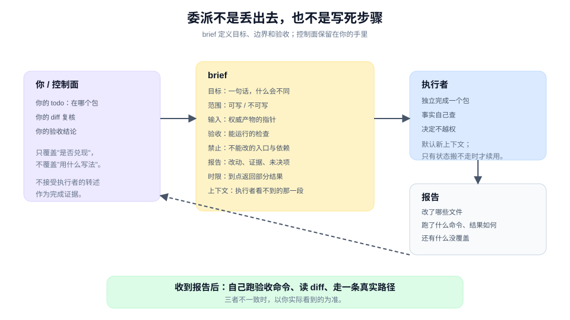

# 委派出去，保持控制

> 教程 07 / 12 · 上一页：[06 先建立反馈，再改实现](./06-build-a-feedback-loop.md) · 下一页：[08 证明兑现的是原承诺](./08-prove-the-promise.md)

## 眼前困惑

P1 已经跑通。现在要把 P2（页面勾选与调用）交给另一个 agent 或同事。

你担心的不是他们不会写代码，而是：

- 他们不知道"勾选"的边界是跨页保留、刷新清空；
- 他们顺手改了全量导出的入口；
- 他们报告"做完了"，但你看不出到底验证了什么；
- 你为了不出错，把每一步都写死，结果他们只是在替你打字。

委派不是把任务丢出去，也不是把步骤写死。它是设计一份**能让陌生执行者独立完成、又能被你验收**的输入。



## 现在动作

### 1. 写一份 brief

一份够用的 brief 有八块：

```text
目标：一句话，说明完成后什么会不同。
范围：允许写哪些文件或目录；不允许碰哪些。
输入：权威产物的指针（共同问题、行为卡、模块形状、现有代码位置）。
验收：可运行的检查，或可观察的结果。
禁止：不能改的入口、不能加的依赖、不能做的重构。
报告：完成时必须给出什么（改动、证据、未决项）。
时限：大致的时间盒；到点没完成就返回部分结果。
上下文：执行者看不到的上一段对话，用指针或简短摘录补上。
```

以 P2 为例：

```text
目标：用户在导出页勾选若干行后点击导出，浏览器下载的 CSV 只包含勾选行。
范围：只改 export-page/ 下的组件与测试；不要改 exporter/。
输入：
- 共同问题与词卡：见任务附件。
- 行为卡：勾选 3 行 -> 3 行 CSV。
- 接口：OrderExporter.export(selection)。
验收：
- 组件测试：勾选 3 行后调用 export，传入的 orderIds 恰好 3 个。
- 手工或 E2E：勾选 3 行，下载文件 3 行。
禁止：不改全量导出入口；不记住上次勾选；不引入新的状态库。
报告：改了哪些文件、跑了什么命令、结果如何、还有什么没覆盖。
时限：半天。
```

### 2. 范围要写"可写",也要写"不可写"

只写"改导出页"不够。执行者可能为了通过测试去改 exporter，或者顺手重构共享组件。

把不可写范围写出来，等于提前处理最可能的越界。不是不信任，而是让边界可检查。

### 3. 决定留给 owner，事实给指针

brief 应该说明"要什么"和"怎样算完成"，而不是"先写哪个函数、再写哪个函数"。

- **事实**：接口在哪、现有测试怎么跑、词卡怎么定义。给指针，不要让执行者重建。
- **决定**：勾选是否跨页、按钮禁用文案、空状态怎么显示。这些由你或产品 owner 定；如果没定，在 brief 里标成"未决"，不要留给执行者临场发挥。

### 4. 保留 brief、todo 与合并权

无论谁执行，你都要保留三件事：

1. **你的 todo**：知道当前在哪个包、哪些包被阻塞。
2. **你的 diff 复核**：不接受"我改好了"的转述，自己看改动。
3. **你的验收结论**：自己跑检查，或者看着检查跑；不把执行者的自报当成 verdict。

这些控制不是微观管理。它们只覆盖"这一步是否兑现"，不覆盖"你用什么写法实现"。

### 5. 默认用新上下文，只有状态搬不走时才续用

新任务给新执行者，brief 写全。只有新工作确实依赖旧执行者持有的状态（未提交改动、正在跑的服务、本地 checkout）时，才续用同一个上下文。

续用旧上下文的风险是：指令会在多轮里丢失，而执行者不会主动告诉你它忘了哪一条。

### 6. 验收时自己跑一次

收到报告后，至少做三件事：

- 跑 brief 里的验收命令；
- 读 diff，确认没有越界；
- 用一条真实路径走一遍，确认报告没有夸大。

如果三者不一致，以你实际看到的为准。

## 可见成果

一份 brief，加一张验收清单：

```text
[ ] 目标一句话，能说清什么会不同
[ ] 可写范围与不可写范围都写了
[ ] 输入是权威产物的指针，不是转述
[ ] 验收命令能直接运行
[ ] 禁止动作明确
[ ] 报告形状明确
[ ] 收到报告后自己跑过验收
[ ] diff 没有越界
```

## 休息点

可以停在这里。你已经能把一个有边界的工作包交给陌生执行者，并且知道怎样验收，而不需要把每一步写死。

如果 brief 写得比实现还长，说明包切得太大，或者验收条件还没想清。回到 [05](./05-cut-work-into-delegable-units.md) 重切，通常比继续补 brief 更有效。

## 下一段

下一页 [08 证明兑现的是原承诺](./08-prove-the-promise.md)，会把执行者的报告放回原承诺：哪条兑现了、哪条没覆盖、哪条仍然无法结论。

想先看完整方法，查 [手册：委派与协作](../manual/delegate-and-collaborate.md)；想回到教程起点，见 [教程地图](./README.md)。
