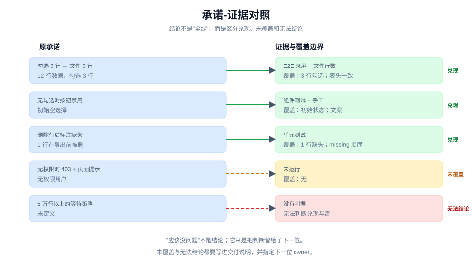

# 证明兑现的是原承诺

> 教程 08 / 12 · 上一页：[07 委派出去，保持控制](./07-delegate-and-keep-control.md) · 下一页：[09 评审变更是否值得合入](./09-review-for-merge.md)

## 眼前困惑

P2 的执行者报告：勾选导出做完了，组件测试绿了，还附了一段录屏。

你看了很开心，但心里还有三个问题：

- 没有勾选时按钮真的禁用了吗？
- 有一行在导出前被删掉，结果会不会静默少一行？
- 无权限的用户会看到什么？

报告说"完成"，但它回答的是执行者理解的范围，不一定是 [01](./01-define.md) 里那份共同问题。



## 现在动作

### 1. 回到原承诺，不回到执行者的复述

先把三份材料摊开：

- [01](./01-define.md) 的共同问题；
- [03](./03-make-a-promise-observable.md) 的行为卡；
- 执行者的报告与 diff。

以原承诺为准。执行者的复述可以帮助理解，但不能替代来源；如果两者不一致，先修正来源或指出偏差，不要直接接受复述。

### 2. 建一张承诺-证据表

每条重要承诺一行：

| 承诺 | 可观察行为 | 证据 | 覆盖边界 | 结论 |
|---|---|---|---|---|
| 勾选 3 行导出 3 行 | 下载文件 3 行数据 | E2E 录屏 + 文件行数 | 12 行数据、3 行勾选 | 兑现 |
| 无勾选时按钮禁用 | 按钮 disabled + 提示 | 组件测试 + 手工 | 初始空选择 | 兑现 |
| 删除行后标注缺失 | 结果含 missing | 单元测试 | 1 行被删 | 兑现 |
| 无权限时 403 | 页面提示无权限 | 未运行 | 无 | 未覆盖 |
| 5 万行以上 | 等待策略 | 未定义 | 无 | 无法结论 |

这张表的价值不在"全绿"，而在**区分兑现、未覆盖和无法结论**。

### 3. 自己跑真实表面

单元测试是支持证据，不是全部。至少走一遍真实路径：

- 打开页面；
- 勾选 3 行；
- 点击导出；
- 打开下载的文件，数行数、看表头。

如果项目有验证 skill 或控制面，用它；没有就手工走一遍，并把命令、输入和结果记下来。

真实表面会暴露单元测试看不到的问题：按钮样式、下载文件名、浏览器兼容、权限拦截的位置。

### 4. 结论只能四选一

每条承诺给一个明确结论：

- **兑现**：有证据，且证据覆盖了声明的范围。
- **未兑现**：证据显示行为不对。
- **未覆盖**：没有证据，或者证据不覆盖这条承诺。
- **无法结论**：证据冲突、环境不可用，或判据本身不清楚。

不要写"应该没问题"。"应该"不是结论，它只是把判断留给了下一位。

### 5. 记录残余风险与下一步

交付前留下两行：

```text
未覆盖：无权限 403 的页面提示；5 万行以上的等待策略。
残余风险：如果权限拦截发生在导出之后，用户可能先下载到空文件。
下一步：补一条 403 的 E2E；与产品确认超大文件的等待策略。
```

残余风险不是失败。它是你把"不知道"变成"可被接手"的方式。

## 可见成果

一张承诺-证据表，加一句结论：

```text
本次 P2 兑现：勾选导出、空选择禁用、缺失行标注。
未覆盖：无权限提示；超大文件等待策略。
结论：可以进入评审，但不能宣称"导出功能完成"。
```

## 休息点

可以停在这里。这是第二座山的山顶：你不仅有一条能变红的回路，还能说清它证明到哪里、没证明什么。

如果结论里"未覆盖"太多，不要急着合并。先补最关键的一条，再继续；或者明确把未覆盖项交给下一位 owner。

## 下一段

下一页 [09 评审变更是否值得合入](./09-review-for-merge.md)，会把这份证据表带进评审：标准轴看它是否符合项目约定，规格轴看它是否忠实实现了来源承诺，两轴并排，不合并成一个分数。

想先看完整方法，查 [手册：验证](../manual/verify.md)；想回到教程起点，见 [教程地图](./README.md)。
