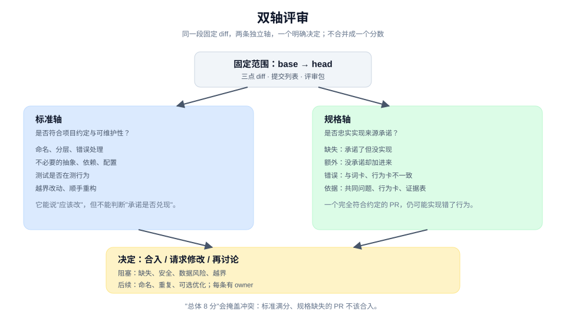

# 评审变更是否值得合入

> 教程 09 / 12 · 上一页：[08 证明兑现的是原承诺](./08-prove-the-promise.md) · 下一页：[10 交付、观察、开始下一轮](./10-ship-observe-and-loop.md)

## 眼前困惑

P2 的 PR 已经打开。diff 不大，测试绿了，执行者说"按 brief 做完了"。

你开始读 diff，很快陷入两种模式之一：

- **挑刺模式**：命名不够好、这个函数可以拆、注释可以删。改完这些，PR 看起来更整齐，但没人回答"它是否兑现了承诺"。
- **放行模式**：测试都绿了，看起来没问题，点合并。三天后才发现无权限路径没有处理。

评审不是把 diff 看一遍。它要同时回答两个不同的问题：**这改动是否符合项目约定？它是否忠实实现了来源承诺？**



## 现在动作

### 1. 固定评审范围

先把范围钉死：从哪个 base 到哪个 head，包含哪些提交。所有评审者看同一段三点 diff（merge-base 到 head），不凭记忆各自选范围。

同时准备评审包：

- 目标分支与 fixed point；
- 三点 diff 与提交列表；
- 来源共同问题、行为卡、承诺-证据表；
- 项目约定与相关 ADR；
- 验证结果与残余风险；
- 决定 owner。

评审包的作用是让"看什么"和"凭什么判断"一致，而不是让每个人从聊天记录里重建。

### 2. 标准轴：是否符合项目约定与可维护性

只看这一轴时，问：

- 命名、分层、错误处理是否符合仓库现有约定？
- 有没有引入不必要的抽象、依赖或配置？
- 测试是否在测行为，而不是镜像实现？
- 有没有越界改动、无关格式化、顺手重构？
- 新增的复杂度是否值得？

标准轴可以提出"应该改"，但它不判断"这条承诺是否兑现"。一个完全符合约定的 PR，仍然可能实现错了行为。

### 3. 规格轴：是否忠实实现来源承诺

只看这一轴时，把 diff 放回 [01](./01-define.md)、[03](./03-make-a-promise-observable.md) 和 [08](./08-prove-the-promise.md) 的承诺-证据表：

- **缺失**：承诺了但没有实现的行为。
- **额外**：没有承诺、但被顺手加进来的行为。
- **错误**：实现了，但和词卡、行为卡或边界不一致。

规格轴的结论不是"代码好不好"，而是"这份改动是否就是我们要的那一份"。

### 4. 两轴并排，不合并成一个分数

两条轴的发现放在同一张表里，但不要压成"总体 8 分"：

| 轴 | 发现 | 严重度 | 处理 |
|---|---|---|---|
| 标准 | `ExportButton` 与旧的 `DownloadButton` 重复 | 中 | 后续 PR 合并 |
| 标准 | 新增了一个不必要的状态库依赖 | 高 | 本 PR 移除 |
| 规格 | 无权限 403 的页面提示未实现 | 高 | 本 PR 补上 |
| 规格 | 5 万行以上未定义 | 中 | 明确标为未覆盖，下一轮处理 |

合并成一个分数会掩盖冲突：一个标准轴满分、规格轴缺失的 PR，不应该因为"代码漂亮"而合入。

### 5. 区分阻塞项与后续项

每条发现只归两类：

- **阻塞**：不修就不能合入。通常是规格缺失、安全问题、数据风险、越界改动。
- **后续**：可以合入，但要有明确的下一步。命名、重复、可选优化通常在这里。

"后续"不是"永远不做"。它要写进 issue 或下一个工作包，并指定 owner。

### 6. 给出决定，而不是感觉

评审的交付物是一个决定：

```text
决定：请求修改后合入。
阻塞：补 403 页面提示；移除新增状态库依赖。
后续：合并重复按钮；5 万行策略另开工作包。
依据：规格轴 1 项缺失；标准轴 1 项越界。
决定 owner：<具名人>。
```

如果两轴都通过，也要写清"通过了什么"和"哪些没有覆盖"，而不是一句 LGTM。

## 可见成果

一张双轴评审表，加一个明确决定：

```text
固定范围：base main @ abc123 -> head def456，3 个提交
标准轴：2 项（1 阻塞，1 后续）
规格轴：2 项（1 阻塞，1 未覆盖）
决定：请求修改；阻塞项修完后由 <owner> 复核合入
```

## 休息点

可以停在这里。你已经把"看起来不错"拆成两条可复核的轴，并且给出了一个下一位能执行的决定。

如果评审发现的是定义或设计问题，不要在当前 PR 里硬修。回到 [01](./01-define.md) 或 [04](./04-design-a-testable-shape.md)，把上游修正后再回来。

## 下一段

下一页 [10 交付、观察、开始下一轮](./10-ship-observe-and-loop.md)，会处理合入之后的事：部署、暴露、交付决定，以及从真实运行信号开始下一轮。

想先看完整方法，查 [手册：验证](../manual/verify.md)；想回到教程起点，见 [教程地图](./README.md)。
