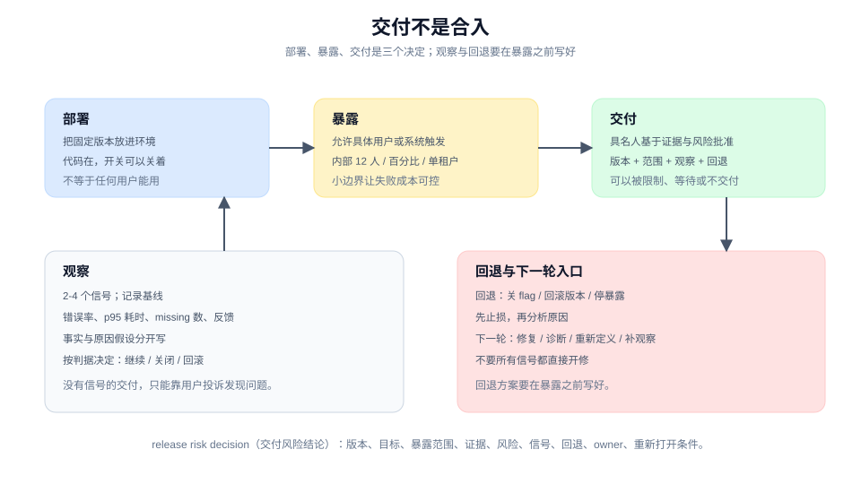

# 交付、观察、开始下一轮

> 教程 10 / 12 · 上一页：[09 评审变更是否值得合入](./09-review-for-merge.md) · 下一页：[11 让环境在下一轮更好](./11-improve-the-environment.md)

## 眼前困惑

PR 合入了。CI 绿了，评审也过了。团队在群里说"导出功能做完了"。

但"合入"只是代码进了主干，它没有回答：

- 哪些用户现在能用它？是所有客户，还是只有内部运营？
- 出问题时，谁在什么时候发现？看哪个信号？
- 如果必须撤回，撤回的是代码、开关，还是数据？
- 这次交付的证据，能支持"对所有用户开放"吗？

把合入当成交付，是这一页要处理的第一个误解。



## 现在动作

### 1. 把部署、暴露、交付分开

三个词不是同义词：

- **部署（deploy）**：把固定版本放进一个环境。
- **暴露（expose）**：允许具体用户、agent 或外部系统真正触发它。
- **交付（release）**：具名人基于证据、风险、观察和恢复能力，批准某版本在某范围内可用。

可以部署但不暴露（代码在，开关关着）；可以暴露给一小群人但不全面交付。把三者分开，才能说清"现在到底进行到哪一步"。

### 2. 写一张交付决定卡

```text
版本：v1.4.0（commit abc123）
部署目标：production
暴露范围：内部运营 12 人，feature flag `export_selection`
证据：承诺-证据表；P2 E2E；评审结论
已知风险：超大文件未定义等待策略；403 提示已补但只在 staging 验证
观察信号：导出错误率、p95 导出耗时、missing 行数量、用户反馈
停止/回退：错误率 > 2% 或 p95 > 10s 时关闭 flag；数据不回滚
owner：<具名人>
重新打开条件：错误率连续 1 小时正常，且 3 位运营确认可用
```

这张卡的重点不是格式，而是**每个空格都要有人填**。填不出来的格子，就是还没准备好的地方。

### 3. 先给小边界

第一次交付不要直接对所有人开放。可选的小边界：

- 内部用户或设计伙伴；
- feature flag 控制的百分比；
- 单个租户或单个区域；
- 只读路径，先不写数据。

小边界的目的不是永久限制，而是让失败的成本可控，并且让观察信号有意义。

回退方案要在暴露之前写好。等出事再想怎么回退，通常已经太晚。

### 4. 观察真实信号，不观察"应该没问题"

为这次交付定 2 到 4 个信号，并记录基线：

| 信号 | 基线 | 当前 | 判据 |
|---|---|---|---|
| 导出错误率 | 0.3% | 0.4% | > 2% 关闭 flag |
| p95 导出耗时 | 1.8s | 2.1s | > 10s 关闭 flag |
| missing 行数量 | 未知 | 12 | 突增时查上游删除逻辑 |

记录时区分**已观察事实**和**原因假设**：

```text
事实：14:05 起导出错误率从 0.4% 升到 3.1%，集中在 12 个内部账号。
假设：可能是权限接口在 14:00 的发布导致；尚未验证。
下一步：查权限接口的错误日志；先关闭 flag 止损。
```

事实和假设混在一起，会让下一轮从猜测开始。

### 5. 用信号决定下一轮从哪里进

一条运行信号可能通向四个不同入口：

- **修复**：明确的实现缺陷，回到 bug fix。
- **诊断**：症状清楚但原因不明，先建证据闭环。
- **重新定义**：信号说明原承诺不再成立，回到定义。
- **补充观察**：信号太弱或噪声太大，先加观测，不急着改。

不要所有信号都直接开修。先判断它属于哪一类，再决定下一步。

## 可见成果

一张交付决定卡，加一条信号记录：

```text
交付：v1.4.0 对内部运营 12 人暴露，flag 控制。
观察：错误率 0.4% -> 3.1%，集中在 12 个内部账号。
回退：关闭 flag，不动数据。
下一轮：先查权限接口日志；若确认是发布导致，回滚该发布。
```

## 休息点

可以停在这里。你已经把"合入"推进到"可控地交给真实用户"，并且知道出事时看什么、谁来停。

如果这次交付没有可观察信号，先不要扩大暴露。没有信号的交付，只能靠用户投诉来发现问题。

## 下一段

下一页 [11 让环境在下一轮更好](./11-improve-the-environment.md)，会把这次交付里反复出现的摩擦变成结构：一条会失败的检查、一次承诺退役，或一个更清楚的阶段边界。

想先看完整方法，查 [手册：交付、运行与演进](../manual/ship-run-and-evolve.md)；想回到教程起点，见 [教程地图](./README.md)。
