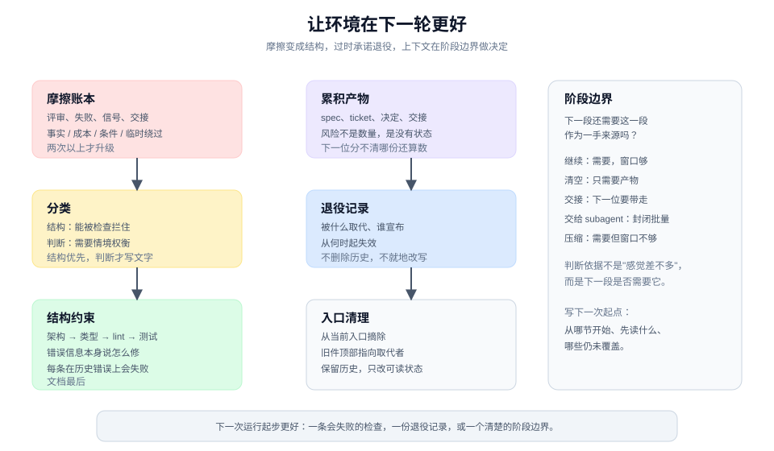

# 让环境在下一轮更好

> 教程 11 / 12 · 上一页：[10 交付、观察、开始下一轮](./10-ship-observe-and-loop.md) · 下一页：[教程之后](./after-tutorial.md)

> 方法边界：promise retirement（承诺退役记录）与 accumulated corpus（累积清单）是本手册的扩展。pstack 没有 spec 生命周期，只有 `docs/guide/04` 的"落地后删除计划"与 `correct` 的"删掉不再需要的规则"；摩擦账本的简版可以追溯到 `correct` 与 `reflect`。

## 眼前困惑

导出功能交付了。复盘时你发现三件事：

- 评审里第三次出现"忘记处理 missing 行"；
- 半年前那份导出 spec 还挂在文档首页，但已经不代表现在的方向；
- 下一个 agent 接手时，仍然要从聊天记录里猜"上次为什么这样定"。

这次修好了，下次还会以另一种形式出现。问题不在这一次的实现，而在**环境**：重复的纠正没有变成结构，过时的承诺没有退役，上下文没有边界。



## 现在动作

### 1. 收集摩擦，不凭印象

把这一轮的摩擦放到一张账本里，每条一行：

```text
来源：评审 / 失败回流 / 运行信号 / 交接
事实：发生了什么，成本是多少
条件：在什么情况下发生
临时绕过：这次怎么绕过的
假设：可能的原因（标明未证实）
下一步：观察 / 结构化 / 写进 skill / 退役
```

一次事件是轶事。同一个机制出现两次以上，才值得升级成结构。

### 2. 先分类：结构问题还是判断问题

- **结构问题**：可以用架构、类型、lint、测试或运行时检查拦住。
- **判断问题**：需要在具体情境里权衡，无法机械判定。

结构问题优先用结构解决。判断问题才写进文档或共享词汇，并且要短、要具体、要带一个失败例子。

### 3. 按可靠性排序找约束

从强到弱：

1. **架构**：让错误写法根本不存在，例如把状态收敛到一个 owner。
2. **类型**：让非法状态无法表示。
3. **lint / CI**：让错误无法通过，且错误信息本身说明怎么修。
4. **测试**：让回归被捕获。
5. **文档 / 规范**：最后才用，因为跳过它没有任何东西会失败。

每条新检查都要在一个真实历史错误上证明它会失败。没有失败过的检查，只是装饰。

以"忘记 missing 行"为例：

```text
结构修复：ExportResult.missing 改为必填字段，构造结果时必须显式给出。
验证：去掉 missing 字段后，类型检查失败；补回后通过。
测试：删除 1 行后导出，断言 missing 包含该 id。
文档：只在类型和测试都表达不了的部分写一句。
```

### 4. 让不再算数的承诺退役

多轮之后，spec、ticket、决定和交接件会堆积。风险不是数量，而是**没有状态**：下一位读的人分不清哪份还算数。

做一次轻量盘点：

| 产物 | 状态 | 处理 |
|---|---|---|
| 导出 spec v1 | 已被 v2 取代 | 写退役记录，从入口摘除 |
| 勾选行为卡 | 仍然有效 | 保留，链到当前 spec |
| 旧 PR 讨论 | 历史 | 保留，不作为权威输入 |

退役记录至少写四件事：

```text
被退役：导出 spec v1
取代者：spec v2（链接）
宣布人：<具名人>
生效时间：2026-10-19
入口处理：从文档首页移除；在 v1 顶部加一行指向 v2
```

退役不是删除历史，也不是把旧 spec 就地改写成新 spec。它是一次被记录的作废决定。

### 5. 在阶段边界做上下文决定

一轮工作结束、换会话、换 agent、上下文快满时，都是一个阶段边界。此时选择：

- **继续**：下一段仍然需要这一段作为一手来源。
- **清空**：下一段只需要共同问题、行为卡和当前状态。
- **交接**：下一位需要一份可携带的交接包。
- **交给 subagent**：下一段是封闭的批量工作。
- **压缩**：上下文太满，但下一段仍需要它的摘要。

判断依据不是"感觉差不多了"，而是：**下一段工作是否仍需要这一段作为一手来源？** 不需要就清空或交接；需要但窗口不够，就压缩。

### 6. 写下一次运行的起点

最后留一句：

```text
下一次从哪开始：spec v2 的 3.2 节；未覆盖项是超大文件等待策略；
先读：共同问题、行为卡、当前承诺-证据表。
```

这句话比一份长总结更有用。它让下一位不必读完整段历史，也知道从哪里接。

## 可见成果

三样东西，至少做成一样：

- 一条会失败的结构约束；
- 一份承诺退役记录；
- 一个阶段边界决定。

以及一条摩擦账本记录，写清它为什么值得升级。

## 休息点

教程到这里结束。你走完了一个完整循环：把请求说清、把承诺变成行为、把工作委派出去、用证据收回、评审、交付，再让环境变好。

不需要每次都走满十二页。下次遇到具体卡点时，回到对应的一页，或者直接查手册。

## 下一段

教程之后，先看 [教程之后：按下一道坎找手册](./after-tutorial.md)，再按问题查 [手册目录](../manual/README.md)：定义、设计与计划、委派与协作、验证、交付、运行与演进、让环境变好。

如果你想把这一轮的经验固化下来，先写一条摩擦账本记录，再决定它属于结构、判断还是退役。不要急着改文档；先问"下次什么东西会拦住它"。
